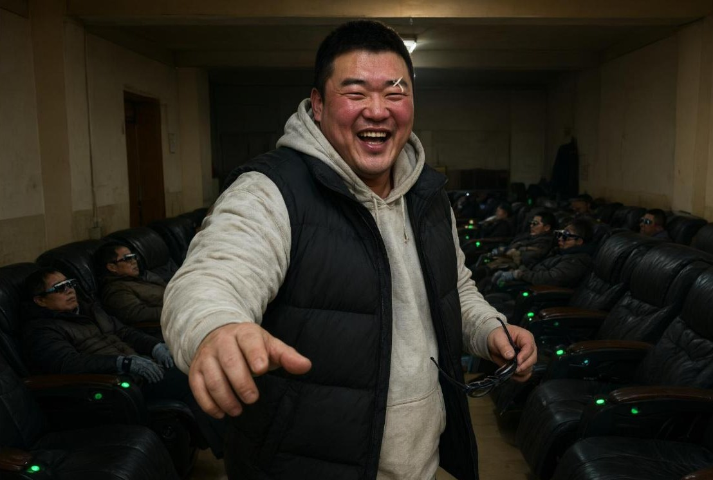
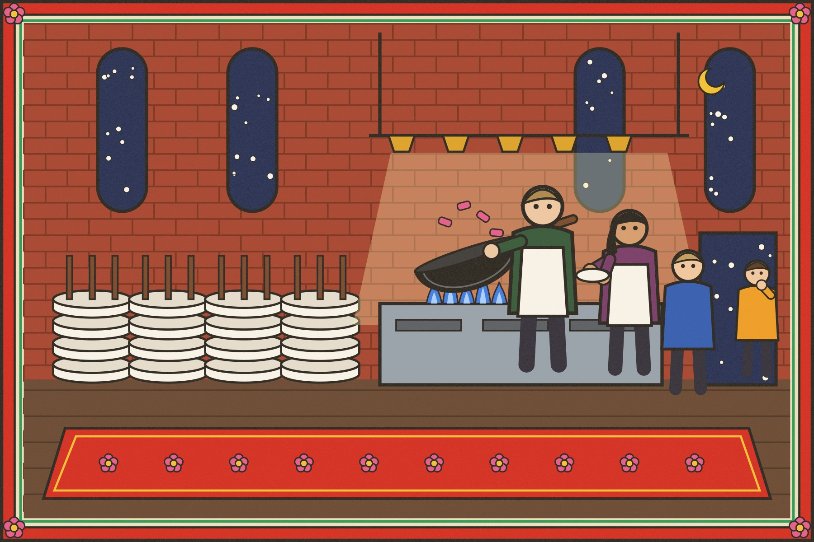

# 第八章　两百毫秒

一百零四科琳记脉　两百毫秒铁子数锅

**成都 13:40 · 拉法叶 00:40**

老蒲是提着自己的勺来的。

后屋最里头那个角落，钟姐叫人腾了出来，摆了一个灶：一个真的燃气灶，一口真的铁锅，锅里抹了一层油，什么都没有。灶边一把躺椅，躺椅上搁着一副手套、一副眼镜。手套是给手的，眼镜是给眼睛的，锅是给火的。菜在太平洋那边。

“勺用不着，”钟姐说，“那边有。”

“那边的是那边的。”老蒲说。

他把勺搁在灶台上。勺把上缠的布条黑得发亮，缠了二十几年，换过三回布，没换过勺。

后屋的人都偏过头来看他。一百二十把躺椅，今天下午只有他一个是站着的。

邱野过来，把眼镜递给他。“蒲叔，戴上，先看一眼。”

老蒲接过来，在手里翻了两面。他炒了四十多年菜，炒菜从来不戴眼镜。蒸汽一起，镜片一白，跟瞎子一样，他靠的是耳朵。

“那边看得见锅？”

“看得见。西奥的眼睛，就是你的眼睛。”

“耳朵喃？”

“也是他的。”邱野顿了一下，“晚一点。”

“晚好多？”

“两百毫秒。”

老蒲不晓得两百毫秒是好多。邱野眨了一下眼睛。“一眨眼的一半。”

老蒲哼了一声，像是嫌少，又像是嫌多。

旁边那把躺椅上的人站了起来。个子大，一米八八往上，脸盘子宽，红扑扑的，眼睛小，一笑就没了。左边眉毛断了一截，一道白印子斜着穿过去。老蒲自己左边那条眉毛是秃的，看人先看眉毛，看了一眼，没问。他朝老蒲伸手，手掌厚得像一块砧板。

*图一　一笑，眼睛就没了。*

“老爷子，今天我给你打荷嗷。宋铁军，叫我铁子就行。”

“东北的？”

“沈阳铁西的。”

“东北的锅包肉，糖放得多。”

“老爷子你别埋汰我们沈阳，”铁子说，“糖多那是哈尔滨。我们沈阳的锅包肉，酸甜，挂汁，一咬嘎嘎脆。”

老蒲左边那条秃眉毛动了一下，半边脸像在笑。

铁子三十八，到成都七年了，后屋里就他一个北方人。他开的那副身子是玛丽索尔，在仓库搬了两年货，胳膊有劲。他手机的屏保是一张照片：他爸妈坐在三亚的海边，穿着一模一样的花衬衫，冲着镜头比剪刀手。照片上没有他。那趟三亚是他在年货节抢的特价团，两个人七千八，他掏的钱。

**成都 14:20 · 拉法叶 01:20**

眼镜一戴上，后屋就没了。

老蒲站在一个空空的大厅里。红砖墙，窗户又高又窄，十六张圆桌摞在墙角，桌腿朝天。灯只开了灶台上那一排，照得一口锅黑得发亮。锅边站着一个女的，系着围裙，头发扎得紧紧的，是梅姐。门口站着一个瘦高的白人男的，胳膊抱在胸前，是值守，达米安。

他低头。底下是一双手，不是他的。手指头长，指甲剪得齐，指纹是好的，一道一道看得清清楚楚。那双手握着锅把，稳得像焊在上头。

“蒲师傅，听得见吗？”梅姐说。

声音到他耳朵里，比她嘴动晚了一点点。他看着她的嘴先停了，才听见那个“吗”。

“听得见。”老蒲说。他的话从西奥嘴里出去，他自己听不见。

邱野在后屋拍了拍他的肩膀。肩膀是成都的，脸上烤的是成都的火，锅里却是空的。腰花在美国，在梅姐手边一个白瓷碗里，切好了，花刀打得还行，就是厚了一点。他想说厚了，又没说。那不是他的厨房。

他儿子就在这个镇子上，隔着几条街，这个钟点在睡觉，五点半要起来。儿子出国八年，老蒲一回都没来过。这是他头一回站在儿子住的地方，用的是别人的腿。

“火爆腰花，”梅姐说，“菜单上第九道。”

他开火。成都的火蓝了，美国的火也蓝了，他看得见，闻不见。鼻子在成都，锅在美国，成都这口锅里只有一股空油烟的味道。

油下锅。他等“滋”的一声。等到了，比他心里那一拍晚一点。腰花下去，“刺啦”。他等“刺啦”里头起那一点噼噼啪啪，那是他四十年的耳朵：起了，就是火候到了，再多一秒就老。

噼啪来了。他起锅。

腰花装进盘子，梅姐夹了一块，嚼了两下，没说话，又嚼了两下。

“老了。”她说。

老蒲没出声。他晓得。起锅那一下，手感就不对，那一声噼啪传到他耳朵里的时候，锅那头早就噼啪过了。

梅姐忽然把筷子一放，捂着嘴往门外跑。门口的达米安侧了侧身子让她，回过头看着她的背，又看了看锅。

*图二　锅在美国，耳朵在成都，中间差一眨眼的一半。*

“她咋了？”老蒲问。

“腰子味儿冲，”铁子在旁边说。他开的玛丽索尔就站在灶台边上，手里端着一碗芡汁。“美国人吃不惯这个。”

邱野没吭声。他看着老蒲的手，老蒲成都的手。刚才起锅的时候，那双手在空锅上颠了一下，颠得漂亮，颠得什么都没有。

“蒲叔，”邱野说，“你等不得那一声。”

“不等那一声，等啥子？”

“等它前头那一声。”邱野说，“你耳朵听到的，是那边两百毫秒以前的事。你要动在你听到以前。”

“火候是耳朵听出来的，”老蒲说，“你拿脑壳算啥子？”

“那你听早点。”

老蒲把眼镜推到脑门上，看着成都这口空锅，看了很久。

**成都 15:00 · 拉法叶 02:00**

梅姐回来了，脸是白的，嘴唇上沾着水。达米安跟在她后头，手里端着一个纸杯。两个人在门口站了一下，梅姐压低了声音，说了一句英语。

老蒲听不懂。“她说啥子？”

铁子开的玛丽索尔就站在离门口三步远的地方。他顿了一下。

“没啥，”铁子说，“说腰子味儿冲。”

他没说的那一句是：别跟我妹妹讲。

“冲就喊她拿花椒水泡一哈，”老蒲说，“几分钟就捞，莫泡久了。”

梅姐重新切了一碗腰花，切薄了。老蒲看见了。

第二锅。

油下去。这一回老蒲没等。他耳朵里还是那个“滋”，手已经动了。腰花下锅，刺啦，他闭着眼睛，眼皮底下是西奥看见的那口锅，锅里的东西在动，比他心里快一拍。

“老爷子，”铁子的声音在他耳朵边上，在成都，没隔着海，“是骡子是马，拉出来遛遛。我给你数嗷。我盯着那头呢，我数，你下。”

老蒲没答应，也没说不。

“三——二——”

铁子数到二，老蒲的手已经动了：淋芡，翻锅，起。他在空锅上颠那一下，比平常早了半拍，早得他心里发虚。

腰花装盘。梅姐夹了一块。

这一回她嚼得慢，嚼完了，又夹一块。

“对了。”她说。

达米安从门口走过来，站在灶台边上，看着西奥那双手。那双手把锅放回灶上，擦了擦锅沿，一点都不抖。达米安看了一会儿，又走回门口去了。他跟西奥说过，除夕那天晚上手要是抖了，他给按住。这双手用不着他。

老蒲把眼镜摘下来。后屋又回来了，一百二十把躺椅，绿光一明一暗。他低头看自己的手。那双手在抖，抖得很细，从手腕抖到指尖。六十五岁，四十年的灶，他头一回在灶边上手抖。

“还差一口气。”他说。

“老爷子，”铁子说，“差的那口气是你的气。锅那头，指定没毛病。”

老蒲看了他一眼，左边那条秃眉毛又动了一下。

“明天，”老蒲说，“你还给我数。”

“得嘞。”

**成都 19:30 · 拉法叶 06:30**

工作群里，王鹏发了一条：“今天老蒲第一锅，典。第二锅，赢麻了。”

铁子回了一条语音，转成了字：“我告诉你嗷王鹏，第二锅是我数出来的。你们四川人打字跟发电报似的，一个字一个字往外蹦，我还得查字典。”

王鹏：“你们东北人说话跟拍短视频似的，镜头一关就蔫了。”

铁子：“我镜头关了七年了，你看我蔫没蔫。”

唐蕾发了一个字：“乐。”

何蔓：“差不多得了。明天还上班。”

王鹏盯着何蔓那一行看了一会儿，发了一个流汗的黄豆。何蔓没回。

铁子在更衣柜跟前给他妈打了个视频。三亚那头，他妈在海边的广场上，背后一排老头老太太在跳舞，音箱放的是二十年前的老歌。领舞的是个退了休的老太太，音箱是她的，充电的钱大家凑，一个月十块，他妈回回头一个交。他妈说话一句一个“儿子”，问他过年回不回。

“回不了，”铁子说，“初一下午一点以前，我得在这儿给一个老爷子数数。”

“数啥？”

“数锅。”

他妈没听懂。她把镜头转过去，说你爸在那儿。跳舞的人堆里，一个穿花衬衫的老头停下来，冲镜头摆了摆手，没过来，又转回去跳了。铁子也摆了摆手。数锅的事他没解释，“嗷嗷”应了两声，说妈你跳你的，挂了。挂了以后，他把手机屏保那张照片点开，放大，看了一会儿他爸的花衬衫，又缩回去了。

乐子在工位上看完了群里的话，没回。他把眼镜收进柜子，想起今天晚上那扇门没锁，想了一下，又想了一下，穿上外套，往另一个方向走了。

**成都 21:30 · 拉法叶 08:30**

前屋收了摊，徐好翔那张桌子摆开了麻将。

“今天麻将。”唐蕾坐下来，看了邱野一眼。

“今天麻将。”邱野说。袖子挽着，左边胳膊上那块创可贴贴得平平的，一个角都没翘。

汪蓉的脚在桌子底下，脚背搭在徐好翔的小腿上，搭了一晚上没拿开。徐好翔打牌慢，一张牌在手里摸半天，摸的时候眼睛不看牌，看她。

唐蕾赢了三把，把钱往兜里一揣，站起来就走。

“这早就走嗦？”汪蓉说。

“明天还是麻将。”唐蕾说，“今天赢够了。”

她一个人走回去。玉林的巷子里，路灯一盏隔一盏，她专踩亮的地方走，哼着歌，调子跑了也不管。

邱野也走了。

楼上，汪蓉拉上那幅酱红色的窗帘，屋里又成了一口焐着火的砂锅。床还是两张拼起来的，中间那条缝，今天没人睡。

她解围裙。还是死结。徐好翔坐在床沿上看她解，不帮。

“三十年了，”汪蓉说，“你就看。”

“我手慢。”

“你手慢，是你装的。”

他就伸手，一下就解开了。

汪蓉五十二了，腰上一圈肉是软的，膝盖上两块老茧，是跪着擦了三十年茶铺地板跪出来的。

完了，她枕在他那块软肚皮上，听里头咕噜咕噜响。

“今天天府来了个人，”汪蓉说，“问后屋的动作记录卖不卖。”

“啥子动作记录？”

“一百二十个人，两年，手是咋个动的，脚是咋个走的，锅是咋个颠的。他说机器拿去学了，以后就用不着人了。”

她伸出一根指头，在他胸口上写了一个数。写得很慢，他一个零一个零地数。

徐好翔没说话。

“今天老蒲那两锅腰花，”汪蓉说，“也在里头。”

“身子是人家的，”徐好翔说，“手是后屋那些娃娃的。我卖啥子？卖了，我拿啥子脸去收茶钱？”

“初一以后，后屋那些娃娃就没得活路了。”汪蓉说，“卖了，钱分给他们。”

“你想卖？”

汪蓉翻了个身，背对着他。

“我想你再想一哈。”她说。

徐好翔看着天花板。酱红的窗帘透进来一点街上的光。他想起老蒲今天下午站在那口空锅跟前，颠了一下，什么都没颠起来。

他没再说话。他的手搁在汪蓉背上，没动。过了很久，汪蓉听见他在黑里头，把那个数小声念了一遍。

**拉法叶 10:00 · 成都 23:00**

九点半，科琳清了一遍待取的筐。有一袋放了九天，名字是个八十一岁的；上礼拜他家里人来过电话，说不用留了。她撕了标签，把那一小瓶放回架子上。里头的药，一片没动过。

西奥是九点五十八分进的药房。科琳从柜台后头看见他推门，先看见的是手。两只手插在外套口袋里，口袋在抖。

“减药方案，”她说，“签个名。”

她把平板推过去。屏幕上是一张表，十四周，一周一格，剂量一格比一格小，最后一格是零。

她又从柜台底下摸出一只七格的药盒，一格一个盖子，搁在平板边上。“一个礼拜装一回。别放卫生间，潮。”

“十四周以后，”西奥说，“手就不抖了？”

“十四周以后，手还给你。”科琳说，“身子还回去一半。”

“肩膀呢？”

“肩膀是你的。上头的肉是借的，借的要还，慢慢还。”

西奥把笔拿起来。笔尖落在屏幕上，一碰就滑，名字的头一个字母裂成了三截。他放下笔，又拿起来。

“三年前，”他说，“你扶过。”

科琳没动。三年前她伸手，是因为他后头排着队。今天他后头没有人。

“你扶。”西奥说。

这两个字，冉峥从来没对她说过。条款单上三个人的名字签在一起，规矩是她定的，颜色是她问的。两年了，没有一个人叫她做过一件事。

她伸手，握住他的手腕。脉在她拇指底下跳，抖从他的骨头里传到她的骨头里，细，密，一刻不停。她扶着那只手，一个字母一个字母地写，写到最后一个，她没有马上松开。

西奥低头看她的手。

“你手凉。”他说。

“药房冷。”

“不冷。”

她松开了。西奥把两只手揣回口袋，走到门口，又回过头来。

“下礼拜一，还是十点？”

“每个礼拜一，十点，十四个礼拜。”

“十四个礼拜。”西奥说。说得很慢，像在数一样还没到手的东西。

门关上了。科琳把右手的拇指按在自己左手的手腕上，找那个脉。找到了，跳得比平常快。她看着墙上的钟，数了一分钟，一百零四。她把这个数记下来，像记一张处方，记完了，没处去交。

