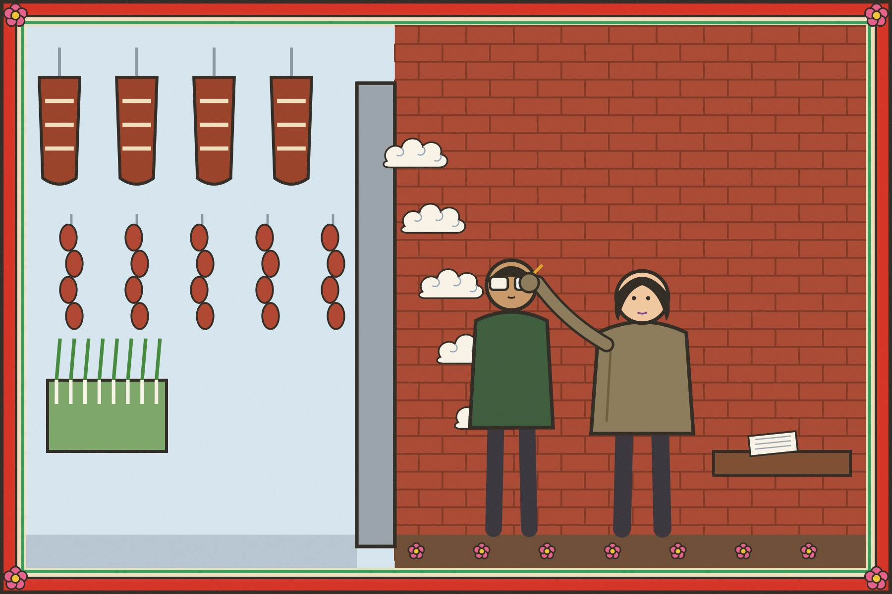
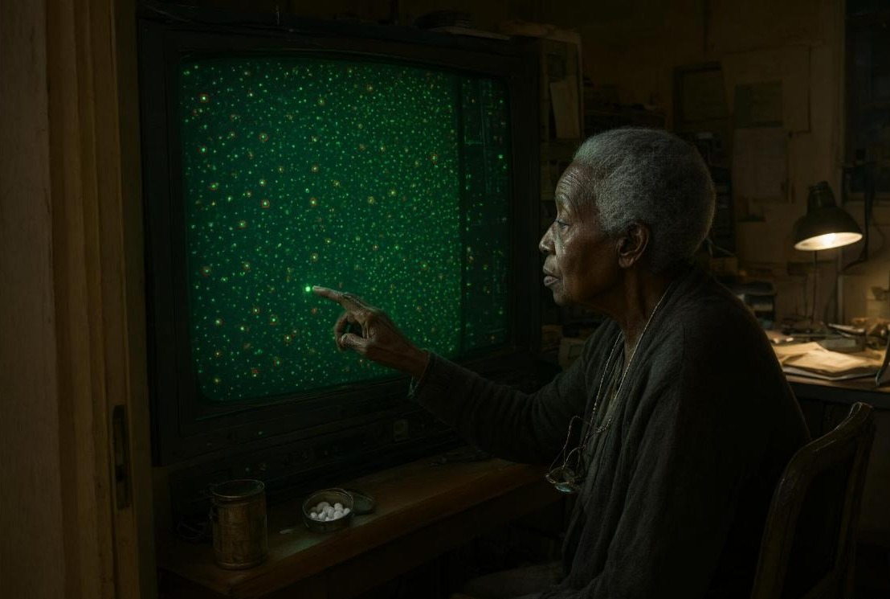

# 第十五章　让

冷库姊妹不肯让　床头夫妻不转身

**拉法叶 19:10 · 成都 08:10（次日）**

火车站那个大厅，明天晚上要坐一百六十个人。今天晚上只有两个。

琳在长桌上摊开备菜单，一样一样地对：腊肉切片，香肠切片，蒜苗洗过了，晾在竹匾里，根上的土留着。郫县豆瓣二十斤，开了一桶，剁过了。鱼明天早上到。她从耳朵后头拿下铅笔，一行一行打钩，打完了，又别回去。

备菜单底下压着一张表，露出半截。

梅姐从冷库里出来，抱着一扇腊肉，看见了那半截。她把腊肉放在案板上，把表抽出来。

表是州里的，抬头一行粗体字：转移项目·亲属申请。第二页有一栏：申请人与生物学父母的关系。琳在“同胞姊妹”前头的小方框里打了一个钩，钩打得很重，纸都划破了一点。第三页最底下一行小字：生物学母亲将收到书面通知，三十日内可提出异议。

“你没藏。”梅姐说。

“我没藏。”琳说。

梅姐把表折起来，进了冷库。琳跟进去，带上了门。

冷库里亮着一盏白灯，架子上一扇一扇挂着腊肉，一挂一挂挂着香肠，地上码着蒜苗的箱子。两个人一张嘴，就是一团白气。

“三十天。”梅姐说。

“州里给的。”琳说，“我给不了你什么。”

“你要它做什么？”

“养。”

“你有凯。凯的数不够，你们还有别的路。布兰特跟你说了三条。”

“三条里头，只有这一条，是我认得的。”

“你认得什么？它就是一个罐子，一串数。”

“它是你的鼻子，文的耳朵，念念那个样子。”琳说，“我看一眼就认得。别的罐子，我认不得。”

梅姐往后一靠，靠在挂腊肉的架子上，腊肉晃了晃。

“我就是不要你认得。”她说，“我给出去，是给不认得的人。不认得，我才放得下。你养，我天天看得到。礼拜天你带它来吃饭，它坐在小浩边上，喊我姨妈。我坐在桌子对面，看它长我的鼻子，一年一年地长，长到十八岁。”

琳没说话。

“我让了你一辈子，”梅姐说，“这一样，我让不了。”

琳把手套摘下来。冷库里冷，她的手冻得通红。

“你让我的，”她说，“我一样都没要过。”

梅姐愣住了。

“灌风的那半边床，是你自己要睡的。蛋黄，是你自己夹给我的。你二十二岁不念了，是你自己不念的。我一个字都没说过。我考上那天，你在电话里哭，我也哭。可我没要过。”琳说，“你让，是你要让。你让了，你心里好过。”

梅姐的脸白了。冷库的灯是白的，照得她更白。

“这一样，我不要你让。”琳说，“它已经不是你的了。我要的，是州里的一个罐子。”

“那是我的——”

“你签了字。”

梅姐不说话了。冷库的风机嗡嗡地转，架子上的香肠一挂一挂地轻轻晃。她再开口，声音低下去了。

“你要，就要。”她说，“我只要你答应我一样：它一辈子不知道我是哪个。”

琳看着她。

“我不骗它。”

“琳——”

“我管了八年试验田。”琳说，“哪一棵是从哪一块地移过来的，我都记在本子上，一棵都没漏过。我不骗它。”

两个人站着。梅姐身上开始打抖，嘴唇发紫。她礼拜二才做完，医生说这个礼拜别受凉。

“出去。”琳说，“你冻着了。”她把自己的棉外套脱下来，扔在梅姐身上。

她推开门。大厅里暖气开得足，一股热气扑过来，琳的眼镜一下子白了，两块镜片白得什么都看不见。进冷库以前她拿洗洁精抹过镜片的，抹了八年的老法子，今天不管用。她没摘，就那么站着，站在一片白里头。

梅姐看着她。小时候在合肥，冬天从外头进屋，琳的眼镜也是这么一下子就白了，琳也是不摘，站在门口等，等姐姐来擦。

梅姐把袖子拉下来，裹住手，替她擦。左边一块，右边一块。琳站着让她擦，一动不动。

*图一　左边一块，右边一块。*

擦干净了，琳看得见了。两个人谁也没说话。

“明天妈来。”梅姐说。

“我不说。”

“妈要是知道了，”梅姐说，“你猜她说什么？”

“一家人，给哪个不是给。手心手背都是肉。”

“对。”梅姐说，“她就会这么说。”

“那你还怕什么？”

梅姐看着案板上那扇腊肉。“我怕她说得对。”她又说：“过了年再说。”

“过了年，”琳说，“我交表。”

梅姐回到案板前头，拿起刀，切腊肉。一片一片，切得很薄，薄得透光。琳拿起铅笔，在备菜单上打了一个钩。

**拉法叶 21:40 · 成都 10:40（次日）**

蒲青刷完了牙，没走，对着卫生间的镜子，嘴巴在动，没出声。镜子里那张脸随他妈，白，冬天白得发青；鼻子随他爸，高，鼻梁上起一个小节。

路易斯靠在门框上看。“你在背什么？”

“没什么。”

“你背了十分钟了。”

蒲青把牙刷插回杯子里。“明天我站在灶台边上，”他说，“我爸开着西奥的眼睛，看得到我。”

“八年了，他认得出你？”

“认得。我站着的样子跟他一样。左脚在前头，右脚往外撇。他在灶前站了四十年，我一天都没站过，站出来还是那个样子。”

路易斯低头看了看蒲青的脚。左脚在前头，右脚往外撇。

蒲青小时候在饭桌上写作业，他爸从灶上下来，隔着一张桌子，手上一股花椒和油烟的味道。他没牵过那双手，那个味道他认得。明天那双手是西奥的，味道是锅里的，隔着一个大厅，他还是会认得。

他走过来，从后头抱住蒲青，下巴搁在他肩膀上。两个人都在镜子里。

“明天你爸在，”路易斯说，“今天你出够。”

蒲青笑出声来。路易斯的手从他睡衣底下伸进去，指头尖上那几块烫出来的硬皮，刮在他肚子上，一道一道，糙得很。蒲青转过身，把他推到门框上，咬他的下嘴唇。两个人从卫生间撞到床上，撞翻了一个台灯，谁也没去扶。

三年了，墙那边是邻居家的车库，车库里只有一辆车，一台割草机，没有人。蒲青这回一点都没收着，出了声，又出了一声，一声比一声整。路易斯在他耳朵边上数。

数到第三声，墙那边的车库门哗啦啦地往上卷，邻居下晚班回来了，车灯从窗帘缝里扫进来，在天花板上划了一道。两个人一下子都停了，一动不动，憋着气，听着车开进去，车门响，车库门又哗啦啦地往下落。

落到底，蒲青先笑了，笑得埋在路易斯脖子里直抖。路易斯也笑。笑完了，蒲青没停，接着来，比刚才还响。

完了，两个人并排躺着，台灯还倒在地上，灯泡朝着墙，照出一个歪歪的圆。

蒲青看着天花板，说了一句成都话。

“什么意思？”路易斯问。

“爸，我有个人了。”

“就这一句？”

“就这一句。我们那边，这一句就够了。”

路易斯学了一遍，六个字的调子错了四个。蒲青笑得直咳嗽。

“你别喊爸。”

“以后要喊的。”路易斯说。

蒲青没接话。过了一会儿，他起来，从门后挂着的外套内兜里摸出一张折了两折的纸。是玛丽索尔的女儿画的：一口黑锅，一团紫火，一个人，有手，没有脸。他把画又折好，放进明天要穿的那件白厨师服的口袋里，扣上扣子。

**拉法叶 23:50 · 成都 12:50（次日）**

红隼岭的夜班室在一排机房的尽头。以斯拉十一点五十到的，手里拿着明天晚上的方案，打印出来的，四十一页。他四十六，白，常年在屋里待着的那种白，白得发灰，胡子刮得发青。

露丝坐在屏幕前头。六十七岁，个子高，背有一点驼，皮肤是深棕色的，屏幕的绿光照上去，额头和颧骨上浮着一层亮，灰头发剪得贴着头皮，老花镜拿一根珠子链挂在胸前。手指头又长又干，数东西的时候一根一根往下按，像在拨念珠。桌上一罐薄荷糖，是沃斯抽屉里留下来的。她嚼了半辈子尼古丁口香糖，沃斯走了以后改吃这个，一个晚上吃一颗，吃到现在，还剩小半罐。夜班室的暖气，她一个人的时候总调低两度，自己多套一件开衫。

屏幕上是全县的座位，一个座位一个绿点。从中国开过来的，点外头多一圈细细的红边。

*图二　薄荷糖剩小半罐。屋里剩她一个。*

“今天多少？”以斯拉问。

“一千三百零七。”露丝说，“礼拜一一千四百二十，礼拜二一千三百六十一。好些人家等不到明天，先换了。马尼拉的，珀斯的，本地的。”

“还有一个不是换了。”她拿笔尖点了点屏幕左下角，“河东的，七十九岁，礼拜一下午走的。系统里那一栏，写的是永久离线。”

“明天呢？”

“明天十二点，还剩多少，就停多少。”

以斯拉把方案搁在她桌上。露丝早就看过了。她翻到第三十三页，用一根长指头按住其中一行。

火车站，旧候车大厅。两副身子：西奥·罗斯，玛丽索尔·巴尔加斯。登记时段：十八点至二十四点。活动：烹饪。备注：手持热锅。

“这两个，”露丝说，“十二点那一下，手上端着锅。”

以斯拉看着那一行。方案里写得清清楚楚：二十三点四十五分提醒；二十三点五十五分以后，不得开始新的动作；零点整，安全停机，身体保持原姿势。线断了，就停下。这句话是他写的，写了十几年，一个字没改过。

“他们菜单上最后一道，”露丝说，“是十一点五十几上。”

“那是他们的事。”

“锅底下是真火。”露丝说，“那就是消防的事了。”

以斯拉从口袋里摸出一支笔，在第三十三页的边上写了一个字：锅。写完了，在后头加了一个问号。

露丝看了那个问号一眼，没说什么，剥了一颗薄荷糖。

“明天十二点，”她说，“你写的这个，你自己来看它停。”

“我在。”

“二十号你一走，”露丝说，“这间屋里就我一个。”

“二十号到二十二号。三天。”

“三天也是一个人。”

以斯拉看着她。共事十几年，她没说过这种话。

“你可以跟我去。”他说。说完了，他自己吓了一跳。

露丝笑出声来。“一个六十七岁的外邦老太太，去你们的婚礼？”

“女的坐一边，男的坐一边。”以斯拉说，“你坐女的那边，没人问你是哪里来的。”

露丝不笑了。她看着屏幕，一千三百零七个点，一明一暗，像夏天夜里的萤火虫，只是不飞。

“过了明天再说。”她说。过了一会儿，又说：“三号塔上那对红隼，前天回来了一只。”

“另一只呢？”

“还没回。”露丝说，“往年都是一起回的。”

以斯拉拿起方案，走到门口，又回头看了一眼。露丝已经在数了，嘴唇一动一动，那根长指头在屏幕上一个点一个点地往下按。数完一遍，又从头数。

**拉法叶 01:20 · 成都 14:20**

最后一回走菜。

大厅里只亮着灶台上那一排灯。西奥的身子站在灶前，玛丽索尔的身子在边上打荷，达米安靠在门口，胳膊抱在胸前。

今天走的是干烧鱼，菜单上最后一道。新鲜的鱼明天早上才到，今天拿冻鱼走一遍火候。鱼是下午照老蒲隔着海交代的法子化的：冷水泡，水里搁一把盐，不许拿热水冲。西奥那双手把鱼滑进锅里，油响了。铁子在成都数：“三——二——”老蒲没等他数完。

鱼起了锅，西奥的身子转过来，看着门口的达米安，开口说了一句话。说的是成都话，达米安耳朵里的翻译慢了半拍，翻成英语：

“我儿明天来不来？”

达米安愣了一下。“来。”

“他站哪儿？”

达米安走过去，站在灶台左手边，离灶一步远。“这儿。最后那条鱼，他接。”

西奥的身子看着那块地方。那张脸是西奥的，神情是一个六十五岁的成都厨子的，眼睛盯着灶台边上一块空地，像那儿已经站着一个人了。看了很久，久得铁子在那边小声喊了一句：“老爷子？”

“晓得了。”老蒲说。

**拉法叶 02:30 · 成都 15:30**

文醒着。梅姐十一点才回来，身上一股腊肉味，洗了澡也没洗掉。她躺下来就没动，背对着他，可他知道她也醒着。她睡着了，呼吸是往下沉的；醒着，是吊着的。

“你说，”梅姐对着墙说，“让不让？”

文没答。他把被子往上拉了拉，说：“我收了十几年垃圾。”

“嗯。”

“人家扔出来的东西，过几天又出来翻，翻回去的，我见得多。”他说，“翻回去的，都比扔以前放得好。擦干净了，搁在柜子顶上，再也不扔了。”

“那是东西。”

“罐子上也只有一串数。”文说。

梅姐不说话了。文伸出手，在她腰上捏了一下。礼拜五晚上他也捏过，那回她一扭身躲开了。

这回她没躲。

他的手就搁在那儿，没往别处走，也没拿开。两个人都醒着，听楼下冰箱一阵一阵地响。冰箱停了，她的呼吸才往下沉了一点，沉到一半，又吊上来了。

**拉法叶 03:10 · 成都 16:10**

三点十分，梅姐下楼，开了厨房那盏小灯。

那块硬纸板还在冰箱顶上。她抽下来，摊在长桌上。十六个圆，一百六十张便利贴，贴了三天，又揭了好几回。

琳那张在主桌上，角翘起来了，胶粘不住了。礼拜六晚上她把它挪了三回，揭下来又贴上，贴到最后，就成了这样。

梅姐看了一会儿，拉开抽屉，翻出一卷透明胶带，撕下一截，把琳那张贴死在主桌上，挨着她自己那张。

贴完了，她拿指甲把胶带的边一点一点地刮平，刮了很久。

