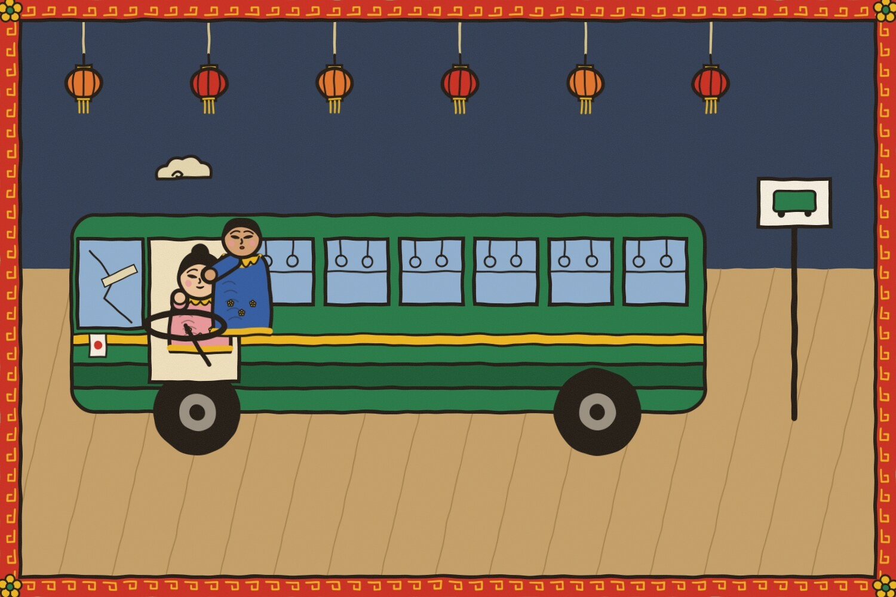
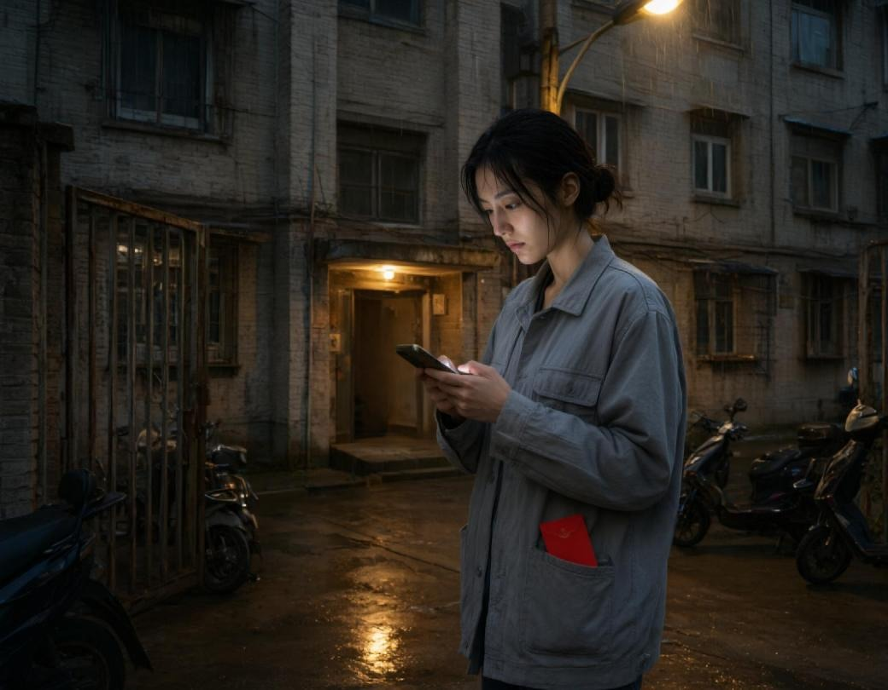

# 第二十五章　回娘家

唐蕾末班车坐到底　琳剥一碗蒜数不清

**成都 13:30 · 拉法叶 00:30**

王鹏他妈烧了一桌子菜，比除夕那天还多两样。

王芳是十二点到的，带着张一帆，手里提了两箱奶，一箱给爸妈，一箱说是给王鹏的，“补补脑壳”。她在快递站干了十年，提东西不用手，用腰，两箱奶往门口一放，像卸了一车货。

张一帆一进门就窝在沙发上，眼睛盯着手机，手指头动得飞快。十五岁，校服外头套着一件大一号的黑羽绒服，头发剪成那种两边推光、顶上留一撮的样子。外婆给了他一个红包，他说了声谢谢外婆，眼睛都没抬。

“你在搞啥子？”王鹏凑过去看。

“出票。”张一帆说，“天府的年卡，初二到初七翻倍。我收了二十张，昨天出了十四张。”

“哪个买？”

“上头那些。”他把屏幕一侧，一排头像，“你们那种上班的，没得时间排，买我的。现在你们没上班了，我这个生意要垮。”

王鹏看了他一眼。“你小子。”

“最好卖的是儿童层。”张一帆说，“上班的爸妈买了票，自己不去，把娃娃往里头一扔，里头有真人陪着耍，按钟头算。有个叔叔扎小辫扎得最好，排他的妈妈最多，要提前三天约。”

王鹏剥橘子的手停了一下。

“啥子叔叔？”

“不晓得。我又不进去，我卖票的。”张一帆把手机一扣，“开饭了没得？我饿了。”

“舅，你那个表情包又包浆了，”张一帆说，“昨天群里你发的那个流汗的，我们班上没人用了，古早。”

饭桌上，王鹏他妈先问工作，王鹏说没了，初一一点钟没的，全屋一百二十个人一起没的。他妈筷子停了半天，又问那个江西的姑娘。

“不谈了。”王鹏说。

一桌子人都不动了。

“三十八万八，加一套房，”王鹏说，“我拿什么给？拿一个月工钱加四万七的动作费？人家也没错，货比三家，人家家里就是那个价。我不谈了。”

他说的是普通话，一个字都没带成都味儿。他妈拿手背抹了一下眼睛，抹完了，给他夹了一块排骨。

王芳低头扒了一口饭。去年她把给张一帆补课的钱停了，凑了八万八，拿去给王鹏撑场面。那笔钱人家姑娘家收了，说是定金，不退。

“那八万八——”他妈开口。

“姐，”王鹏说，“我还你。”

“还啥子还。”王芳把碗一推，“我是泼出去的水，钱也是泼出去的。泼出去了，还收得回来？”

张一帆抬起头，看了看他妈，又看了看他舅，又低下头去出票。王鹏看着这个外甥的后脑勺，想起十二年前，张磊坐在这张沙发上，给三岁的张一帆扎小辫，扎了一个又一个，扎得满头都是，小东西咯咯地笑。张磊不打麻将。张磊一分钱都是交给王芳的。

这些他没说。他夹了一块排骨，放到外甥碗里。

**成都 15:00 · 拉法叶 02:00**

何蔓她妈住在城东一个老小区，六楼，没电梯。

初二回娘家，何蔓没有娘家可回，就回她妈这儿。她妈五十五了，烫了头，皮肤白，下巴跟何蔓一个样，尖，往前翘一点。十六年前离的婚，离了以后，过生日何蔓收两个蛋糕，一个爸买的，一个妈买的，两个不能摆在一张桌子上。

“那天早上，”她妈一边剥橘子一边说，“送你上班的那个，是你爸？”

何蔓“嗯”了一声。

“车还是那辆破车。”她妈说，“方向盘都还在。二十年了，他就不晓得换一辆。”

“他说那辆开顺手了。”

“他啥子都是顺手了。”她妈把剥好的橘子塞到她手里，“门口那个小伙子是哪个？还烟给你爸那个。”

“同事。”

“同事还烟？”

“前同事。”何蔓说，“初一一点以后，都是前同事了。”

她妈没再问。她一向这样，问一句，看一眼，看完了自己心里就有数了，有没有数不要紧，反正她觉得有。

“没得活路了，你搬回来住。”她妈说，“我这儿两间屋，你那间一直空着。”

“不搬。”

“房租好贵？你一个人在外头——”

“我付得起。”

她妈把橘子皮扔进垃圾桶，扔得很响。

“你跟你爸一个样。”她说。

何蔓没回嘴。她看着她妈的手，手背上一块一块的老人斑，指甲倒是新做的，红的，亮的，过年做的。她爸的手她前天看过，黑，糙，指甲缝里有土，那双手点了一辈子烟，从来没碰过指甲油。

两双手，她都像。她不说。

走的时候，她妈从抽屉里摸出一个红包，塞进她外套兜里。

“二十六了还给啥子压岁钱。”

“拿到。”她妈说，“你爸给了没得？”

“给了。”

“给了好多？”

何蔓看着她妈。十六年了，两个蛋糕，两个红包，两个人谁都没输过谁。

就是三十那天，她妈回村里炖了一下午腊猪脚，也是自己端一碗在灶屋吃的，堂屋那张桌子，她没上。

“跟你这个一样厚。”她说。

她其实还没拆。

**成都 17:00 · 拉法叶 04:00**

钟姐四点五十五就到了，比约的早五分钟，坐在后屋那张麻将桌跟前等。

她穿一条薄裙子，光着腿，二月里也光着，开歌厅那些年落下的习惯。汪蓉给她倒茶，倒的时候看了她一眼，又看了一眼。钟姐的眼睛今年像是年轻了，眼皮不垂了，眼白清亮，三十岁的人的眼睛，长在一张五十五岁的脸上。

“做了的？”汪蓉问。

“眼睛。”钟姐说，“包月的。”

唐蕾没来，说去天府开公交车了，邱野坐了第四个座。打了几圈，钟姐手上快了一点，摸牌不在手心里捏了。

“天府那个舞池，”她摸着一张牌问，“好多钱一晚上？”

“门票不贵。”邱野说，“身子另算。二十出头的，一个钟头八百，带跳舞的动作包。你人躺在底下躺椅上，开个年轻的身子上去跳。”

“躺椅。”钟姐说。

她手里那张牌捏住了，没打出去。

“你要去？”汪蓉问。

钟姐没答，把牌打出去，是一张九条。邱野推倒了，胡了。

第七把，钟姐自摸。她把牌推倒，坐着没动，不知道下一步该干啥。

“收钱噻。”汪蓉说。

钟姐伸手，一家一家收了。收完了，钱就搁在手边，一张一张散着，她没数。

**成都 19:00 · 拉法叶 06:00**

胡师傅说要请她吃饭，唐蕾说吃饭可以，吃完了要打麻将。

胡师傅说麻将他打不来，他请她去耍别的。

天府四楼，晚上七点，人散得差不多了。那辆真公交车停在场子当中，绿的，老式的，车身上还留着二〇二〇年代的线路牌，车头一块玻璃裂了一条缝，用胶带粘着。白天有钱人排队来开，一个钟头三百八，开一圈，停一站，下车拍照。

“你来开。”胡师傅把钥匙递给她。

“我不会。”

“我教你。”

唐蕾坐到驾驶座上，座位是皮的，磨得发亮，屁股坐下去陷一个窝，是胡师傅坐了二十年坐出来的形状，她坐进去，松松垮垮的。方向盘大得像个锅盖。胡师傅站在她旁边，一只手扶着她的椅背，一只手指给她看：这是油门，这是刹车，这是开门的，这个按钮按了，后门开。

她开了。车往前一窜，她踩死了刹车，两个人都往前一扑。

“慢点。”胡师傅说，“公交车不赶。”

她又开。这回慢了，车沿着场子转了一圈，过了一个假站牌，她自己按了开门，没人上，又关了。

“倪家桥到了。”胡师傅在旁边报。

她笑出了声。

“倪家桥原先有个老太婆，”胡师傅说，“天天七点零五上车，坐到终点，又坐回来。”

“现在喃？”

“去年腊月起，没上过了。走了。”

*图二　公交车不赶。*

转到第三圈，她把车停在场子最暗的那个角上，熄了火。车里只亮着一盏小灯，顶上的，黄的。

“最后一排。”她说。

胡师傅跟着她走到最后一排。那排座位是连着的，长长一条，皮也裂了，露出底下的黄海绵。她把他按坐下，自己跨上去，膝盖跪在两边的裂缝里，海绵扎得膝盖痒。他的手还是那个样子，规规矩矩搭在她腰上，十点十分。

“这车，”她贴着他耳朵问，“有没有摄像头？”

“拆了。博物馆里的车，不算车。”

“那就不算。”

她把他的外套从肩膀上扒下来。他左胳膊比右胳膊黑一个色，从袖口黑到手背，二十多年车窗里的太阳晒的，一道线齐齐的，像戴了一只长手套。头一回吃火锅，她就盯上了这条胳膊。她低下头，顺着那道线，从手腕一口一口啃到胳膊肘。胡师傅的手在她腰上紧了一下，十点十分走了样。

啃到胳膊肘，她没往回啃。她从他身上下来，在他两个膝盖中间跪下去。老公交的地板是橡胶的，一道一道防滑的棱，凉，硌人，她也没垫东西。

她解他的皮带。胡师傅一把按住她的手。“莫，”他说，“这个脏。”

“洗了澡没得？”

“洗了。”

“那就不脏。”她把他的手拿开，“行车中，司机莫说话。”

他就没说了。他那两只手没地方搁，在半空里悬了一下，抓住了前头那排椅背上的铁杆，一边一只，还是十点十分。她低下头去。

上一回他嘴里还念站名，念得清清楚楚。这一回一个站名都没念出来，出来的是她没听过的一声，憋在嗓子里，像这辆老车刚才起步。

她没让他到站。她抬起头，拿手背抹了一下嘴。两个膝盖上压出来一道一道的印子，跟地板一个花。“还早。”她说，“这才起步。”

她从包里摸出那个小盒子，他这回自己拆了，手熟了。车厢很空，整辆车跟着轻轻晃，晃得那盏小灯一闪一闪，吊环在头顶上叮叮当当地碰。后来他笑出来，说开了二十年车，没在最后一排坐过一回。

她攥着他的手腕站起来，把他也拽起来，拽到车厢中间，两只手抓住头顶上的吊环。

“站稳扶好。”她学着车上的喇叭说。

他从后头贴上来。四十六岁的人，肚子是软的，贴在她后腰上是暖的。他两只手不搭腰了，一只箍着她的肚子，一只顺着她举起来的胳膊摸上去，摸到吊环，把她的手连吊环一起攥住。车又晃起来，一车的吊环都在响。

“下一站——”他喘着报。

“莫报站。”唐蕾说，“开你的车。”

他就不报了。他开得不慢了，是一脚油门踩到底的那种开法，二十年没在线路上开过的那种。到站的时候她叫出了声，空车厢里有回音，她听见自己的声音从车头那边弹回来。

后来她趴在他肩膀上，看着前头空荡荡的一排一排座位，一直看到驾驶座，那个皮座位上还留着她刚才坐出来的一个浅窝。

“唐蕾。”胡师傅说。

“嗯。”

“我想……”他停了一下，“我想跟你坐到终点站。”

唐蕾抬起头看他。他说得很认真，眼睛都不眨，像在报站。

她伸手在他胸口拍了一下，像码一张牌。

“我不坐终点站。”她说，“我坐到哪站算哪站，想下就下。”

胡师傅过了一会儿也笑了，笑得有点难看。

“那下一站，”他说，“你还上不上？”

“看车来不来。”

**拉法叶 07:30 · 成都 20:30**

合肥那边是晚上八点半，琳她妈刚从别人家回来，围裙还没解。

初二她去城南一户人家露一手，烧了十个菜，那家老两口，儿子在深圳，闺女在新加坡，都没回来。一个菜十二块，加上两锅米饺，主家多给了五十，说是过年红包。

“他家老头吃米饺，”她妈在视频里说，“吃一个，看一眼手机，吃一个，看一眼手机。我问他看什么，他说看他孙子在新加坡吃没吃饭。”

琳把手机靠在糖罐上，一边听一边剥蒜。凯还在睡，昨天夜里他膝盖疼，翻来覆去。

“妈，”琳说，“以后过不来了。”

“我晓得。”她妈说，“新闻里讲了。”

她妈把围裙解下来，叠好，放在桌上，叠得四四方方。

“前天晚上，”她妈说，“我在凯身上，跟你们坐了一桌。凯那个身子，膝盖不好，上台阶要先抬左脚。我一晚上都想跟他说，你这膝盖要去看。后来一想，不是我的膝盖，我说了算啥。”

琳没吭声。

“那个罐子，”她妈说，“你们两个可说好了？”

“初六交表。”

“你姐可签了？”

“十八岁以前不说。十八岁以后说。”

她妈点点头，点了好几下。

“你们小时候盖的那床被子，”她妈说，“被面上是什么花，你可记得？”

“红的。”琳说。

“红的。什么花？”

琳想了一会儿。“不记得了。”

“我记得。”她妈说。是什么花，她没讲。

“等它生下来，”她妈说，“我自己坐飞机去。用我自己的腿。”

“妈，你七十一了。”

“七十一怎么了。”她妈说，“你外婆七十一还挑水。”

琳低头剥蒜，剥着剥着，指甲盖缝里辣得疼，她没停。

挂了视频，凯趿着拖鞋出来了，一瘸一拐，左膝盖上贴着一块膏药。他去冰箱拿牛奶，冰箱门上用磁铁吸着一张表，州里的，抬头写着“转移项目·亲属申请”，同胞姊妹那一格打了一个很重的勾。

他站在冰箱跟前看了一会儿。

“初六交？”

“嗯。”

“申请人那一栏，”凯说，“你写我名字了没有？”

“写了。”

凯点点头，倒了一杯牛奶，喝了一口，又看了一眼那张表。

他把牛奶放回去，顺手把那张表四个角上的磁铁挪了挪，压平了。家里歪的东西都是他扶正的。她种地，顾不上。

“写我名字干什么，”他说，“我又说不上话。”

他说得很平常，像说今天要下雪。琳把手里那瓣蒜搁下，抬头看他。他已经端着杯子走回卧室去了，膝盖一弯一响。

锅里的水开了。琳把那瓣蒜捡起来，接着剥，剥好一颗丢进碗里，又剥一颗。剥到第七颗，身后的拖鞋声又响了，一瘸一拐，比刚才走得快。

她没回头。凯把那杯牛奶搁在灶台上，从后头抱住她，两只手箍在她腰上。他够不着她的肩膀，就把脸贴在她背上，贴在两块肩胛骨当中。他身上一股膏药味，一股刚从被窝里出来的热气。

琳手里那把小刀停住了。

“凯？”

“是我。”

她把刀搁下，伸手把灶上的火关了。锅里的水又翻了几下，静下来。她把他箍在腰上的那两只手拿起来，往下按，按到她那条旧运动裤的松紧带底下。

他把她的裤子褪到膝盖弯，自己的也褪了。拖鞋甩掉了一只，他光着的那只脚踩在她脚背上，是冰的，跟她认识他那年一样冰。她比他高半个头，他踮了一下脚，左膝盖咯噔响了一声，他吸了一口凉气。

“你膝盖——”

“不用膝盖。”

她笑出一声，两只手撑在灶台边上，把那半个头让给他。灶台上散着蒜皮，她手一撑，簌簌地扫下去一地。鼻子底下是蒜的辣，膏药的苦，他的汗。冰箱门上那张日历离她一臂远，今天那一格是白的，没有圈。她看了一眼，开始数，一，二，三，数到十几，乱了，从一再数，又乱了。

后来他的额头抵在她背上，半天没动，两条腿在打颤。

“今天不是那天。”琳说。

“我知道。”凯说。

他把她的裤子提上来，提好，在她腰上拍了一下，端起那杯牛奶，一瘸一拐地回卧室去了。

琳把火重新打着，接着剥蒜。剥了两颗，她往碗里看了一眼。碗里一共几颗，她数不清了，也没再数。

**成都 21:40 · 拉法叶 08:40**

何蔓从她妈家出来，下了六楼，走到小区门口，电话响了。

是个陌生号码，男的，声音很年轻，普通话说得比王鹏还标准。

“何女士您好，我是近邻护理平台的招募专员。我们从天府那边拿到了贵团队的名单，诚邀您加入近邻远程护理团队。”

何蔓站住了。路灯底下飘着一点细雨，不大，打在脸上凉丝丝的。

“名单？”

“是的，一百二十位资深远程操作员，两年无事故记录，非常难得。”那人说，“我们的岗位是在家里远程操控护理机器人，进入老年客户家中提供照护服务。不用出门，在自己床上就能上班。”

“好多钱？”

“按件计费。喂饭一次八块，翻身一次五块，洗澡一次三十。熟练的话，一天能做四十单左右。”

何蔓在心里算了一遍。算完了，比以前少三分之二。

“你们要几个？”

“一百二十位，我们都要。”

“都要？”

“都要。”那人说，“全成都六十岁以上的，今年六百多万。我们缺手。”

何蔓没说话。雨打在她那件大一号的工装外套上，一点一点洇开。

“何女士？”

“明天给你回话。”她说，“不是我一个人的回话。”

*图一　不是我一个人的回话。*

她挂了电话，站在路灯底下，打开那个叫“后屋”的工作群。群还没解散，钟姐没解，也没人退。最后一条消息是初一下午钟姐发的：茶在前头，我请。

何蔓打了一行字，删了，又打了一行，发出去：

明天下午两点，老店前头，开会。人到齐了再说。

过了一分钟，第一个回的是王鹏。

“到。”
