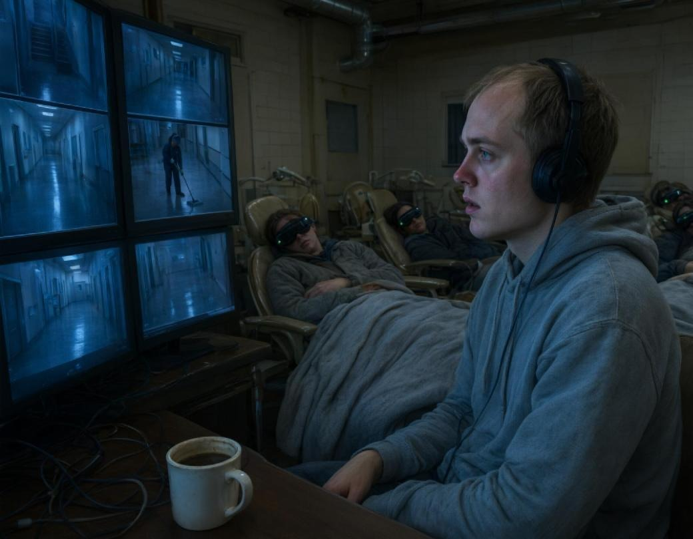
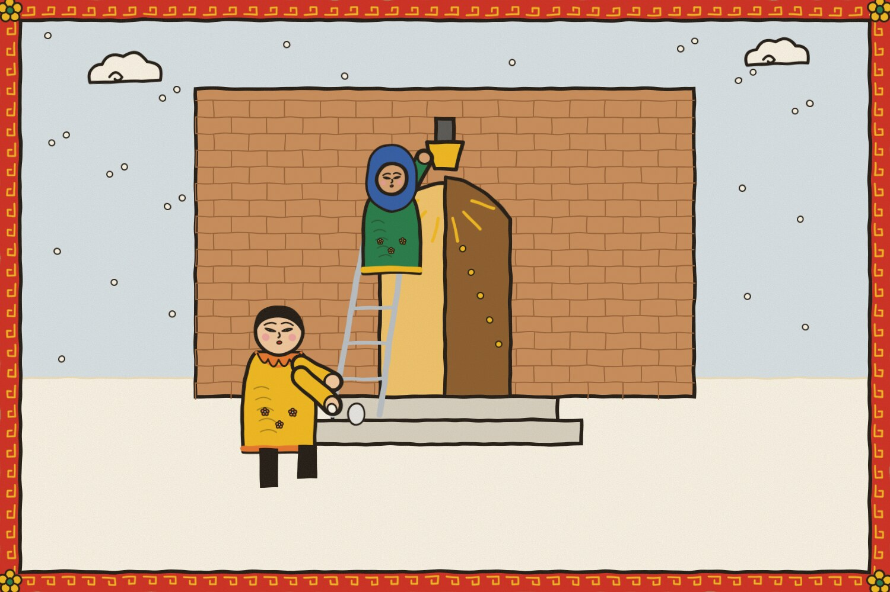

# 第二十六章　夜班

阿丝玛登梯换灯泡　何女士隔屏争工钱

**拉法叶 10:30 · 成都 23:30（初二）**

玛丽索尔家的厨房桌子上，铺着三张纸。

是她自己打的字，打印机墨不够了，最后一页的字淡得发灰。没有律师。代孕的中介二〇四四年就关了，家里人帮家里人，州里的法管不到，也不保。三张纸上写的是她跟路易斯、蒲青三个人说好的话，说好了，就写下来，写下来，就签。

“三月开始。”玛丽索尔用笔尖点着第一行，“十二月生。用我的卵，用你的——”她看了蒲青一眼，“用你的。”

“嗯。”

“钱按摇篮的价，一个月一结。生下来，喊我姨妈。不喊妈。”

“嗯。”

“最后一条。”她翻到第三页，“坐月子，你爸来做饭。站在他自己的灶跟前，用他自己的手。不是开别人的身子，是他自己。”

蒲青看着那一行字。墨淡了，可是看得清。

“这一条，”路易斯在旁边说，“你爸还不知道。”

“我知道他还不知道。”玛丽索尔说，“所以写在这儿。”

她女儿六岁，坐在桌子另一头画画，画的还是那口锅，紫色的火，旁边多了一个小人，躺在一个篮子里。

“这是谁？”蒲青问。

“妹妹。”小姑娘说，“还没生出来，先画上。”

玛丽索尔第一个签，签得很快，像签快递单。路易斯第二个，他在名字后头画了一个小十字，他外婆教的。轮到蒲青，他拿着笔，笔尖悬在纸上，停了一下。

“你爸那一条，”玛丽索尔说，“你跟他说了吗？”

“过了年说。”

“过了年了。”

蒲青签了。三个名字排在最后一页上，一个比一个歪。

玛丽索尔把三张纸收起来，夹进一个塑料文件夹，放到冰箱顶上，跟那瓶圣犹大的蜡烛搁在一起。

“今天晚上我上班，”她说，“马尼拉的。他们开得慢，可是客气，开完了还给我留一句‘谢谢姐’。”

**拉法叶 13:20 · 成都 02:20（初三）**

回到家，路易斯一关门就把蒲青按在门背后。

“签了。”他说。

“签了。”

“你签的时候手抖。”

“没抖。”

“抖了。我看见了。”路易斯亲他下巴，亲一口说一句，“抖了。抖了。”

蒲青把他推开半步，又揪着他毛衣领子拽回来。两个人从门口一路扭到沙发，谁也不让谁，茶几上的遥控器掉在地上，电视自己开了，在放马尼拉的新闻，一个女主播在讲夜班的事。路易斯伸脚把电视踢灭了。蒲青翻到上面，按住他两只手腕，按在沙发扶手上。路易斯指尖上那些烫伤的疤，小小的，白的，蹭在他手心里，糙。

“以后，”蒲青喘着说，“我爸来了，就不能这样了。”

“那就趁现在。”路易斯说，手腕一拧挣出来，反手把他掀下去，压住了。

隔壁车库的门又响了，卷上去，哗啦啦的。这回他们谁都没停。蒲青也没咬手腕，出的声比车库门还响。

后来两个人挤在沙发上，一个的腿压着另一个的腿。路易斯数着天花板上的灯泡，数完了说：“十二月。”

“十二月。”

“你还没跟他说。”

“我知道。”

**拉法叶 16:00 · 成都 05:00（初三）**

那束花布里没扔，插在厨房一个空的牛奶罐里，玻璃纸拆了，缎带拆了。花是好花，扔了可惜，她是这么想的。

布雷登站在厨房门口看着那束花。他一夜没睡好。

他把那个叫老K的人的私信从头翻了一遍，翻到去年夏天。头几个月说的都是游戏，说的都是女人靠不住，说他爸那种人走了是对的，男人一个人过才自在。后来开始问别的。你妈几点出门。你妈今天走的哪条街。你妈那个工会的活动在哪儿开。你妈几点回。

他回过。回过“不知道”，回过一个街名，回过她们工会开会的那个教堂。有一回他打了“十点”，又删了。回的时候他没多想，就是聊天。

上礼拜，他妈说有个戴帽子的胖男人在她走的那条路上站了两回。

昨天晚上，那个人问他，花好看吗。

布雷登看着牛奶罐里那束红的，看了很久。他想跟他妈说。他张了嘴。

“晚饭吃意面。”布里在灶前头说，没回头，“你去把垃圾倒了。”

他去倒了垃圾。

垃圾桶在后门外头。他把袋子扔进去，盖子盖上，站在那儿，看着巷子那一头的公交车站。站台的长椅上没人。雪落在长椅上，薄薄一层，有一块是空的，没积雪，像刚有人坐过。

吃面的时候，他妈问他今天怎么不吭声。他说没怎么。他妈看了他一眼，没再问。她自己也不吭声。两个人对着那束插在牛奶罐里的花，把一锅面吃完了。

他妈二十岁那年，半夜抱着两岁的他从一栋房子里出来，这事他不记得，他妈也从来没讲过为什么。他只知道他们娘儿俩搬了四回家，他妈每回都先把门锁换了。

**拉法叶 22:00 · 成都 11:00（初三）**

达米安又上班了。

马尼拉的公司在城北租了一间旧牙科诊所，椅子还是牙科的，能放倒，上头躺着十几个本地人，睡着，眼镜戴着，夜里租给马尼拉。值守还是要本地的，按州里的规矩，一个醒着的美国人，看着这些睡着的美国身子，看着别人的手开它们。一个钟头三十八块，跟以前一样。

“美国的身子，美国的手。”上礼拜他在群里还这么说。

现在他坐在一排屏幕前头，看马尼拉的手。

马尼拉的手开得慢。成都的手是快的，准的，一刀下去不回头。马尼拉的手每一下都要停一停，像先问一声。玛丽索尔躺在第四张椅子上，开她的那个人在城东一栋写字楼里拖地，拖到一个拐角，停下来，把一个歪了的垃圾桶扶正了。

耳机里有人轻轻哼歌，调子他没听过，词他听不懂。

“姐，”达米安说，“你在哼什么？”

哼声停了。“对不起，先生，吵到您了？”

“没有。哼吧。”

过了一会儿，哼声又起来了。凌晨一点休息，十五分钟，那个人在耳机里跟他说话，英语带着一点卷舌，说她叫乔伊，四十一岁，三个孩子，白天在马尼拉开别的身子，晚上开这边的，两班倒。

“先生，”乔伊说，“你们那儿白天长什么样？”

达米安愣了一下。

“我开了半年了，”乔伊说，“全是晚上。我没见过你们那儿的太阳。”

达米安想了一会儿，跟她讲河，讲桥，讲河边那排老仓库，讲冬天的太阳是白的，挂得低，照在雪上晃眼睛。他讲了十五分钟，讲到休息结束。

“谢谢先生。”乔伊说，“我下回自己看。”

“你看不到。你只上晚上。”

“那你下回再讲。”

休息完了，乔伊又开着玛丽索尔的身子去拖地。达米安看着屏幕上那双手，慢，一下一下，像先问一声。他想起除夕夜里，十二点整，西奥那只手在他手心里停住，过了半分钟，抖起来。他答应过要握住的，他握住了。那是他这一年干得最对的一件事，没人给他钱。

他把屏幕上第四个格子放大了一点，看着那双手把垃圾桶扶正。

*图一　像先问一声。*

**成都 14:00 · 拉法叶 01:00**

老店前头来了八十三个人，茶钱钟姐出。

徐好翔把前头的桌子拼起来，拼了五张，还是坐不下，后头的人站着，靠着柱子，有人蹲在门槛上。汪蓉提着大铜壶一路掺过去，掺一碗，说一声“慢点烫”。

何蔓站在最前头，没坐。她把近邻的话一条一条念了：在家开护理机器人，喂饭八块，翻身五块，洗澡三十，一天四十单上下，无犯罪记录，不准跟老人聊天。

“不准聊天？”唐蕾说，“那老人家买它做啥子？”

“买手，不买嘴。”王鹏说，“效率。”

“效率啥呀效率。”铁子在后头说，“我告诉你嗷，老头老太太图的就是有人陪唠，手谁没有啊。”

底下哄了一声。

何蔓等他们笑完了，拿出手机，拨了昨天那个号码，开了外放，搁在桌子当中。

“你好，我是何蔓。我们这边八十三个人，在一张桌子上。我说条件，你记。”

那头的年轻人愣了一下：“何女士您请讲。”

“一，按件可以，每天保底两百，不够两百平台补。二，聊天不扣钱，老人家要说话，我们就陪他说。三，八十三个人一起签，一个不要，都不签。”

“何女士，聊天会影响效率——”

“那你们去找机器人。”何蔓说，“天府那边拿来的动作，机器人也学会了。你们不要我们的手，也行。”

那头没声了。茶铺里八十多个人，没一个说话，有人端着茶碗忘了喝。

“我请示一下。”年轻人说，“半个钟头给您回话。”

何蔓挂了电话。她这才坐下，端起汪蓉掺的那碗茶，喝了一口，烫得她皱了一下眉。

王鹏坐在她旁边那条板凳上，隔着一拳宽。他从兜里摸出一包纸巾，抽了一张，搁在她茶碗边上。

“烫到了。”

“没有。”

“你嘴唇红了。”

何蔓拿纸巾按了一下嘴，按完了攥在手里。她没看他。

“刚才那句，”王鹏压低了声音，“‘那你们去找机器人’，是我想说的。”

“你想说，”何蔓说，“你没说。”

王鹏没回嘴。他把腿往回收了收，膝盖还是碰到了她的膝盖。碰到了，他没挪，她也没挪。板凳很窄。

钟姐站在门帘子底下，从头听到尾。

“你们缺个执照。”她开口说，“护理平台要用远程的人，得挂在有执照的单位底下。我那张，改个用途，跨境改成境内，报上去，一个月下来。”

何蔓转过头看她。

“你要抽几成？”

“一成。”

“半成。”

钟姐看着她，看了一会儿，嘴角动了一下，不晓得是不是笑。

“半成。”她说，“这回不扣你半个钟头。”

半个钟头以后，那头回话了：保底一百五，聊天不扣钱，八十三个一起签。无犯罪记录那一条，不能改，是民政局的规定。

茶铺里有人鼓掌。何蔓没鼓，她的眼睛在找一个人。

后头那根柱子边上，铁子刚才还站着，现在空了，地上一个茶碗，茶是满的，一口都没动。

**拉法叶 03:00 · 成都 16:00**

闹钟是两点五十五响的。阿丝玛伸手按了，没开灯。

卧室的窗户外头是一片收过的豆子地，地那头，红隼岭的四座冷却塔一字排开。夜里看不见塔身，只看得见塔顶上四炷白汽。十一点，九号厅起来，最东边那一炷就粗一圈；三点刚过，它矮回去，就是那边算完了。

塔里克已经醒了，靠在床头，眼镜架在鼻尖上，手机的光照着他的脸。他五十二了，亚历山大港人，个子不高，宽，胸口的毛白了一半，在超净间里待了三十年，脸是不见太阳的那种白。左手腕上一块烫疤，是年轻时候热板烫的，烫的时候他没松手，手里端着一片刚甩好胶的硅片。

“矮了。”他说。

最东边那一炷白汽矮下去了。过了两分钟，帖子来了。卡洛威每天夜里三点发一条，全世界二十来万个助手替主人读，主人都睡着。他们两个是自己读的。四年了，每天夜里三点，一回没落下。

帖子很短：今夜，量到一格。上一格还是腊月里的事。四年前，那颗行星上真量到的只有七格，如今几十格，别的都是猜的。底下一张图，一个圆，大半是灰的，灰里头零零星星几个亮点。

阿丝玛把眼镜戴上，凑过去看。新的那一格她一眼就找到了，在左下角，像一粒刚撒下去的芝麻。把太阳那一圈光剥掉，把行星那一丁点光拣出来，是她实验室写的那一段；下一代接光的芯片，是塔里克在超净间里一片一片做的。

“一格。”她说。

“一格。”他说，把手机扣在床头柜上。

他转过来，把她的眼镜摘了，叠好，搁在手机上头。二十五年了，她还是那个毛病，摘了眼镜就眯眼，眯着眼看他，像看显微镜里一个还没对上焦的东西。他就等，等她对上。

她五十岁了，头发拿海娜染过，发根那一截是白的；肚子软，生过两个，皮上几道浅浅的纹，她从来不遮。他的手从她睡衣底下进去，手心是糙的，超净间的手套一天戴十个钟头，手上的皮老是裂。她喜欢那个糙。裂口刮在她腰上，刮得她一缩，又迎上去。

他压上来，很重，她喜欢他重。她两只脚在他背后交叉，扣住了，像扣上一道锁。头一回见他，两个人都裹在白连体服里，只露一双眼睛，她看了一下午他的眼睛，下了班才知道他长什么样。现在她闭着眼睛，也知道他哪儿是哪儿。

二十五年了，他还是会先停一停，等她。今天她没让他等。她拿脚后跟在他腰眼上磕了一下：“别等。压下来。”他笑了一声，就真压下来了，整个人，全给她。他左肩比右肩低，三十年趴显微镜趴出来的，她的下巴正好搁在低的那一边。他后脖子那一块，一年到头捂在连体服的帽子里，比哪儿都嫩，她把嘴贴上去，舌头尖一碰，他后背的汗一下子出来了。这房子里就他们两个，她这才想起来不用咬枕头了，就叫出了声。

对版的时候，十字要落在十字上，差一微米，一片就废了。他们两个对了二十五年，一挨上，十字还是落在十字上。到的时候他喊了她一声，喊的是那个小名，只有他喊。

他没下来，压着她，她也不让他下来。窗外最东边那一炷白汽矮着，那边歇了，这边也歇了。

五点半，她起来，去浴室洗了一个大净，从头发到脚趾，一处不落。清真寺门口那盏灯，昨天夜里她路过的时候看见灭了。她从抽屉里拿了一个新灯泡，把车库里那把折叠梯子夹在胳膊底下，出了门。天还黑着。

**拉法叶 07:10 · 成都 20:10**

晨礼散了，阿丝玛最后一个出来，手里拎着一个新灯泡和一把折叠梯子。

门口那盏灯昨天夜里灭了，灯泡烧了。她站在台阶上看着那个黑了的灯罩，看了一会儿，把梯子撑开。

梯子是铝的，有一条腿短半寸，站上去晃。她五十岁了，教了二十年电子工程，换个灯泡用不着人帮，可是梯子晃。

“我扶着。”

迦勒从街对面走过来，穿着送外卖的那件黄外套，一夜没睡的样子，眼窝是青的。他在台阶底下站住，双手扶住梯子腿。

阿丝玛没推辞。她爬上去，拧下旧灯泡，递下来，他接住了。

“烧了。”他说。

“烧了。”

她把新的拧上去，拧紧，喊他：“开关在门里头，左手边。”

迦勒站在门槛外头，没动。

那扇门他摸过，晚上来，摸一下门框就走。门里头他没进过。他耳朵里还塞着一只耳机，里头那个男人的声音又在说，说这里不够，说这里的人软，说真的道在别处。

“左手边。”阿丝玛在梯子上又说了一遍，“够得着。”

迦勒把耳机摘下来，攥在手心里，跨进去一只脚，伸手在门里头摸到了开关，按下去。

灯亮了。白天亮着，看不出来，只有灯罩底下那一圈是暖的。

他把脚收回来，站在门槛外头。

“谢谢。”阿丝玛从梯子上下来，把梯子收起来，夹在胳膊底下，“明天夜里，它还亮着。”

*图二　左手边，够得着。*

**拉法叶 08:30 · 成都 21:30**

蒲青给他爸打视频的时候，成都是晚上九点半。

老蒲坐在蒲记的灶跟前，手机靠在调料架子上，镜头对着的是他的半张脸和那口锅。锅里是空的，他在擦。

“吃了没得？”老蒲问。

“吃了。”

“吃的啥子？”

“面包。”

老蒲哼了一声，不晓得是嫌弃还是知道了。他擦锅擦得很慢，一圈一圈。店里就他一个人，收银台后头那把椅子空着，椅背上搭着蒲嬢嬢的一件旧毛背心。

“你妈在你二嬢那儿，”老蒲说，“耍到十五。”

“我晓得。她给我发了照片，苗苗领她看豌豆尖。”

“豌豆尖。”老蒲说，“郫都的豌豆尖，比城里的嫩。”

“爸，”蒲青说，“有个事——”

老蒲手上停了一下，抬起眼睛看镜头。

“铁子明天来店里，”老蒲说，“那个东北娃儿。近邻不要他，我要。”

“为啥子不要？”

“他年轻的时候犯过事。”老蒲说，“人家规矩是规矩。我这儿是灶，灶不查户口。”

蒲青点点头。

“你刚才说有个事。”

蒲青看着屏幕上他爸那半张脸，眉毛那儿秃了一块，是年轻时候溅油烫的。他张了张嘴。

“爸，”他说，“腰花的刀口，是不是要斜着切？”

**拉法叶 10:30 · 成都 23:30**

礼拜天，萨凡纳来晚了。她从停车场走到场边，走了五分钟，走得像在马背上颠了一夜。场边那排长椅上，科琳坐在老位子上，手里一杯咖啡。

萨凡纳在她旁边坐下，坐下以前先把大衣叠了两叠，垫在底下。

上礼拜天她就坐在这条长椅上，偏过头看了这个女人一眼，在心里把她划掉了：一辈子守着规矩，规矩就是她们的妆。

场上冉峥带着球往前走，没人拦得住。

球裤短，他大腿后头那两条肉一步一绷。萨凡纳的眼睛跟着走。她看男人，从来是先看哪一块该改；这一个她从头看到脚，背上那片坑都算上，一块都不想改。

“礼拜五练腿，”萨凡纳说，“练狠了。”

“嗯。”科琳说。

她喝了一口咖啡，没转头。她在看另一样东西：场子那头，一双手捧着一瓶水，拧了三回才拧开盖子。
