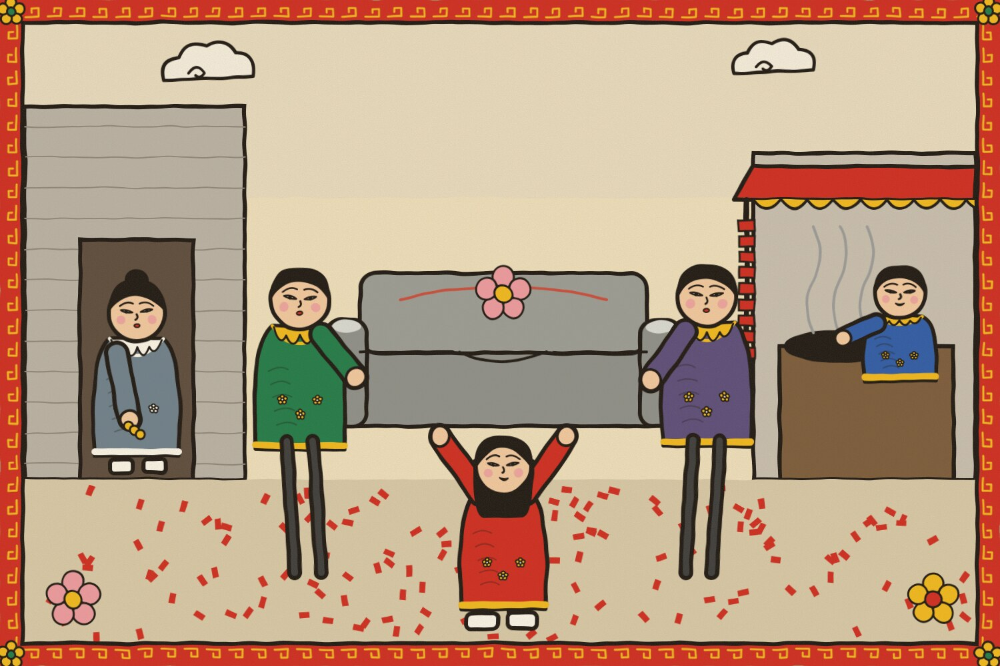
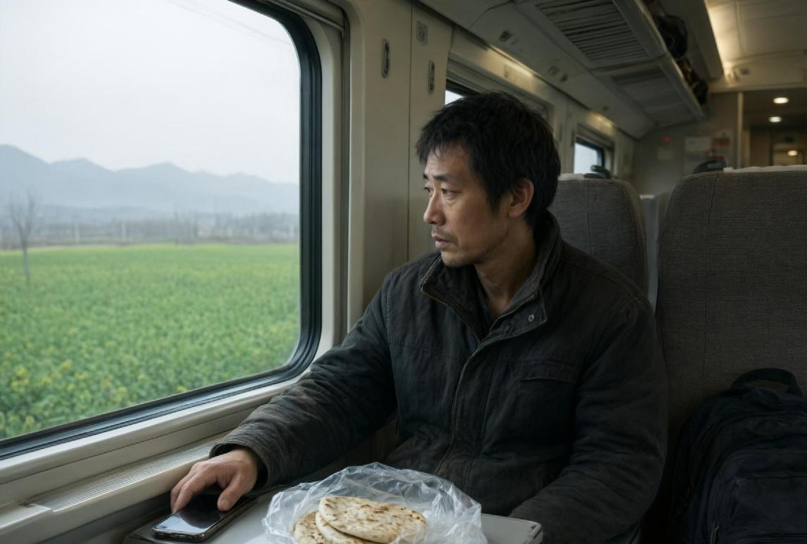

# 第二十八章　破五

三人抬沙发当花轿　一人坐火车去徐州

**成都 07:10 · 拉法叶 18:10（初四）**

破五，一早巷子里就有人放鞭炮，噼噼啪啪，送穷。

邓晓燕的屋里只剩一张沙发，别的都装箱了，十一个纸箱，码在门口，箱子上她用记号笔写着：衣服，书，锅，杂。老罗叫的车八点到。

乐子站在沙发跟前，看了一会儿。灰布面子，扶手上磨出两块亮，是他十年手肘撑出来的。中间那一格的弹簧塌了，坐下去往一边歪，他睡了十年，睡成了自己的形状。

邓晓燕站在空屋子当中，看着那张沙发，又看看他。

“十年。”她说。

“九年零十个月。”乐子说。

“你倒是算得清。”

“沙发上睡觉，”乐子说，“睡一晚上算一晚上，好算。”

她笑了一下，笑完了，转过身去把窗户关上。窗户关了，鞭炮声小了，屋里一下子空得很。

“搬去哪儿？”邱野问。他是乐子打电话喊来的，唐蕾也来了，穿着运动鞋，说今天不耍，今天出力。

“后屋。”乐子说，“徐好翔说堆躺椅那边还有块空地。”

三个人一人一头，唐蕾在中间托着，把沙发抬下楼。楼道窄，转弯的地方卡住了，邱野在下头喊往左，乐子在上头喊往右，唐蕾在中间笑得手软，沙发差点滑下去。

出了单元门，巷子里的鞭炮刚放完，一地红纸屑。三个人抬着一张旧沙发走在红纸屑上，像抬一顶轿子。卖早饭的老板娘在锅边上看着，喊：“哦哟，嫁沙发嗦？”

“嫁出去了。”唐蕾说，“没得彩礼。”

*图一　一地红纸屑，抬过去一张沙发。*

邓晓燕站在楼门口，没跟着下来。她穿着护士鞋，白的，鞋头磨黄了，手里攥着一串钥匙，是老罗那套房子的，铜的，新配的，很亮。

乐子抬到巷子口，回头看了一眼。她站在那儿，没挥手。他也没挥。他两只手托着沙发，腾不出手来。

**成都 13:50 · 拉法叶 00:50**

东站，二十二号站台，两点的车，去徐州。

乐子坐靠窗的位子，一个双肩包，一个塑料袋，袋里是两个冷了的锅盔。车开之前，他把手机拿出来，打了一行字，发给邓晓燕。

钥匙在鞋柜上。沙发在徐好翔后屋。我走了。

车开了。成都往后退，楼往后退，田往后退。一个钟头以后，他手机响了一下。

晓得了。

就三个字。他看了半天，把手机扣在小桌板上。

*图二　就三个字。他把手机扣在小桌板上。*

两点五十，他给邵昌打视频。拉法叶那边是半夜一点，邵昌没睡，在超净间外头的更衣室里，身上套着一半白大褂，头上一个发网，脸被头顶的灯照得发青。

“你在火车上？”邵昌说。

“往东走。”

“往东哪儿？”

“先徐州。徐州下来，去丰县，去看个人，吃顿饭。”

“吃完了呢？”

“吃完了回杭州。”乐子说，“我爸那张桌子还在，房子还在，值三成了，也是我的。”

邵昌伸手从旁边的柜子里拿出一个塑料盒，打开，凑到镜头前头：一盒平菇，灰白的，一朵一朵像耳朵。

“昨天在湿地捡的。”他说，“二月，雪底下，长在死木头上。”

“你那个不老实的，”乐子说，“帮我问问，我往东走，对不对？”

邵昌用的是付费的那档，开“多想一会儿”，不老实，费电，一个月的电费比他房租还贵。他拿它算过很多东西，没算过这个。

“不用算，”邵昌说，“它会说你早就想好了，就等个人说一声。”

乐子笑了一下。

“你跟我说过一句，”邵昌说，“光吃利息，不碰本金。”

“我说过？”

“我跟头一个离婚那年。”邵昌说，“你在成都，我在这边。你说，人跟钱一样，光吃利息，不碰本金，就饿不死。”

窗外是一片油菜，还没开花，绿的，一直铺到山脚下。乐子看着那片绿。

“我这十年，”他说，“吃的都是别人的利息。”

**成都 17:00 · 拉法叶 04:00**

老罗的房子在一环边上，一百四十平，三室两厅，客厅大得说话有回声。楼底下就是那所小学，操场上的跑道是红的。

罗佳五点钟来了，带着她闺女。小姑娘七岁，扎个马尾，进门鞋都没换，就趴到窗户上看楼底下的操场，鼻子把玻璃压出一块白。

罗佳三十四，在城西开宠物医院，跟她爸一个下巴，方的，说话快。她帮着拆了两个箱子，拆到“杂”那一箱，里头是一个文殊院请的香炉，一串念珠，一包没拆的护士帽。

“邓嬢嬢，”罗佳说，“我妈那间屋，我想留着，放点我妈的东西。”

“你留。”邓晓燕说，“我不进去。”

罗佳点点头。

小姑娘从窗户上回过头来：“九月份我就在底下读书了。”

“晓得。”邓晓燕说，“你爷爷买这个房子，就是为了这个。”

“那你喃？”

罗佳喊了一声，叫她莫乱问。邓晓燕蹲下来，把小姑娘鞋带上的一个死结解开，重新系了一个。

“我嘛，”她说，“顺带的。”

罗佳牵着闺女走了。走到门口，回过头来说：“我爸胃不好，晚上莫给他吃辣的。”

“晓得。”

**成都 19:30 · 拉法叶 06:30**

后屋靠墙那一排躺椅，四把一摞，码了三十摞。当中还是那张麻将桌。最里头那个角落空出一块地，沙发就搁在那儿。

汪蓉坐上去试了一下，屁股一沉，人往一边歪，歪到扶手上。

“这个沙发是歪的。”她说。

“人睡歪的。”徐好翔说，“睡了十年，人家也没摔下来过。”

他在她旁边坐下来，也歪了，两个人歪成一堆。汪蓉没起来，就那么靠着他。前头茶铺里有人在喊掺茶，她也没动。

“钟姐那个执照，”她说，“今天报上去了。”

“我晓得。”

“后屋以后做啥子？”

徐好翔扇子在手心里敲了两下。他看着靠墙码起来的躺椅，看着水泥地上一圈一圈的印子，看着麻将桌，看着沙发。

“白天打麻将。”他说，“夜里哪个没得地方睡，来睡沙发。”

“收钱不？”

“就收个茶钱。”徐好翔说，“十五块。”

汪蓉没说话，把头往他肩膀上又靠了靠。沙发往一边歪，他们两个也往一边歪，歪着，坐着。

**成都 21:00 · 拉法叶 08:00**

屋里就剩他们两个了。老罗洗了澡出来，衬衫照样扎在裤腰里，扎得一丝不苟，腰带勒得很紧。他六十二了，头发白了一半，脸是红黑的，晒的，脖子以下是白的，跟换了个人一样。

邓晓燕坐在床边，手机亮着，那三个字还在屏幕上。她把手机翻过去，扣在床头柜上。

“过来。”她说。

老罗走过来，在她跟前站着。她伸手，把他扎在裤腰里的衬衫一把扯出来，扯得很响。

“在屋头还把衣裳扎到裤腰里做啥子？”

“扎惯了。”老罗说，“跑了三十年业务，见人就要扎好。”

“我不是业务。”

她一颗一颗解他的扣子。他肚子上有一道疤，阑尾的，三十年了，白的，像一截粉笔印。她拿指头在那道疤上摸过去，摸到头。他的手搭在她肩膀上，一股豆瓣味，洗了澡还在，那是他卖了一辈子的东西，洗不掉。

她把他推倒在床上，床是新的，硬，弹了一下。他躺着，看着天花板上那盏吊灯，吊灯也是新的，他老婆走了以后他换的。

“慢点，”老罗说，“我腰杆。”

“晓得，你腰杆嘛。”她说，“我天天翻身翻的都是你这个岁数的。”

她慢下来。他喘着，喘着笑了，说你这个护士，上了床还在查房。她没理他，俯下身子，耳朵贴在他胸口上，听他的心跳，咚，咚，跳得有点急，不乱。她听了好一会儿。

后来老罗睡着了，打呼噜，呼噜是一长一短的。邓晓燕起来，光着脚走到客厅，客厅太大了，她站在当中，听见自己的脚步声。

她把手机翻过来看了一眼。三个字。她把手机揣进睡衣兜里，去厨房烧了一壶水，站着喝完了一杯。

**拉法叶 08:30 · 成都 21:30**

重庆老板的电话是八点半打来的，梅姐正在给念念扎辫子。

“梅老板，过年好哈！”他嗓门还是那么大，“我说个事，你听一哈。”

他说的事是这样：印城那边，他的店夜里的帮厨原来都是成都开过来的，初一以后没了，马尼拉的手他试了两天，切的肉片厚薄不匀，他老婆尝了说不行。现在有一家公司卖机器人厨房，动作是买来的，成都一家馆子的老师傅两年的手艺，一道腰花，一道回锅，一道干烧鱼，样样都有，牌子叫“蒲记风味”。

“我想在你们拉法叶开个头，试一哈。”他说，“你那个老火车站，十三那天，租给我一晚上，你的老客人，你发个消息。钱好说。”

梅姐手上的皮筋绷断了，弹在她手背上。

“蒲记风味？”

“对头。”重庆老板说，“就是你们年夜饭那个师傅嘛，人家授权了的，手印都按了的，合法的。”

梅姐没说话。念念回过头来看她，头发散了一半。

“好多钱？”

重庆老板说了一个数。那个数梅姐在心里过了一遍，正好是老火车站三个月的房租。年夜饭那一百六十个座，刚刚填上她欠的那三个月，下个月的还没着落。

文在门口换鞋，要去转运站上班，听见了，停下来。

“我想一下。”梅姐说，“中午给你回话。”

她挂了电话，从抽屉里拿了根新皮筋，接着给念念扎。扎完一边，扎另一边。

“老蒲知道不？”文问。

“老蒲自己按的手印。”梅姐说，“卖给天府的时候，他按的。”

“他按手印的时候，”文说，“不晓得会卖到美国来，炒给你的客人吃。”

梅姐把念念的辫子扎好了，拍了拍她的头。念念凑过来闻她的手，闻了一下说：“妈妈手上有电话的味道。”

文换好了鞋，出门了。门关上的时候，梅姐对着门说了一句：“钱是钱。”

门那边没回话。

梅姐拿起手机，给重庆老板发了一条：十三，场子给你。老客人我发消息，来不来是他们的事。

那边秒回了一个大拇指，又跟了一条语音，她没点开，也听得见那个嗓门。

她坐在厨房桌子跟前。冰箱门上，朱妮那张画还压着摇篮的传单，画上一双手，没有人。

**拉法叶 09:40 · 成都 22:40**

湿地公园的木栈道上积着雪，没人扫，只有一行脚印，大的，往林子里去。

萨凡纳顺着那行脚印走了二十分钟，在一棵倒了的老榆树跟前找到了他。

邵昌蹲在树干边上，背对着她，一件旧冲锋衣，袖口磨破了，头上一顶毛线帽，帽子底下的头发已经花白了一半。他手里拿着一把小折刀，正从那截烂木头上一朵一朵往下割平菇。

“邵教授。”萨凡纳说。

“不是教授。”邵昌没回头，“管超净间的。”

萨凡纳走过去，在他旁边蹲下来。她今天没化妆，就抹了点口红，脸冻得通红，雀斑一颗一颗都出来了。她看他割了两朵，伸手搭在他小臂上。这是她的老办法，男人的小臂，碰一下，看他缩不缩。

邵昌没缩，也没看她的手。他把一朵平菇放进塑料袋，又割下一朵。

“全县的男人，”萨凡纳说，“都说你跟女人不用开口。女人都先开口。”

“嗯。”

“那我开口了。”

邵昌这才转过头看她。他四十八了，眼角的纹路很深，眼睛是笑的，可是嘴不笑。

“你手冷。”他说。

他把自己右手的手套摘下来，递给她。手套是旧的，羊毛的，里头还是热的。萨凡纳愣了一下，接过来，戴上。手套大，指头空着一截。

她说过很多话，跟很多男人，每一句她都知道下一句是什么。这回她不知道。她张了嘴，又闭上了。

“这种蘑菇，”邵昌说，“只长在死了的木头上。活的不长。”

他把小折刀递给她，刀把朝着她。萨凡纳接过刀，学着他的样子，从木头上割下一朵，割歪了，带下来一块烂木头。

她笑了。这回是在该笑的地方笑的，不早，不晚。

“礼拜六，”她说，“我请你吃饭。”

“你先开的口。”邵昌说，“行。”

**成都 23:10 · 拉法叶 10:10**

徐州东站，车停了五分钟，乐子下车。

站台上冷，比成都冷得多，风是干的，刮在脸上像砂纸。他把那件夹克的领子竖起来，竖起来一边，另一边又窝进去了。他伸手去翻，翻了两回，没翻出来。

出站口外头是汽车站，最后一班去丰县的车已经走了，明天早上六点四十有第一班。他买了票，在候车室找了一条长椅，把双肩包枕在脑袋底下，躺下了。

长椅是硬的，铁的，冰凉。他躺上去，长椅不歪，他歪不进去。

对面长椅上坐着一个老头，七十多岁，抱着一个蛇皮袋，看了他半天。

“上丰县？”老头问，一口苏北话，硬邦邦的。

“嗯。”

“上丰县干啥？”

乐子想了一会儿。

“吃顿饭。”他说。
