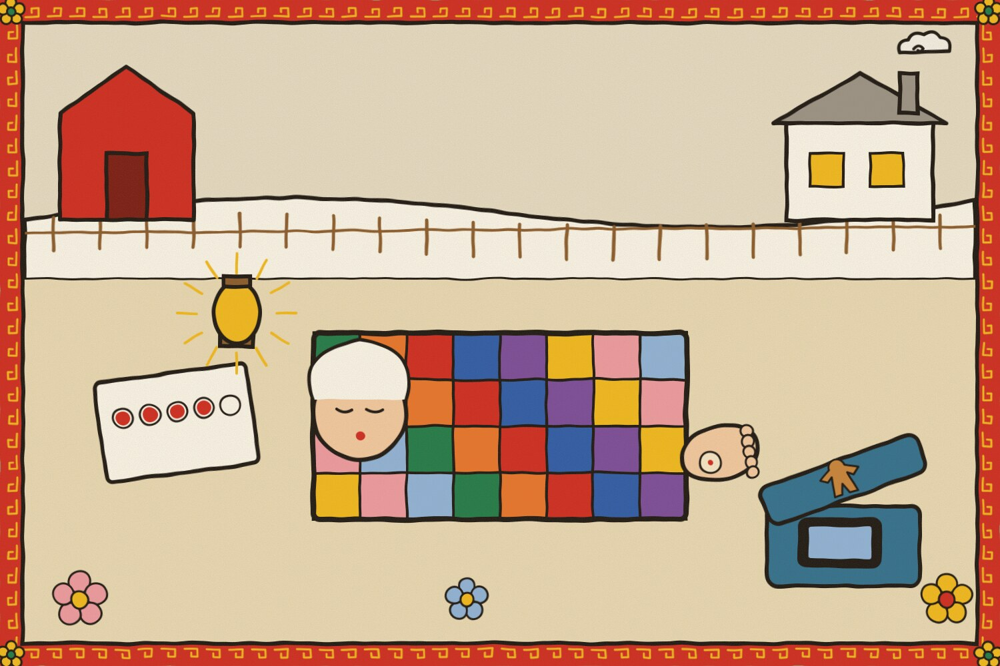

# 第二十九章　脚后跟

铁子灶前供旧案　冉峥单上添新条

**拉法叶 11:50 · 成都 00:50（初六）**

莉迪娅一天只看一回手机，中午，趁着去谷仓喂牛。

饼干铁盒在草料堆后头，盖子上画着一圈褪了色的姜饼人。她打开盒子，手机屏幕亮着，上头一个未接电话，一条语音留言，号码不认得，开头是印第安纳州的区号。

她蹲在草料堆边上听。一个女人的声音，说英语，说得很慢，很清楚，是那种念惯了单子的声音。

“这里是州新生儿筛查随访办公室。我们找以斯帖·伯克霍尔德的家人。孩子的足跟血筛查结果需要马上复查。请今天，不要等到明天，带孩子去最近的医院急诊。如果孩子吃奶少、叫不醒、身上发软，请马上去。我们已经通知了接生婆。请回电。”

后头念了一串号码。莉迪娅没记，她听见了一个词，那个词又长又拗口，她九岁那年在医院走廊里听过一回，医生说给她爸听的，她爸点头，其实没听懂。她听懂了一半。

*图一　她听懂了一半。*

以利是七个月走的。走的那天早上，也是叫不醒。

她把手机揣进围裙兜里，没盖饼干盒，跑出了谷仓。

汉娜家隔着两块地，雪化了一半，地里是泥。她跑过第一块地的时候摔了一跤，手撑在泥里，起来接着跑。

汉娜在厨房里擀面，四个大的围着桌子，阿莫斯坐在炉子边上补马套。以斯帖在摇篮里，摇篮挨着炉子，暖和。

莉迪娅没说话，先去摇篮跟前把小的抱起来。小东西软得像一块没发起来的面，脑袋往后一仰，眼皮动了动，没睁开。

“从早上就不肯吃。”汉娜说，“贪睡。”

“不是贪睡。”莉迪娅说，“州里打电话来了，说她的血有问题，叫今天就去医院。”

厨房里一下子没了声音。四个大的看着她，阿莫斯手里的锥子停在半空中。

“州里打给谁？”阿莫斯说。

莉迪娅从围裙兜里把手机掏出来，搁在桌子上，搁在擀面杖旁边。

“打给我。”她说。

阿莫斯看着那个手机，看了好一会儿。

“等主教来。”他说，“下午他要过来看马。”

“等不得。”莉迪娅说，“以利就是等的。”

汉娜手上的面粉还没擦，她走过来，从莉迪娅怀里把孩子接过去，贴着脸听了听。

“喊车。”汉娜说。

莉迪娅拿起手机，拨了戴尔的号。戴尔七十二了，退休的邮差，开一辆老面包车，专门给附近几家阿米什人拉活，去镇上，去医院，去拍卖场。电话响了三声，他接了。

“戴尔，我是莉迪娅。”她说的是英语，“去医院，现在。”

她挂了电话。屋里所有人都看着她，看着她手里那个东西，看着她拿它说英语，说得那么顺。

汉娜没问电话是哪儿来的。她把孩子裹进那床旧拼布被子里，裹了两层。

*图二　脚后跟上一块胶布，饼干盒里一个电话。*

**成都 07:10 · 拉法叶 18:10**

蒲记的卷帘门拉起来一半，冷风从底下灌进来。

铁子在后厨切腰花。蒲嬢嬢那条蓝围裙系在他胸口底下，短了一大截，腰带上那一截红线补的地方，刚好勒在他肚脐眼上。

老蒲站在他背后看。看了一会儿，伸手把菜板上一片腰花翻过来，看背面的刀口。

“深了。”

“再浅就翻不起花了嗷。”

“翻得起。底下留一层皮，莫切穿。”

铁子把那片腰花扔进碗里，重新拿起一个。他手大，那把刀在他手里显得小。

蒲嬢嬢坐在前头收银台后头那根蓝板凳上，剥蒜。她还没搬走，每天照样来坐一会儿。离婚的单子已经签了，初八去民政局，她说没离之前，这家店还有她一半。

“老爷子，”铁子说，刀没停，“跟你唠个嗑。我那个无犯罪证明，开不出来，你知道为啥不？”

“不晓得。”老蒲说。

“你也不问。”

“你要说，你就说。”

铁子切完了一个腰子，放下刀，两只手在围裙上擦了擦。

“二十三那年，我爸在工地上讨工钱。干了一年，包工头说没钱，带了七八个人来，拿钢管。我爸脑门上挨了一下，左边。”他拿手指在自己左边眉毛上比了一下，“我抄了一把铁锹，抡过去，那人肋骨折了俩。我回手的时候，铁锹把磕我自己脑门上了，也是左边。”

“判了好久？”

“一年半。”铁子说，“没钱赔，人家不松口。胳膊拧不过大腿。爷俩一人一道，左边，一模一样，跟商量好的似的。”

“我爸到现在，跟我视频都不敢正脸，老往边上躲，觉着是他把我整进去的。”铁子说，“我说爸，你躲啥呀，你那道疤比我那道好看，你那是钢管的，正经货。他也不笑。”

老蒲没说话，从筐里另拿了一个腰子，自己切，一刀一刀，又快又匀。切完了，转过身去开火。火苗子扑上来，蓝的。腰花下锅，颠了两下，又抓了一把泡椒，一把蒜苗。

一碗腰花面，搁在铁子跟前的案板上。

“吃了再切。”老蒲说。

铁子看着那碗面，看了好一会儿，没动筷子。

蒲嬢嬢从前头站起来，把桌上的辣椒罐子往他那边推了推，又坐回去剥蒜。

铁子埋下头吃面，吃得很响。吃到一半，他说了一句：“这腰花，刀口也深。”

老蒲没接话，把刀擦干净，搁回铁子那块菜板上。

**拉法叶 08:30 · 成都 21:30**

医院的家属室在三楼，一张沙发，一台咖啡机，一扇朝着停车场的窗户。

莉迪娅在这儿坐了一夜。昨天下午的事，她现在想起来，是一截一截的：护士抽血，拿一个小冰袋装着跑；一个年轻医生看着一张单子，脸一下子变了；有人喊，有人推车；一根很细的管子扎进以斯帖头皮上的血管里，因为手上的血管太细了找不着。医生说了个数，血氨两百多，说正常的不到五十。

半夜的时候，那个数掉下来一点。今天早上，又掉了一点。

汉娜坐在莉迪娅旁边，手里拿着一个吸奶器，医院给的，塑料的，嗡嗡响。她吸满了一瓶，拧上盖子，站起来，走到洗手池边上，倒了。

孩子现在不能吃奶，奶里头的东西她化不掉。

汉娜倒完了，拿水冲了冲瓶子，坐回来，接着吸。她衣服前头湿了两块。

墙上的屏幕亮着，屏幕里是印第安纳波利斯的一个医生，里利儿童医院的，一个四十来岁的女人，说话很快，又很耐心，一句话说完，要停一下，等莉迪娅翻给阿莫斯听。其实阿莫斯听得懂英语，他就是要人再说一遍。

医生说的是一个试验。拿以斯帖自己的血，查出来坏的是哪一个字母，就照着那一个字母，做一针药，改过来。做这一针，要十天。一针，一辈子。试验的钱，试验出。条件是以后十五年，每年回去抽一回血。

“以利那年，”莉迪娅说，“要是有这个——”

“那年没有。”医生说，“那年要做半年。”

阿莫斯坐在窗户边上，一直没开口。

门开了，主教进来了。约德主教六十出头，个子不高，胡子一直垂到第二颗扣子，身上还穿着他修车铺的那件帆布外套，袖口一圈黑的机油，进门带进来一股汽油味。

他没坐，站在屏幕前头，听医生又说了一遍。听完了，他问了一句。

“十天？”

“十天。”

“这十天里头，她怎么办？”

“吃药，吃特殊的奶粉，一天抽两回血。药会有人配好，家里也能喂。”

主教点点头，转过身来看着阿莫斯。

“改了，”阿莫斯说，嗓子是哑的，“还是上帝给的那个娃娃吗？”

主教没回答他。他走到汉娜跟前，低头看了看她手里那个嗡嗡响的吸奶器，看了看洗手池，看了看她衣服上湿的那两块。

“以利那年，”主教说，“我也在。”

阿莫斯低下头。过了好一会儿，他把手伸出来。护士把笔和单子递过去，他签了，签得很慢，一个字母一个字母描。

主教往外走，走到门口，停下来，没回头。

“莉迪娅。”

“在。”

“电话用完了，”主教说，“放回饼干盒里去。”

门关上了。莉迪娅坐在沙发上，手按在围裙兜上，没松开。

**拉法叶 09:40 · 成都 22:40**

州卫生厅在拉法叶的办事处，在市中心一栋老楼的二楼，走廊里一股消毒水和旧地毯的味道。

琳把那张表推进窗口。转移项目·亲属申请。同胞姊妹那一格，打的勾把纸都划破了，她用透明胶在背面粘了一道。

窗口里的女人戴着眼镜，看了一遍，盖了一个章，又看了一遍。

“生物学母亲会收到书面通知，”她说，“三十天之内，她可以提出异议。她也可以签一张放弃异议期的声明，那就不用等了。”

“我知道。”琳说。

“表格上说，生物学母亲是您姐姐。”

“是。”

那女人抬头看了她一眼，又低下头，把回执撕下来，从窗口底下递出来。

凯在楼下车里等。暖气开着，玻璃上一层雾，他拿袖子擦出一块，看见她出来，赶紧把车门打开。

“交了？”

“交了。”

她坐进来，手冻得发白。凯把她两只手拿过去，夹在自己两个手掌中间，搓。他手心是热的，软的，有一点汗。

“你姐那边，”他说，“会签那张放弃的吗？”

琳看着挡风玻璃上那块擦出来的地方，外头那栋老楼的门楣上积了一道雪。

“不晓得。”她说。

梅姐的手机是十点一刻响的。

她在厨房里算账，十三那天要用的桌子椅子，重庆老板说他的机器自己带，碗筷也带，她只出场子。手机响了一下，是州里的邮件。她点开，从头看到尾，看到最底下一行：生物学母亲如放弃三十日异议期，请签署附件二。

附件二是一页空表，底下一条横线，等着签名。

梅姐把那一页打印出来，看了一会儿，没签，拿冰箱贴压在冰箱门上，压在朱妮那张画旁边。画上一双手，没有人。

**拉法叶 12:10 · 成都 01:10（初七）**

科琳把那张条款单从抽屉里拿出来的时候，发现最底下多了一行。

不是她的字。她的字是印出来似的，一笔一划，每一行都对齐。这一行歪的，字大，写字的人手劲重，纸背面都顶出了印子。

电话响了，我接。

冉峥跪在书房的地毯上，衬衫扣子扣到最上面一颗，眼镜擦得很干净，等着。

“谁的电话？”科琳说。

“莉迪娅。”冉峥说，“她没打过。我给了她号码。她说她一天只看一回手机。”

科琳拿着那张纸，读了两遍。两年了，这张单子上每一条都是她写的，他签。这是他头一回自己往上写。

她拿起笔，在那一行旁边签了自己名字的头两个字母，签得很小。

“那就开着。”她说，“放桌上，我看得见的地方。”

他把手机从裤兜里掏出来，屏幕朝上，搁在书桌上，搁在她的笔筒旁边。上礼拜那个笔筒摔过一回，缺了一个口。

科琳走过去，把他的眼镜摘下来，叠好，也放在书桌上，挨着手机。没了眼镜，他那张脸更像个孩子了，圆的，下巴上一个小坑，眼睛黑，老老实实地看着她，找不着焦点。

“颜色？”

“绿。”

她解他的扣子，从最上面一颗开始。一颗，两颗。他胸口宽，热，一股铁锈、镁粉和便宜肥皂的味道，跟两年前一样。她解到第五颗，手停了一下。她发现自己在听那个手机。

手机没响。

她把他推倒在地毯上。他躺下去，那么大一个人，躺下去像一面墙倒下来，可是轻，一点声音没有。她一只手按着他的胸口，按得很实，像按一沓刚点完的药盒子。

单子上第三条是她自己的字：不戴。抽屉里那一盒，还是十一个。他的两只手搭在她膝盖上，是稳的。她看着他的手。这双手，两年前打个结都打不好。

她一直看着他的脸，看着他的眼睛从她脸上滑到桌上，又滑回来。

“看我。”她说。

“在看。”

“你在看电话。”

他没否认。她俯下身子，嘴贴着他耳朵，说了一句单子上没有的话，很轻。

她趴在他胸口上，听他的心跳。窗外是邻居家的车库，雪从房檐上滑下来一大块，扑的一声。

他的两只手抬起来，停在她背上方一寸，没落下去，等她的话。

“抱。”她说。

他就抱了。他那么大一个人，两条胳膊一合，就把她整个收了进去，一只手掌盖住她大半个背，下巴搁在她头顶上。她闭上眼睛，脸贴着他胸口那片汗。单子上没有这一条。她也没打算写上去。

**拉法叶 12:40 · 成都 01:40**

手机是十二点四十响的。

科琳离得近，先伸手拿起来，看了一眼屏幕。一个印第安纳的号码，没有名字。

她把手机递给他。

“接。”

冉峥坐起来，接了。他没戴眼镜，眯着眼睛，好像这样能听得清楚一点。

“冉峥。”电话那头说，“我是莉迪娅。”

“嗯。”

“医院要两个电话号码。我只有一个。”那边停了一下，“我能写你的吗？”

冉峥看了一眼科琳。

科琳在扣衬衫的扣子，一颗一颗，从底下往上扣，没抬头。
