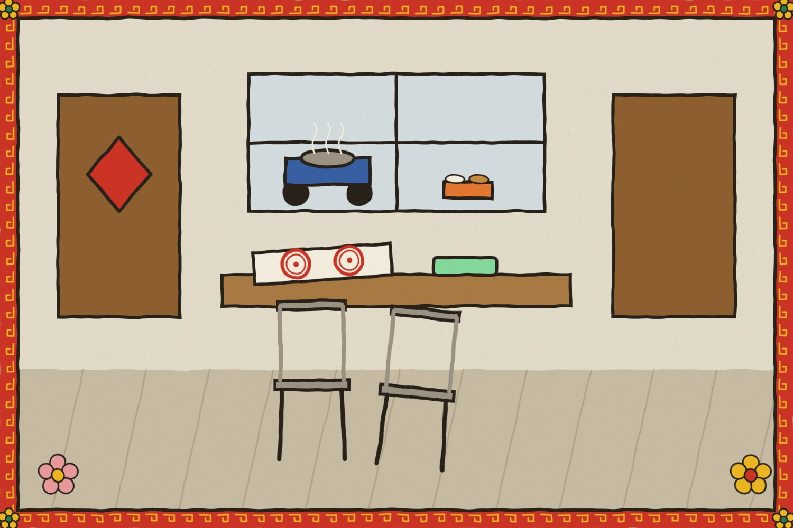
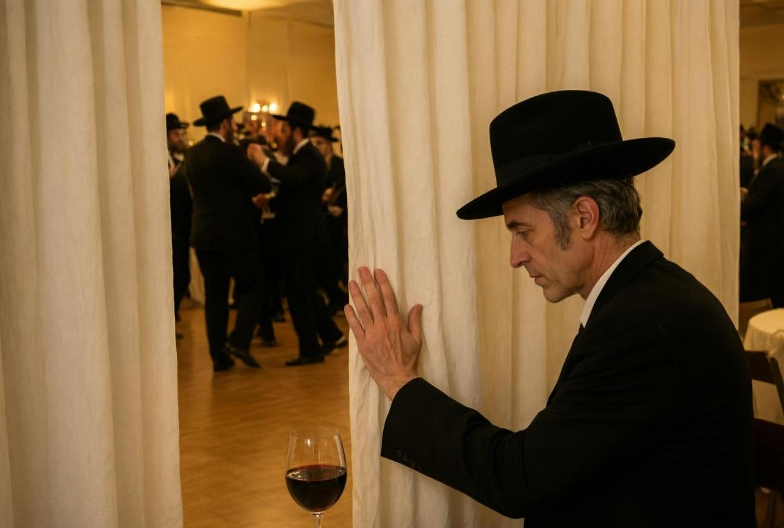

# 第三十二章　帘子

以斯拉隔帘数布褶　老夫妻出门喝豆花

**拉法叶 18:10 · 成都 07:10（初八）**

女的这边，比露丝想的要热闹。

几十张圆桌，桌上铺着白布，摆满了点心，一碟一碟的，甜的居多。女人们都站着，没人坐，穿着深色的长裙，戴着假发或者头巾，抱着孩子，牵着孩子，说话又快又响，露丝一个字都听不懂。

以斯拉的妹妹叫丽芙卡，一直拉着露丝的手，拉到一张桌子跟前，按她坐下，往她跟前推了一碟杏仁饼，又推了一杯茶。

“你是他什么人？”丽芙卡问。她英语说得很慢，带着一种露丝没听过的口音。

“一起上班的。”露丝说，“他白班，我夜班。”

丽芙卡看着她，看了一会儿，点点头，没再问。

“你有几个孩子？”丽芙卡问。

“没有。”

丽芙卡愣了一下，转过头去看桌子底下，桌子底下钻着三个，是她的；楼梯口坐着两个大一点的姑娘，头靠着头说悄悄话，也是她的。

“十一个。”丽芙卡说，“我有时候想，一个都没有，是什么样子。”

“安静。”露丝说。

丽芙卡笑出声来了，笑得捂住了嘴，笑完了，眼睛是湿的。

帘子就在露丝背后，白的，厚，从天花板一直垂到地上。帘子那边，男人们在唱歌，手风琴拉得飞快，脚踩在地板上，咚咚咚，震得这边桌上的茶杯都在颤。

露丝坐着听。听着听着，她听出来了，男人堆里有一个声音，比别人慢半拍，调子是准的，就是慢，像一个很久没走路的人，在找步子。

男人们唱到第二段，她开口了，声音压得很低，唱的是底下那一层，第二声部。没有词，就是哼。

旁边桌上几个女人转过头来看她。一个白头发的老太太皱了皱眉头，一个年轻的抱着孩子的笑了一下。丽芙卡没转头。过了一会儿，丽芙卡也哼起来了，跟着露丝，唱底下那一层。

帘子那边，那个慢半拍的声音停了一下，又接上了，这回没慢。

唱完了，丽芙卡把手搁在露丝手背上。

“他十九岁那年，”丽芙卡说，“问我爸一个问题。”

“他说他记不清是什么了。”

“他记得。”丽芙卡说，“他问：爸，你信吗？我爸没回答。第二天他就走了。”

露丝没说话。

“我爸去年走的。”丽芙卡说，“到走，也没回答。”

**成都 08:50 · 拉法叶 19:50**

民政局九点开门，老蒲和蒲嬢嬢八点五十就到了，排在头一个。

婚姻登记处在二楼，一边是结婚的，门口贴着红喜字，一边是离婚的，门口什么都没贴。结婚那边已经排了七八对，年轻人，手拉手，有一对还在拍照。离婚这边就他们两个。

“你看，”蒲嬢嬢说，“我说早点来嘛，排到头一个。”

办事的是个三十来岁的女的，戴眼镜，穿一件红毛衣，跟蒲嬢嬢那件差不多红。桌子前头两把椅子，并排。

“坐。”她说。

两个人坐下了。椅子是铁的，凉，老蒲坐得笔直，衬衫扣到第二颗。

办事的看了看他们的身份证，又看了看他们，看了好一会儿。

“结婚多少年了？”

“四十年了。”蒲嬢嬢说。

“想清楚了？”

“想清楚了。”

“老人家，你呢？”

老蒲点了一下头。

办事的没再问。她把两张表推过来，一人一张，指给他们哪儿签字，哪儿按手印。按手印是按在桌上一块小玻璃板上，板子亮着绿光。

蒲嬢嬢先按，右手大拇指，绿光闪了一下，嘀了一声。

老蒲按上去，没响。他又按了一回，板子上跳出一行红字。

“认不到。”办事的说，“换个指头试试。”

“他那个大拇指，”蒲嬢嬢说，“四十年，烫没得了。”

办事的看了看老蒲的手。那双手搁在桌上，前臂比小腿还粗，一道一道白色的旧烫疤，大拇指的指肚是平的，亮的，一条纹路都没有。

老蒲换了无名指，按上去，嘀了一声。

办事的在两张表上各盖了一个章，红的，圆的，又从打印机里抽出一张单子，也盖了一个章。

“离婚冷静期，三十天。”她说，“三十天以后，再过三十天以内，你们两个要一起来，本人来，领证。不来的，就当撤回了，当没离。”

“三十天以后，”蒲嬢嬢说，“我在美国。”

“那你就要回来。”办事的说，“两个人，一起来。”

蒲嬢嬢没说话。她把那张单子折起来，折成四折，放进包里。

老蒲站起来，椅子在地上刮了一下，很响。他走到门口，回头看了一眼。那两把椅子还并排放着，铁的，空了。

*图一　两个红章，两把空椅子。*

下了楼，民政局门口有个卖豆花的摊子，一辆三轮车，一口铝锅，锅盖上冒着白气。老蒲在摊子跟前站住了。

“两碗。”他说，“一碗甜的，一碗咸的。”

蒲嬢嬢看着他。

“你请我？”

“嗯。”

两个人坐在摊子边上的塑料小凳上，凳子矮，膝盖顶到胸口。蒲嬢嬢那碗是甜的，红糖水，她拿勺子舀了一口，烫，吹了吹。

“四十年，”她说，“你没在外头请我吃过一回。”

“屋头有灶。”

“屋头有灶，”蒲嬢嬢说，“灶是你的，我是在收银台。”

老蒲没接话，低头吃他那碗咸的。吃了两口，他把碗里的馓子挑出来，挑到她碗里。她爱吃馓子，脆的，一泡就软，要趁早吃，四十年都是这样。

蒲嬢嬢看着碗里那几根馓子，看了好一会儿，拿勺子舀起来，和着红糖水一起吃了。

“十二月，”她说，“你去美国，坐月子那一个月，我还在那边不在？”

“你在不在，”老蒲说，“我都去。”

“我是问你，我在不在。”

老蒲把碗端起来，把最后一口汤喝了，碗底朝天。

“你在。”他说。

蒲嬢嬢低下头，拿勺子在碗里刮，碗早就空了，她还在刮。

**拉法叶 21:40 · 成都 10:40**

帘子上一共有三十七道褶子。

以斯拉数了三遍，三遍都是三十七。他坐在男人这边最后一张桌子上，靠着帘子，背后隔着一层布，就是女人那边。

刚才那一段歌，他唱慢了，后来跟上了。帮他跟上的那个声音是从帘子那边来的，低，稳，在底下托着，他认得。他把手掌贴在帘子上，布是厚的，凉的，什么也摸不到。他贴了一会儿，把手拿下来，搁回膝盖上。

*图二　那个声音从帘子那边来，在底下托着。*

一个小男孩，七八岁，从桌子底下钻过来，仰着头看他，问了一句话。以斯拉听懂了，问的是：你是谁家的？

他张了张嘴，想了一会儿。

“新娘的舅舅。”他说，用的是那种他二十七年没说过的话。

小男孩点点头，好像这就够了，又从桌子底下钻回去了。

婚礼他一个人都不认识。新郎是谁家的孩子，他不知道，新娘他头一回见，十九岁，个子小，眼睛跟丽芙卡一模一样，跟他一模一样。新娘被抬到椅子上，举起来，转圈，他坐着没动。

丽芙卡的男人来过一回，端来一杯红酒，搁在他面前，看了他一眼，没说话，走了。他留着胡子，戴着眼镜，比以斯拉小五岁，看上去比他老十岁。

以斯拉没喝那杯酒。

快十点的时候，他站起来，走到门口去透气。门口很冷，台阶上积着一层薄雪，路灯底下有几个半大孩子在追着跑，穿着白衬衫，黑裤子，没穿外套。

门开了，丽芙卡出来了，手里抱着一个纸箱子，鞋盒那么大，用麻绳捆着。

她把箱子递给他。

以斯拉接过来，很沉。

“二十七年。”丽芙卡说，“一年一封，生日那天写。”

他把箱子抱在怀里，抱得很紧，麻绳勒进手指头里。

“爸的事，”他说，“我知道得晚了。”

“你知道得晚，”丽芙卡说，“他也没告诉你。你们两个一样。”

她站在台阶上，比他高一级，正好跟他一样高。她伸手把他的帽子扶正了，扶完了，手没拿下来，在帽檐上停了一下。

“明年还来不来？”

“来。”以斯拉说。

“带她来。”丽芙卡说，“她唱得好。”

**成都 11:20 · 拉法叶 22:20**

邱野住在玉林北路，五楼，没电梯。唐蕾爬上来，喘着气，手里提着一袋冒菜，红油都渗到袋子外头来了。

“你又没上班，”她说，“我来看你饿死没得。”

邱野刚跑完步，头发是湿的，穿一条短裤，光着膀子，胳膊上那块方方正正的白贴片还在，周四换的那块。

“还没饿死。”他说，“冒菜你买的哪家？”

“巷子口那家，不辣。我晓得你最近吃不得辣。”

“我啥时候吃不得辣了？”

“你上回吃了拉了三天，你自己发的群。”

唐蕾把袋子往桌上一搁，四下看了一圈。屋里还是那样，一张床，一张桌子，墙上贴着一张跑步的路线图，红笔描的，从玉林北路一直描到锦江边上，又描回来。桌上一摞简历，最上头那张写着：远程操作员，两年，延迟补偿。

“你还在投？”

“投起耍的。”邱野说，“开身子的活路全没得了，投出去也是打水漂。”

邱野笑了一下，没去碰那袋冒菜。他看着她，她额头上一层细汗，爬楼爬出来的，刘海粘在上头。他伸手把她的刘海拨开。

“你一身汗。”唐蕾说。

“你也是。”

“我那是爬楼爬的，你那是跑步跑的，不一样。”

“咋个不一样？”

“你的汗是白出的。”唐蕾说，“我的汗是为了一袋冒菜。”

她把外套脱了，搭在椅背上，又把毛衣从头上扯下来，扯到一半，头发缠在扣子上了，邱野过来帮她解，解了半天，她在毛衣里头骂了一句，他在外头笑。毛衣终于下来了，她头发乱得像个鸡窝，也不管，推着他往床上走。

床是单人床，两个人睡挤。她把他按下去，自己跨上去，坐在他肚子上，低头看他。他跑步晒出来的那身小麦色，从脖子一直到胸口，胸口以下是白的，一条线，分得清清楚楚。

“你这个颜色，”她拿指头沿着那条线划过去，“跟个裱糊匠糊的一样，上半截一个色，下半截一个色。”

“你再划。”

她就再划，从左划到右，划到他腰上。邱野吸了一口气，两只手掐住她的大腿。她身上软，哪儿都软，他一掐一个窝。

他们不急。以前在一起的时候急，现在不急了。她再划一道，他掐她的手就重一分；她故意划得慢，他就掐得狠。她俯下身子，往他耳朵眼里吹了一口气，他哼了一声，翻过身来把她压在底下，床吱嘎一声，楼下有人拿扫把杆杵了两下天花板。

唐蕾笑得浑身发抖，抖得他也跟着笑，两个人笑成一团，笑完了，才接着来。

接着来就不笑了。邱野一米八五，一身肉是跑出来练出来的，她一米五几，他一只手就把她两只手腕扣在了枕头上。她由着他扣。她喜欢他这副膀子，喜欢它一使劲鼓起来的那一条，喜欢贴片底下那一小块比别处白的皮。她抬起头，在那块白皮上亲了一口。

“前戏喃？”她说。

“爬五楼不算？”

“那是我爬的。”

他就松了手，老老实实从头来。嘴往下走，脖子，锁骨，走到她肚子上那一圈软肉，啃了一口，啃得她一缩。她这个人，牌桌上嘴最碎，这会儿只剩出气，手揪着他后脑勺上那一撮短头发。

“够了没得？”他抬起头问。

“听牌了。”她说，“莫抬脑壳。”

他又低下去。

“重点嘛。”她说，“楼下要杵，等他杵。”

他就重了。单人床的床头撞着墙，墙皮往下掉灰，掉在她头发里。打一下午麻将腰都不酸的人，这一下酸了，酸得她直吸气，又舍不得叫他放。

楼下的扫把杆又杵上来了，咚，咚，咚。他们两个谁都没停。

她骂了一句，又脆又响。邱野让她骂得没稳住，整个人塌下来，一百五十斤全压在她身上，汗是咸的，滴在她眼皮上。

“起来嘛，”她推他，“压死人了。”

他没起来。她推了两下，也不推了。

后来冒菜凉了，两个人坐在床上，一人一双筷子，从袋子里捞着吃。

“以后我们就这样？”唐蕾说。

“哪样？”

“想耍就耍，耍完各回各家。”

“你回家，”邱野说，“我这就是我家。”

“那你就莫动。”唐蕾说，“我回。”

邱野夹起一片藕，看了一会儿，搁进嘴里。

“要得。”他说。

唐蕾穿衣服的时候，他的眼镜在桌上亮了一下，弹出一行字。她瞄了一眼：家族基因徽章，您有一项新的匹配，点击查看。

邱野伸手过去，把眼镜扣在桌上，扣得很轻。

**成都 12:30 · 拉法叶 23:30**

张一帆是找他妈的身份证的时候翻到那个本子的。

他那个转票的号被平台封了，说是未成年，要绑一个大人的身份证才能解。他妈去快递站上班了，他把衣柜最底下那个抽屉拉出来，户口本、房产证、他小学的奖状，都在一个红塑料袋里。

本子夹在户口本里头。绿皮的，比手机还小，封面上印着一个银行的名字，边角都磨圆了。

存折。他只在电视剧里见过。

他翻开。头一页，十二年前的日子，存入，两千。对方户名那一栏，两个字：张磊。

第二行，下一个月的十五号，存入，两千，张磊。

第三行，又一个月，两千，张磊。

一页二十行，一行一个月。他往后翻，翻一页，又翻一页。日子一个月一个月往后走，一个月都没断过，户名那一栏，一个字都没变过。中间换过一回本子，旧本子订在新本子后头，拿订书钉订的，订歪了。最右边一栏是余额，一行比一行多两千，一路往上涨，十二年，一回都没往下走过。

他妈跟他说过，他三岁那年，他爸走了，再也没管过他们。他问过一回，就那一回，他妈说，莫问，问了也是没得。后来他就不问了。他在学校里跟人说，他爸死了，说多了，自己都快信了。

他坐在地上，背靠着衣柜，一行一行地数。

数到最后一行，是上个月十五号。存入，两千。张磊。

他又从头数了一遍，数的数是一样的。

一百四十四。
