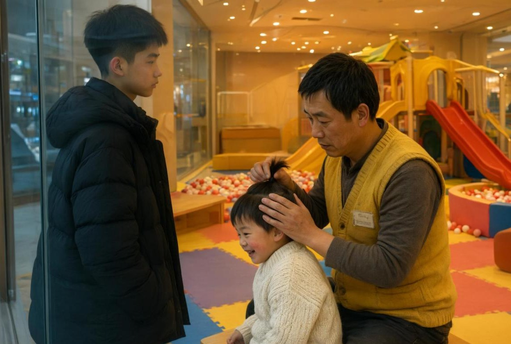
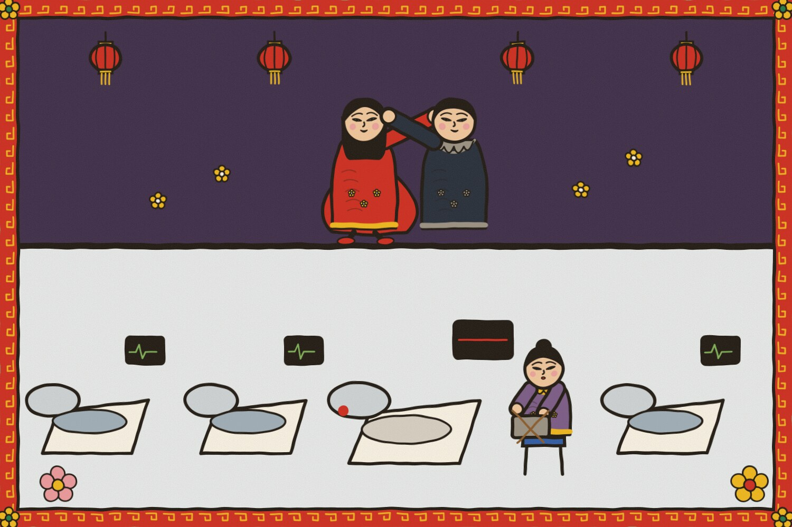

# 第三十三章　儿童层

张磊隔玻璃扎小辫　钟姐借身子跳拉丁

**成都 15:00 · 拉法叶 02:00（初九）**

天府的儿童层在二楼，一整层，四面是玻璃墙，外头的人看得见里头，里头的娃娃看不见外头，玻璃是单面的。

张一帆站在玻璃外头，站了二十分钟了。

他那个号封了，票出不去，手里还压着六张儿童层的周末票，四百八一张。他本来是来找人收货的，在门口转了两圈，没收成，就站到这面玻璃跟前来了。

玻璃里头，是一片彩色的软垫子，滑梯，球池，一个假的小火车站。几十个娃娃在里头疯跑，大的七八岁，小的刚会走。陪他们耍的大人穿一样的黄背心，背心上有名牌，一个大人管五六个娃娃。

最里头靠墙，摆着一排矮凳子，那是扎辫子的地方。

排在那儿的娃娃最多，七八个，男的女的都有，排成一条线，前头那个坐在凳子上，后头那个的爸妈在玻璃外头远远地看。坐在凳子后头扎辫子的，是一个男人，四十多岁，个子不高，背有点驼，手指头又细又长，扎得飞快。三股头发在他手里一绕，一绕，一绕，就成了一根，末梢拿一个小皮筋一缠，拍拍娃娃的脑壳，下一个。

张一帆往前走了两步，脸快贴到玻璃上了。

那男人黄背心上的名牌，字不大，他眯着眼睛看清楚了：真人陪伴 · 张磊。

他站着没动。

那男人扎完了一个女娃娃的辫子，没喊下一个。一个小男孩从球池里爬出来，四五岁，脸圆圆的，头发短得扎不起来，一头撞进他怀里。

“爸，我也要扎。”

“你头发短，扎不起来。”

“我要扎。”

男人把他抱到凳子上，拿手指头把他头顶那一小撮头发揪起来，揪成一个冲天辫，拿小皮筋扎上，扎得直直的，像一根葱。小男孩高兴得在凳子上扭，男人拿手掌罩着他的后脑勺，怕他摔下去。

*图一　扎得直直的，像一根葱。*

张一帆把手揣进羽绒服兜里。兜里有那个绿皮的本子，他今天出门的时候揣上的，揣上了才想起来，自己也不晓得揣它出来做啥子。

他摸着那个本子的边，边角是磨圆的。

玻璃里头，那男人抬起头来，往外看了一眼。玻璃是单面的，他看不见外头，看的是他自己在玻璃上的影子。他理了理头发，又低下头去，喊下一个。

张一帆转身走了。走到前台，他又停下来。

“那个扎辫子的叔叔，”他问前台的姑娘，“几点下班？”

“八点。”姑娘看了他一眼，“你多大了？这一层十二岁以下。”

“我不进去。”张一帆说，“我问一哈。”

他走到电梯口，把那六张票全挂上了二手群，一张两百，挂完了，又全撤了下来。电梯门开了，又关了，他没进去。他站在电梯口，看了看手机上的时间，三点二十。离八点还有四个多钟头。

他下了楼，在一楼的奶茶店门口找了个凳子坐下，坐了十分钟，起来，走了。

**成都 16:30 · 拉法叶 03:30**

人民公园的相亲角，礼拜六下午，伞还是那些伞。

冉峥他妈的黑伞在老地方，湖边第三棵树底下。伞骨上夹着一张纸，纸是新打的，还是那几行：身高一米八三，体重九十八公斤，在美国读书，练举重。照片换了一张，是他自己发回来的，站在一辆车旁边，雪地，笑得眼睛眯成一条缝。

蒲嬢嬢是来鹤鸣喝茶的，喝完了从这边过，看见那把伞，就走过来了。

“哦哟，蒲嬢嬢！”冉峥他妈站起来，把小马扎让给她，自己坐到伞杆边上一块石头上，“你又来了？”

“路过。”

“你屋头那个喃？”

蒲嬢嬢在马扎上坐下，把包搁在膝盖上。

“离了。”她说，“昨天。”

冉峥他妈张着嘴，半天没合上。

“那……那你咋个想得通？”

上一回在这把伞底下，说这句话的也是她，问的是另一件事。蒲嬢嬢想起来了，笑了一下。

“想不通。”她说，“想不通也离了。还有三十天，冷静。”

“冷静个啥子嘛，”冉峥他妈说，“四十年了，还没冷静够？”

两个人都没说话。湖边有人在划船，船是自己会走的，划船的人坐在里头，桨搁在腿上，做个样子。

冉峥他妈把伞骨上那张纸取下来，看了看照片上她儿子那张脸。

“他前两天给我打视频，”她说，“说在美国，天天开车送一家人去医院，那家有个小娃娃，生下来就有病。我问他哪家，他说你不认得。我问他耍朋友没得，他说妈，你莫给我找了。”

“他说莫找，你就莫找了嘛。”

“我在这儿坐了三年了。”冉峥他妈说，“不来坐，礼拜六下午我做啥子？”

“回去陪他爸？”她自己接下去，“他爸礼拜六下午看录像，看的是他自己当年的比赛。五十六公斤级，抓举一百一十五，挺举一百四十二，三十几年了，零头都没有忘过。人只到我耳朵这儿，说起那两个数，嗓门比哪个都大。”

“冉峥那个个子——”

“随我们屋头的。”冉峥他妈说，“他爸就气这个。娃娃八岁就比同班的高一个脑壳，他说高了不好，高了杠子要多走一截路。天天压，压到十八岁，还是一米八三。”

蒲嬢嬢笑了。

“他那个脾气，换个人早就跟他离了。”冉峥他妈说，“我是懒得离。”

蒲嬢嬢想了想。

“去鹤鸣喝茶。”她说，“早上去，三块钱一碗，坐到中午都没人撵你。”

“三块？”

“三块。全成都就那碗茶没涨过。”

冉峥他妈把那张纸对折了，又对折了一回，折成一个小方块，捏在手里。

“那我明天早上去。”她说，“你去不去？”

“我十六就要走了。”

“那还有几天？”

蒲嬢嬢拿指头算了一下。

“六个早上。”

“够了。”冉峥他妈说，“六碗，十八块，我请。”

蒲嬢嬢笑出了声。冉峥他妈也笑，拿手捂住嘴，跟上回一样。她把那个小方块揣进兜里，伞没收，伞还撑着，伞底下两个嬢嬢坐着，一个坐马扎，一个坐石头，前头没有牌子了。

**成都 18:30 · 拉法叶 05:30**

茶铺楼上，汪蓉在收拾一个布袋子。

毛线，三团，灰的。两根竹针。一个保温杯。一包话梅。一件薄开衫，天府里头冷气大。

徐好翔靠在门框上看她收。

“守个人，”他说，“跟出远门一样。”

“三个钟头。”汪蓉说，“三个钟头不短。”

“你守过我三个钟头没得？”

汪蓉把保温杯塞进袋子里，抬头看了他一眼。

“守了三十年。”她说，“你没数。”

徐好翔把扇子搁在门框上，走过来，从后头抱住她。他下巴搁在她肩膀上，胡子扎人，她缩了一下脖子，没躲开。她身上有一股茶叶的味道，三十年了，洗不掉，也没想洗。

“几点走？”他问。

“八点半。”

“还有两个钟头。”

“你算得倒快。”

他的手从她围裙底下伸进去，围裙是熨过的，一道褶子都没有，他手一进去，褶子就有了。她低头看着那只手，看了一会儿，自己把围裙的带子解开了。

床是老的，木头的，一动就响。他们都五十多了，不着急，也着急不起来。她躺下去的时候腰响了一声，他躺下去的时候膝盖响了一声，两个人都笑了。窗户外头是巷子，卖烧烤的刚出摊，炭火的烟飘上来，飘进窗户缝里。

她摸他的背，背上的肉松了，可是骨头还在，一节一节的，她闭着眼睛也数得出来。他亲她的颈窝，亲得很慢，像在品一碗泡了三道的茶，淡了，可是还有味。她搂着他的脖子，喘气的时候，喊了一声他的名字，很轻，像怕楼下的茶客听见。

完了，他们躺着，听楼下有人喊掺茶。

“你守她，”徐好翔说，“我守店。”

“你守个铲铲。”汪蓉说，“你就是坐到喝茶。”

“坐到喝茶，也是守。”

她起来，把围裙系上，系好了，拿手掌把那道褶子抹了抹，没抹平。她就让它那么皱着，提起布袋子，下楼去了。

徐好翔下楼的时候，后屋那张歪沙发上已经睡了一个人。是梓涵，后屋原来那个最小的，二十岁，分期换了一副好看的身子，钱还没还完，活路先没了，房东今天早上把她的箱子搁到了楼道里。她睡着了，脸朝里，那副分期的身子蜷在歪的那一头，膝盖顶着扶手。

徐好翔把自己的外套脱下来，搭在她身上，转身去前头，在她那一栏的账上记了十五块。

**拉法叶 07:10 · 成都 20:10**

那床旧拼布被子又裹上了，裹了两层。以斯帖十天大，在后座上，在汉娜怀里。

冉峥的车太小了。他开的是一辆二手的两厢车，他一个人坐进去，就把驾驶座塞满了，膝盖顶着方向盘底下。车是能自己开的，他还是把两只手搁在方向盘上。

莉迪娅坐在副驾驶。她头一回坐前头。

被子上别着一个小塑料袋，袋子里是科琳配的那瓶药，棕色的。阿莫斯没来，家里还有四个，牛也要人喂。

去印第安纳波利斯，一个钟头。里利儿童医院礼拜六开了一个门诊，要他们本人去签字，再给孩子照一回肝。

车上了高速。外头的地还是白的，太阳刚出来，照在雪上，晃眼。

“你的车，”莉迪娅说，“比戴尔的还小。”

“嗯。”

“你坐得下？”

“坐得下。”冉峥说，“就是腿伸不直。”

后座上汉娜笑了一声，很轻。

开了二十分钟，莉迪娅又开口了。

“你说你给了我号码。你那天在跟谁？”

冉峥看着前头的路。他不会撒谎，也不会绕弯子，这一点莉迪娅早就知道了。

“科琳。”他说，“药就是她配的。”

“她是你什么人？”

“她给我写单子。”冉峥说，“每天几点起，吃什么，做什么，跟谁说话，说了什么，晚上一个字一个字说给她听。两年了。”

莉迪娅转过头来看他。

“你跟她说我？”

“说。你说的每一句，我都说了。”

莉迪娅没说话。她把头转回去，看着前头的路，看了很久。车里只听见以斯帖在后座上哼了一声，汉娜在拍她。

“我们也有单子。”莉迪娅说。

“什么单子？”

“衣服什么颜色，帽子多大，车不能开，电不能用，照片不能照，跟谁结婚。”她说，“没人写在纸上，个个都知道。”

“谁写的？”

“不知道。”莉迪娅说，“几百年前的人。”

冉峥没再问。

过了一会儿，莉迪娅说：“那张单子上，有一行是你自己写的。”

冉峥手搁在方向盘上，没动。

“你怎么知道？”

“你在电话里说，你接。”莉迪娅说，“她要是没让你接，你不会接。她要是让你接，你不会说‘我接’，你会说‘她让我接’。”

冉峥把车速放慢了一点，又放回去。

“是我写的。”他说。

莉迪娅点点头。她把手搁在膝盖上，手指头绞着围裙边，绞了一会儿，松开了。

“我们那张单子上，”她说，“没有一行是我自己写的。”

后座上，汉娜用她们自己的话说了一句什么，很轻，冉峥听不懂。莉迪娅的耳朵红了，没回头，也用那种话回了一句。

“她说什么？”冉峥问。

“她说你开得稳。”莉迪娅说。

冉峥知道不是这句。他没再问。

八点十分，车开进里利儿童医院的地下车库。车库的墙上画着气球，蓝的，红的，黄的，一直画到电梯口。汉娜抱着孩子先下了车，莉迪娅跟在后头，提着那个装药的塑料袋。

冉峥没下车。

“你不上去？”莉迪娅回头问。

“我在这儿等。”冉峥说，“单子上写的是家属。我不是。”

莉迪娅站在车门边上，看了他一会儿。车库里冷，她把披肩往上拉了拉。

“你是第二个电话号码。”她说。

冉峥把安全带解开了，下了车。站直了，他比莉迪娅高出一个头还多，车库的顶低，他得稍微低着头。三个人加一个孩子，一起走到电梯口，墙上那些画的气球，一个一个从他们身边过去。

**成都 21:00 · 拉法叶 08:00**

天府三楼，躺椅区。墙是白的，什么都没画。

一排一排的白躺椅，比后屋那些新，软，躺下去整个人陷进去一半。每张躺椅旁边一块小屏幕，屏幕上一根绿线，一跳一跳的，是躺着的人的心跳。头上一个罩子，罩下来，把眼睛和耳朵都罩住。

汪蓉看了一圈，想起后屋。后屋那一百二十把躺椅，两年，躺满了人，她每天早上拿拖把从中间拖过去，从来没见哪一把旁边坐过一个人。

钟姐换了舒适衣物，一套浅灰的棉的，躺上去，膝盖并拢，两只手搁在肚子上，像躺在银行的柜台上。

汪蓉坐在旁边的塑料凳子上，把布袋子搁在脚边，拿出毛线和竹针。

“你织你的，”钟姐说，“莫一直盯到我。”

“我不盯你，我盯那根线。”

罩子罩下来了。钟姐的脸被罩住一半，只剩下嘴和下巴。下巴还是尖的，嘴上抹了口红，躺下了也没擦。

汪蓉开始织。一针，一针。

楼上是舞池。汪蓉听不见楼上的音乐，躺椅区隔了音，安安静静的，只有一排一排屏幕上的绿线在跳。旁边几张躺椅上也躺着人，有老头，有中年女的，一个个手搁在肚子上，嘴角带着一点笑。他们旁边都没人坐。

舞池里，一个二十二岁的身子正在转圈。

钟姐睁开眼睛，先看见的是自己的手，搭在一个陌生男人的肩膀上，手指头是细的，指甲上什么都没涂，手背上一根青筋都没有。她低头看脚，脚上一双舞鞋，红的，鞋跟细，脚踝是直的，一点不肿。

音乐是萨尔萨，快。那个男人拉着她转，她转了一圈，又一圈，膝盖不痛，腰不痛，转完了不晕。她笑出声来了，笑声是脆的，是二十二岁的声音，她自己都吓了一跳。

她想起她那个歌厅，开了十五年，她在柜台后头收了十五年的钱，舞池里每天晚上都有人转圈，她一回都没下去过。那时候她三十出头，腿是光的，穿高跟鞋站一晚上不嫌累，有人请她跳，她说忙，她是真忙，忙着数钱。

现在她不忙了。她在一个借来的身子里头，转了一圈又一圈，裙子飞起来，扫在那个男人的腿上。她什么都不数。

“你跳得好。”那个男人说，说的是普通话，带一点外地口音。

“我头一回跳。”

“不像。”

“这个身子会跳。”钟姐说，“我不会。”

那男人愣了一下，笑了，拉着她又转了一圈。

*图二　楼上转圈，楼下有人守着。*

十点四十，一只袖子织了一半，汪蓉抬头看了一眼屏幕。

绿线在跳。一下，一下，跳得比她自己的快一点，是在跳舞的心跳。

她低下头，又织了两针。

再抬头的时候，那根线是平的。

平的。一点不跳，从屏幕左边拉到右边，一根直线。

汪蓉手里的竹针掉在地上了。她站起来，凳子往后一倒。她伸手去抓钟姐的手，那只手搁在肚子上，是热的，可是不动。

一秒。两秒。

她张嘴喊人，喊的是什么，她后来自己都不记得了。

三秒。

四秒。

绿线跳了一下。又跳了一下。

躺椅底下响起警报来，尖的，一声连着一声，整排躺椅的灯都亮了，红的。罩子自己升起来了。

钟姐睁开了眼睛。

她看见的是天府三楼的天花板，白的，灯晃眼。她听见警报在响，一声一声，就在她耳朵边上。她想抬手，手抬不起来，是重的，是五十五岁的手，有人死死攥着。

她转过头，看见汪蓉，汪蓉的脸是白的，嘴唇在抖，两只手攥着她那只手，攥得骨头都痛。

警报还在响。
