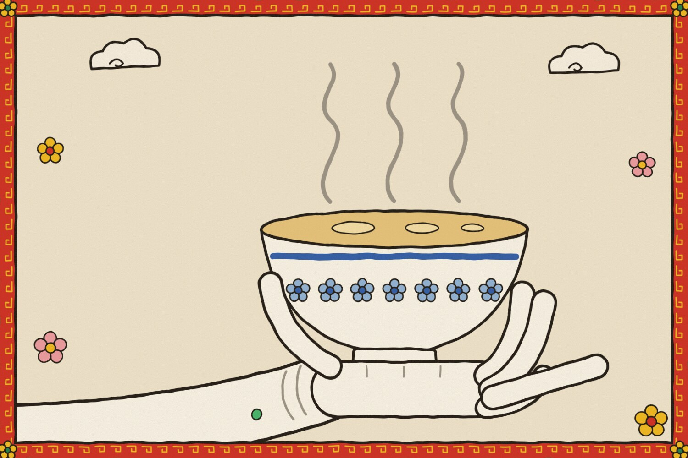
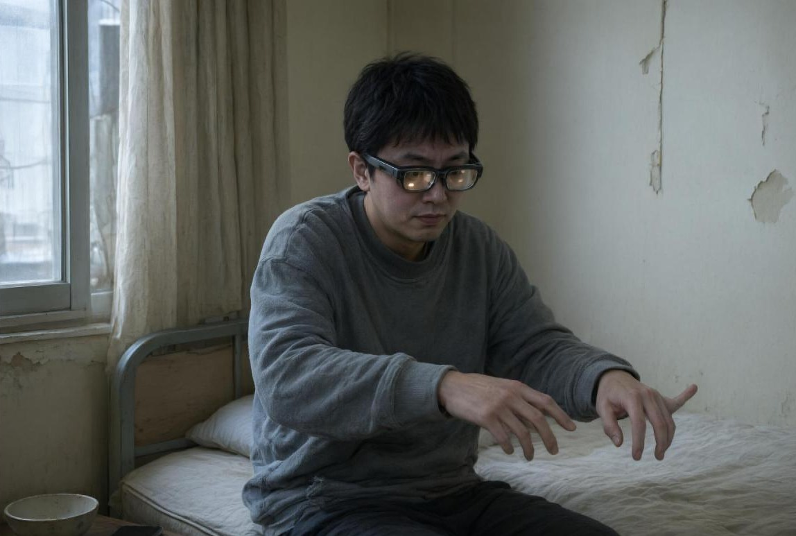

# 第三十五章　无名指

乐子父桌续账本　王鹏铁手翘指头

**成都 19:30 · 拉法叶 06:30（初十）**

杭州，城东，一栋九十年代的老楼，六楼。

门锁是旧式的，铜钥匙，乐子在兜里揣了十年，揣得发亮。他插进去，拧了两下没拧动，锁芯锈了。他使了点劲，咔的一声，开了。

屋里一股灰的味道，底下压着一点旧报纸的味道，还有他爸的烟斗。他摸到门后的电闸，推上去，灯亮了，还亮得起来。窗帘是拉着的，他拉开，灰扑扑地落了一地。

窗户外头，远远的，是钱塘江，江上一座桥，桥上的灯一串一串亮着。

那张桌子就在窗户底下，朝着江。

桌子是他爸年轻时候自己打的，榉木，桌面上有一圈一圈的杯子印，左手边一道深一点的划痕，是他七岁那年拿小刀刻的，刻了个“乐”字，挨了一顿打。桌上东西都还在：一台旧计算器，一个茶杯，杯底一层干了的茶垢，一个硬皮本子。

他爸是坐在这张桌子跟前走的。那年房价跌了七成，他爸天天坐在这儿，算。邻居说，走的那天早上，窗帘也是拉开的。

乐子在椅子上坐下来。椅子吱了一声，坐垫上压出来的那个窝，是他爸的形状，他坐进去，不歪，正好。

他翻开那个本子。

一页一页，全是数字。日子，然后一个数，是这套房子那天的挂牌价。头一页的数很大，后来一天比一天小。每一页的右下角，拿铅笔画着一条小船，指甲盖那么大，有的船头朝东，有的朝西，画得一页比一页细。

他翻到最后一页。最后一行，日子是他爸走的那天，后头没有数，角上也没有船。笔搁在本子边上，笔帽没盖。

乐子看着那一行。

他把笔拿起来，笔干了，划不出字。他在抽屉里摸了一阵，摸出一支铅笔，削都没削过。他拿小刀把铅笔削了，在最后一行底下写了今天的日子，后头也没写数。

他抬头往窗户外头看。江面上一条运沙船，亮着两盏灯，慢慢往东开。他低下头，在那一页的角上，画了一条船，船头朝东。他画得不好，船身歪了，他没擦。

门响了。一个老太太站在门口，七十多岁，烫着卷发，穿一件枣红的毛背心，手里拎着一袋橘子。

“你是六楼那家的儿子？”她说的是杭州话，“灯亮了，我以为是贼骨头。”

“是我。”乐子想拿杭州话说，张了张嘴，出来的还是普通话。十年没回来，杭州话他听得懂，舌头不认了。

“老底子你爸天天坐在窗口头，”老太太说，“我送橘子来，他就讲声谢谢，眼睛看牢江的。”

她把橘子搁在门口的鞋柜上，没进来。

“你回来做啥西？”

乐子想了一会儿。

“坐一坐。”他说。

老太太走了以后，他手机响了。邓晓燕。

“到了？”

“到了。”

“桌子还在不？”

“在。”

那边停了一下，听得见华西的走廊里有人喊护士，有个轮子吱吱地滚过去。

“你那个沙发，”邓晓燕说，“在后屋墙角，有个女娃儿在睡，徐老板收她十五块钱一晚上。”

“哪个女娃儿？”

“梓涵。换了个身子那个，分期还没还完，房子退了。十五块钱她都是记的账。”

乐子坐在他爸压出来的那个窝里，看着江。那张沙发，弹簧哪一根顶腰，他闭着眼睛都摸得到。

“她的账，”他说，“记我名下。”

“沙发是白睡的。”邓晓燕说。

“床是要还的。”乐子说，“我还没还。”

这回那边停得久。轮子滚远了，有人在喊十一床的家属。

“那你坐。”邓晓燕说，“坐好。”

**成都 10:20 · 拉法叶 21:20（十一）**

徐好翔的电话是上午十点二十打来的。乐子还坐在他爸那张桌子跟前，坐了一夜，椅子上那个窝坐热了。

“乐子，你在杭州？”

“在。”

“常熟远不远？”

“两个钟头。”

徐好翔在那头喝了一口茶，咕咚一声。他说有个老头，姓钱，杭州人，在常熟住了三十年，虞山脚下一个大院子，一个人住。二〇二九年那会儿，这个人在他店里扫过一年地，一天一碗茶钱。后来又发了，发得不小。现在老了，在近邻上订了护理，点名要后屋的人。

“何蔓接的单。”徐好翔说，“昨天开了一天，回来跟我说，那个老头说话，她一句都没听懂。老头急了，对着机器人哭。”

乐子没说话。

“他说的是你们那边的话。”徐好翔说，“你去给他当回耳朵。钱他出。”

下午两点，乐子站在虞山脚下那个院子门口。石门框，门楣上原来刻着字，雨水冲了几十年，只剩一个“钱”还认得。

院子里一棵老桂花树，树底下一张藤椅，藤椅上坐着一个老头，瘦，穿一件很好的羊绒开衫，扣子扣错了一颗。脸是六十多岁的脸，眼睛不是，眼睛亮得吓人，是花钱换过的，三十岁人的眼睛，长在一张老脸上。

藤椅边上站着一台近邻的机器人，白的，圆脑壳，两只眼睛是两个绿点。

“乐子。”机器人先开口，是何蔓的声音，普通话，“你来了。”

“来了。”

老头转过头来看他。

“杭州人？”他说的是杭州话，音又是走了的，掺着常熟的软，一个字拐两道弯。乐子听着，像小时候隔着一堵墙听他爸跟人讲话，字一个一个都认得，连起来要想一想。

“杭州人。”乐子说的是普通话。

老头笑了，那双年轻的眼睛一眯，倒显出老来了。

“好。”他说，“我讲，你翻给她。她讲，你也翻给我。”

“她讲普通话，你听得懂。”

“听得懂。”老头说，“就是不想听。我想有一个人，我讲的，他听得懂。”

那个下午，乐子坐在藤椅旁边一张小板凳上，当了三个钟头的耳朵。老头要喝茶，要龙井，不要碧螺春，碧螺春是常熟人喝的，他在常熟三十年，还是喝不惯。老头要把桂花树底下的落叶扫一扫，不要扫干净，留一层。老头讲他老底子在成都扫地，扫一家茶馆，前头扫完扫后屋，后屋那时候摆的是麻将桌，桌子底下扫出来木佬佬的瓜子壳。

乐子翻给何蔓听。机器人停了一下。

“后屋？”何蔓说。

“就是你们那个后屋。”乐子说，“那时候还是打麻将的。”

机器人没再说话。过了一会儿，它拿起扫帚，去扫桂花树底下的叶子，扫一下，停一下，留了一层。

“昨天他哭，”何蔓问，“说的啥？”

乐子转过去问老头。老头看着那台机器人扫地，看了很久。

“我讲了一天，她一句都没接住。”他说，“我就晓得，我老了。”

乐子翻过去，翻得一字不差。机器人的扫帚停了一下，又接着扫。

天黑的时候，老头说客房收拾好了，床是新铺的。

“我睡沙发。”乐子说。

老头看了他一眼，没问为什么，叫机器人去抱了一床被子来。

**成都 15:00 · 拉法叶 02:00**

钟姐家在锦江边上，一百八十平，客厅那张意大利沙发是她三年前订的，等了半年才到，真皮的，奶白的，坐上去会陷，躺上去腰疼。

她出院回来，就躺在那张沙发上。

机器人是中午送到的，白的，圆滚滚的，跟后屋那些年开的身子不一样，没有脸，就一个圆脑壳，两只眼睛是两个绿点。它自己找了个插座充上电，就站在墙角不动了，等单子。

三点整，它的绿点闪了两下，亮了。有人上线了。

“钟——”它开口了，是一个男的声音，普通话，顿了一下，“钟女士，您好，我是近邻的护理员，今天的单子是喂饭和陪护。”

钟姐没睁眼。

“汤在灶头，”她说，“鸽子汤，汪蓉炖的。你热一哈，端过来。”

机器人去了厨房。她听见它开火，等，关火，盛汤，碗磕在灶台上一声，脚步声，一步一步，走得很稳，过来了。

她睁开眼睛。

机器人站在沙发跟前，两只手端着那碗汤，端得很平，一滴都没洒。左手的无名指是翘起来的，翘得直直的，离碗边一指宽，不挨着碗。

*图一　这个身子不长冻疮，那根指头还是翘着。*

钟姐盯着那根指头。

两年，后屋一百二十个人，她坐在柜台后头看监控，看了两年。一百二十双手，开着一百二十个身子，在美国给人端盘子、洗碗、扫地。只有一双手，端东西的时候无名指是翘着的。那个人自己说过一回，当着她和何蔓的面：他开的那个身子是个女的，左手无名指长冻疮，一碰就疼，他端东西就把那根指头翘起来。翘了两年，他自己拿手机，那根指头也翘着。

“王鹏。”钟姐说。

机器人不动了。汤碗端在半空中。

过了好几秒，那个声音又响了，还是普通话。

“钟女士，平台规定，护理员不能透露个人——”

“你说成都话嘛。”钟姐说，“我写了的，要会说成都话的。”

又过了好几秒。

“钟姐。”这回是成都话了，“汤要凉了。”

钟姐坐起来，接过那碗汤。她喝了一口，烫，她吹了吹，又喝了一口。

“你恨我不？”她问。

“不恨。”王鹏说，“你工钱还没给我结完。”

钟姐差点把汤喷出来。她拿手背抹了抹嘴。

“那一个月的遣散费——”

“那是遣散费。”王鹏说，“我说的是初三那天，前头的茶你请。我喝了两碗，你只结了一碗。”

钟姐看着那个白脑壳，看着那两个绿点，看了半天，笑了。笑得胸口疼，那个指甲盖大的东西在里头，一下一下，替她数着。

“十五块。”她说，“我欠你十五块。”

“记到。”王鹏说。

单子上写的是陪护一个钟头。王鹏把碗收了，洗了，搁回碗柜，又回来，站在墙角。

“你坐嘛。”钟姐说。

“坐不下去，”王鹏说，“这个身子膝盖不打弯。”

钟姐看着那个身子的两条腿，白的，直的，像两根晾衣杆。她想起后屋那些身子，二十二岁的，三十岁的，膝盖都会打弯，跳舞都跳得起来，一个钟头一个钟头地算钱，那些钱她数了两年。

“喂一回饭，好多钱？”

“八块。”

“我抽好多？”

“四毛。”

钟姐一辈子算钱，这个数用不着算。

“那四毛我不要了。”

“平台不得准。”

钟姐没话说了。她躺回沙发上，把被子拉到胸口，两条腿还是伸在外头，光着。她闭上眼睛。屋里只有冰箱在响，还有墙角那个白东西，一点声音都没有，它连呼吸都不用。

她睡着了。睡着了脚一蹬，被子滑下去半截。

**成都 15:40 · 拉法叶 02:40**

王鹏在自己屋里，戴着眼镜，坐在床沿上。眼镜里是钟姐的客厅，墙角那个身子看出去，矮一截，歪一点，像蹲着看人。

客厅大得空。一面墙全是柜子，柜子里没有书，摆的是酒，一瓶一瓶，有的封都没拆。茶几上一盒印泥，盖子没盖，红的，干了一半。那是腊月里按手印用的那一盒，一百二十个人，按了一百一十九个。他那个也在里头，按得太重，糊了一团。

沙发上那个人睡着了，嘴微微张着，口红擦掉了，嘴唇是白的。她五十五了，脸上花了钱，看不出来，睡着了就看得出来。两条腿露在被子外头。二月，屋里没开暖风，那腿上起了一层鸡皮疙瘩。平台的规矩他背得：护理员不得在客户睡眠中进行非必要接触。他站了一会儿，看着单子右上角的计时，还剩二十一分钟。

他走过去，弯不下腰，就伸长了胳膊，两只手捏着被子边，一点一点往下拉，拉到脚背，把两只脚都盖住了。手指头一下都没挨着她的皮肤。左手那根无名指，一直翘着。

*图二　手指头一下都没挨着她的皮肤。*

钟姐睁开一条缝。

“那根指头，”她说，“放下来嘛。这个身子又不长冻疮。”

“习惯了。”王鹏说。

钟姐翻了个身，脸朝沙发背，没再说话。

王鹏退回墙角，站好。外头他妈在喊，问他晚上吃不吃面，他没应。二十一分钟，他就那么站着，看着一个背。计时到了，他摘眼镜之前又看了一眼：被子盖到脚，那个背一起一伏，匀的。

**拉法叶 10:00 · 成都 23:00**

第三个礼拜一。

西奥站在柜台前头，科琳在柜台后头，数药片。五片一数，五片一数，数到七十，装进小瓶子，贴标签，递给他。

“伸手。”

他把手伸出来，掌心朝下。科琳看着他的手。

还在抖。可是比上礼拜轻了，比上上礼拜轻多了。手指头尖上那一点颤，要仔细看才看得出来。

“剂量是剂量。”科琳说，“你自己没加，也没减。”

“没有。”

“好。”

她把那张剂量单拿出来，在第三个礼拜那一行打了个勾，勾打得很小，很直。

药剂助理今天休息。店里没别人。门口挂着的牌子，科琳出来翻了一下，翻到“十分钟后回来”。

后头的储藏室，一排一排的铁架子，架子上码着药箱。上礼拜也是这儿。科琳把门带上，没锁，靠在门上，看着他。

“手给我。”

西奥把手递过去。她拿着他的手，翻过来，看手心，又翻过去，看手背，拿拇指沿着他的指节一节一节按过去，像在验一批货。他的手在她手里，抖得比在外头还厉害一点。

“你一碰，就抖。”她说。

“你一碰，我就抖。”

科琳把他的手按在自己腰上。她穿着白大褂，大褂底下是一件灰毛衣，毛衣底下是她的皮肤，热的。他的手隔着毛衣贴上去，抖了一下，停了。

她解他的皮带，解得很快，像拆一个包装。他想亲她，她偏了一下头，没让，把他转过去，让他两只手撑在铁架子上。药箱码得太高，晃了一下，没倒。她从后头贴上来，下巴搁在他肩膀上。

“数。”她在他耳朵边上说。

“数什么？”

“数到五，你停一下。再数到五。”

他数。一，二，三，四，五。停。再数。他的手撑在铁架子上，攥得架子吱了一声，可是不抖了，一下都不抖了。他数到第四个五的时候，没数下去，额头抵在一个药箱上，药箱上印着一行字，他看了半天，一个字都没看进去。

后来她把大褂上的皱褶抹平，把头发重新别好，一根都没乱。

“下礼拜一，”科琳说，“十点，是哈珀值班。她配药配得好，剂量单你交给她。”

西奥扣皮带的手停了一下。

“你呢？”

“我换到礼拜二。”

他看着她。她低着头，在看自己大褂上的扣子，一颗一颗，都扣着。

“还剩十一个礼拜，”西奥说，“你说就到十四个礼拜。”

“药还剩十一个礼拜。”科琳说，“你的手，不用十一个礼拜了。”

她开门出去了。门口那块牌子，她翻回了“营业中”。

西奥站在储藏室里，把手举到眼前，看了一会儿。还是有一点抖。他把手握成拳，再张开，再握上，再张开。

**成都 23:40 · 拉法叶 10:40**

王鹏躺在床上，床是单人床，墙那边是他妈在看电视，声音开得大。

他打开那个叫“后屋”的群。群还在，八十三个人，还在，谁也没退。今天群里很热闹，都在报单子，喂饭几单，翻身几单，洗澡几单，一天下来多少钱。唐蕾发了一个“乐”。铁子发了一张蒲记后厨的照片，菜板上一碗切好的腰花，配了一句：“今儿个，一个没切穿嗷。”

十一点半，钟姐发了一条。这是她出院以后头一回在群里说话。

今天那个开机器人的，汤端得稳。

群里一下子安静了。过了一会儿，有人发了一个问号，有人发了一个大拇指。何蔓什么都没发，可是王鹏看见了，她的名字旁边那个小点亮了一下，又灭了。

王鹏在输入框里打了一个字：典。

那个字在框里亮着。墙那边的电视里在放一个相亲节目，主持人在笑。

他把那个字删了。
