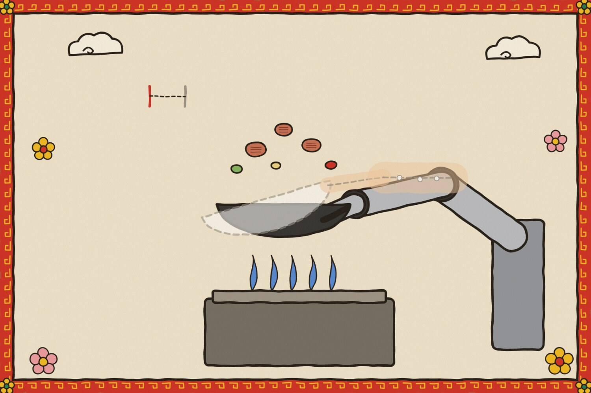
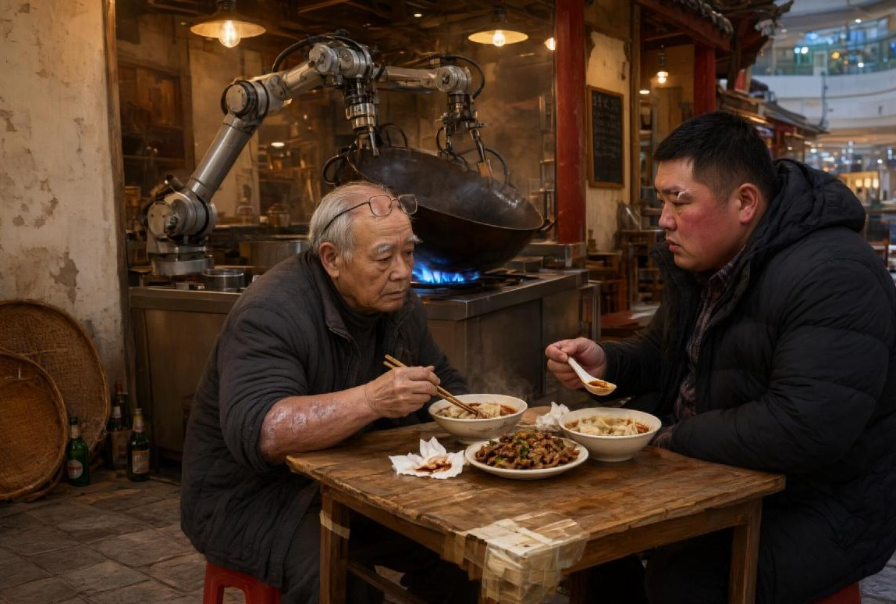

# 第三十七章　早了三百

机器偷师争毫秒　老汉尝肉辨夹生

**成都 11:30 · 拉法叶 22:30（十二）**

天府四楼这一层，叫“老成都”。

电梯门一开，一股菜籽油的味道扑过来，熟的，呛的，跟真的一样。一条街，青石板是压出来的，墙是刷旧的，十几家苍蝇馆子一家挨一家，门口摆着折叠桌、塑料凳子，桌子上一层油亮亮的光。灶台后头站着机械胳膊，一家两条，银灰色，关节上包着一圈黑橡胶，像戴着护腕。

铁子买的票，四十八一张，进门送一碗冰粉。老蒲不要冰粉，铁子两碗都吃了。

“老爷子，最里头那家。”铁子拿勺子指，“小黑板上写的，火爆腰花。”

老蒲走过去，在最靠灶台那张桌子跟前坐下。凳子是矮的，桌子是方的，桌角缺了一块，拿透明胶缠着。跟他店里那张一模一样，连缺口都在同一个角上。他伸手摸了一下那块透明胶，摸出来了：缠胶的人是照着照片缠的，缠了三圈，圈圈一样宽。他自己店里那块，是蒲嬢嬢缠的，缠得歪，缠了七八年，边上都起毛了。

灶上那两条胳膊动起来了。点火，坐锅，下油。油冒青烟，左边那条胳膊端起锅，没有马上颠，先往下一沉，沉了半寸，再往上起。

老蒲的眉毛动了一下。剩下的那一边眉毛。

沉那一下，是他的。四十年，他颠锅都是这样，先沉，借锅的劲，再起。他师傅当年骂他，说他这一沉是多余的，费油。他改不掉，后来也不改了。

“老爷子，”铁子小声说，“这是你。”

老蒲没吭声。

腰花下锅了。嗞的一声，白烟冲起来。老蒲坐在那儿，眼睛没看锅，耳朵在听。那一声嗞，响到第二截，声音要从尖往闷里走，走到闷的那一下，就是起锅颠第一下的时候。

锅起来了。

还没走到闷。

“早了。”老蒲说。

铁子已经在数了，嘴里念念有词，跟在后屋的时候一样。他数完，抬起头。

“早了三百。”他说，“跟那会儿在美国，一模一样。那边慢两百多，你提前动，邱野教的，动在听到以前。它把你提前那一下也学去了。这边又不慢，它还提前。”

*图一　先沉半寸，再起，早了三百。*

老蒲看着那口锅。锅里的腰花翻了三个身，倒进盘子里，青红椒，泡姜，蒜片，颜色都对。

端盘子的是一台送菜的机器人，跟人差不多高，穿一件蓝布围裙，脸是一块光板，画着两只眼睛。它端着盘子走过来，走得很稳，盘子搁到桌上，一滴汁都没洒。

左手的无名指是翘着的。

铁子手里的勺子停了。

“鹏儿？”

机器人没说话，两只画出来的眼睛眨了一下，是程序眨的。它把筷子摆正，摆得跟桌边平行。

老蒲夹了一块腰花，放进嘴里，嚼了两下，停了。

“生了。”他说。

他把那块腰花吐在纸巾上，包好，搁在桌角。腰花切得好，花刀深，一刀一刀，底下留着一层皮，没切穿。是他的刀工。火候是生的。

*图二　是他的刀工。火候是生的。*

“叫他们老板来。”

机器人弯下腰来，弯得很低，低到老蒲耳朵边上，说话了，声音压得很小，是成都话。

“老板不在这层。管这些胳膊的工程师，在七楼。”

说完它直起腰，端着空托盘走了，那根无名指一直翘着。

铁子看着它的背影，看了半天。

“这小子，”他说，“平台规定不让说话的。”

“他说了。”老蒲站起来，“走，上七楼。”

**拉法叶 22:40 · 成都 11:40**

普渡的超净间，黄光区。灯是黄的，黄得像隔夜的茶，光刻胶见不得白光。

塔里克坐在聚焦离子束那台机器跟前，屏幕上是一片芯片的截面，一层一层，像他老家亚历山大港甜点铺子里切开的果仁千层酥。下刀以前，他先在要切的地方铺了一条铂，薄薄的，护着表面；离子束一扫，就从铂底下往里挖。

隔着两台机器，苏海勒在甩胶。二十岁，航天系大三，个子随他爸，不高，宽，连体服穿在他身上绷得紧紧的。他把一滴HSQ点在硅片正中间，盖上盖子，转速打到四千，看着那滴胶摊开，摊成一层比头发丝还薄的膜。

门口的风淋间响了一阵，阿丝玛进来了。

连体服，头套，口罩，鞋套，从头到脚都是白的，只露一双眼睛。超净间里的人都长一个样，认人只能认眼睛，认走路。塔里克没回头，就知道是她。她左脚先落地，落得重，二十五年了。

二十六年前，他在这儿管机器。一个拉合尔来的博士生，来做她头一块芯片，裹得只剩一双眼睛，在他那台机器跟前站了一下午。他教她甩胶，教她烤，教她对版，她一句话没多说，就是看。下了班脱了连体服，他才看见她长什么样。他说他那天下午就认得她了，她说他吹牛。

“上礼拜天那一格以后，还有没有？”苏海勒问。

“没有。”阿丝玛说。

“八天了。”苏海勒把硅片取下来，搁到热板上，“我们这一片，哪年才用得上？”

“你姐那边量满一半的时候。”塔里克说。

“她今天夜里上班？”

“上了。九号厅十一点起。”

阿丝玛走到塔里克身后，看那一屏截面。看了一会儿，她伸出一根戴了两层手套的指头，隔着一寸，点了点最底下那一层。

“这儿，”她说，“有个空。”

他放大。是有个空，针尖那么大，夹在两层中间。

“明天重做。”他说。

超净间里不兴碰人，碰一下，手套就得换。她就站在他身后，站得很近，连体服挨着连体服。隔着两层布，他觉出她在呼气，热的，从口罩边上漏出来，落在他后脖子上。他没回头，手上的旋钮拧过了一格，又拧回来。

邵昌从里头那间出来，锁了门，看见这三个，站住了。

“这么晚。”

“等九号厅。”塔里克说，好像这就是答案。

“韩临刚问我，怎么停了。”邵昌说，“我还没回。”

邵昌看了看他们两个，隔着口罩，看不出他是什么表情。他结过两回婚，四个娃娃。他点了点头，往风淋间走，走到门口，手机响了。

**拉法叶 22:50 · 成都 11:50**

萨凡纳打过去的时候，邵昌刚从超净间出来，在更衣间里，连体服脱了一半。他接了，口罩还挂在下巴上，声音闷闷的。

“我打了。”萨凡纳说。

“嗯。”

“你说你不打给我，让我打给你。我打了。”

“我听见了。”

她靠在床头上，样品册摊在腿上，翻到男人那几页。那几页她闭着眼睛都背得出来，第几号肩膀，第几号下巴，第几号腰，哪一号卖得最好。没有一号背上带坑。她看了一会儿，合上了。

这两个礼拜，册子上的东西没人订，只有人退。夜里的活儿一停，按月供身子的人供不起了，她卖出去的单子，一张一张往回走。

“我想要一样东西，”她说，“你猜不到的。”

那边没声音，只有风淋室的门开了又关，呼的一声，隔一会儿又一声。

“你猜不到的，我才想要。”她说，“你猜得到的，我自己就有。”

“那你写下来。”邵昌说。

“写下来？”

“你不是最会写单子吗。”他说，“一副身子卖出去，哪儿能碰，哪儿不能碰，几点到几点，你一条一条写得清清楚楚。你写一张给我。”

萨凡纳笑了一声。她笑得不是时候，笑早了，自己听出来了，没收住。

“你不怕我写什么？”

“我看完了再说。”

他挂了。萨凡纳拿着手机，听了一会儿那一声嘟。然后她又把样品册翻开，翻到女人那几页，一页一页翻过去。三号腰，五号腿，七号的锁骨，都是她卖过的，卖得最好的那一副，全县有十一个女人在用，走在街上，她一眼就认得出来。翻到底，她合上了。

她想起年三十那天晚上，九号桌那个女人。葡萄牙人，骨架大，肩膀宽，橄榄色的皮，眉毛又浓又黑，一看就没节过食。那个女人一晚上背对着自己那桌，把椅子转过去，盯着厨房玻璃后头一双手看。那双手是萨凡纳卖出去的那副身子上长的。萨凡纳当时跟同桌的人说了一句，说那个女人的老公那副身子是她卖的，说得很得意。那个女人没回头。

她把样品册翻过来，翻到最后一页，空白的，拿起笔。

她写了第一行。写完，她看着那一行，看了很久，没划掉。

三个人。

**成都 14:30 · 拉法叶 01:30**

城西宠物医院，二楼最里头那间是取样室，罗佳一个人在里头。

老邓抱着铁锅进来，抱得很吃力。铁锅是条土狗，黄的，十四岁了，嘴边一圈白毛，后腿已经不太听使唤，走两步就坐下。老邓七十一，抱它上二楼，歇了三回。

“天府那边说，”老邓把一张单子递过来，“要你们这儿开的取样证明。”

罗佳接过来看。天府宠物克隆，基础套餐，六万八，单子底下一行小字：供体须由合作医院取样，皮肤组织两块，耳缘或腹部。

“耳朵上取，”罗佳说，“不疼。打一点麻药。”

“它怕针。”

“那我轻点。”

她给铁锅剃了耳朵边上一小块毛，打麻药，等。铁锅趴在不锈钢台子上，台子凉，它抖。老邓把自己的围巾解下来，垫在它肚子底下。

“它是我儿子的狗。”老邓说。

罗佳没说话，拿镊子夹起一小块皮，剪下来，放进试管里。

“我儿子二十六岁走的。十一年了。走的时候它三岁。”老邓说，“我先问的是能不能做我儿子。天府那个姑娘说，人不得行，犯法。狗得行。”

“狗得行。”罗佳说。她剪下第二块，放进第二支试管。

“做出来的那条，”老邓问，“认不认得我？”

罗佳拿棉签按着那个小伤口，按了一会儿。这个问题她一个礼拜要被问三回。她的规矩是说实话。

“长得一样。”她说，“认不认得，要它自己从头认。”

老邓点点头，没问。

“那也好。”他说，“它从头认，我从头喂。我儿子那个时候也是从头喂的。”

罗佳把试管封好，贴标签。标签上要写供体名字，她写了“铁锅”，又写了主人名字，邓建国。写到“邓”字，笔停了一下。她爸那个女人也姓邓。

老邓抱着铁锅下楼，还是歇了三回。罗佳站在二楼窗户跟前看着他出门，看着他把狗放进电动三轮的后斗里，自己坐上去，把围巾又解下来，盖在狗身上。他就穿一件毛衣，骑走了。

她妈走了以后，那间屋她一直留着，被子叠好，床头柜上的老花镜也没收。她每回回去，先进那间屋坐一会儿，再出来跟她爸说话。她爸那个女人搬进来以后，那间屋的门一直关着，没人进去过。她知道，是那个女人自己不进去。

她站了一会儿，拿出手机，翻到她爸。

十五回来吃汤圆。她打了一行字，看了看，又加了一句：喊她也在。

**成都 18:10 · 拉法叶 05:10**

邓晓燕在华西顶完半个班出来，天已经黑了。老罗的车停在医院门口那排梧桐底下，一辆十几年的旧车，他自己开，不用自动驾驶，说是跑了一辈子馆子，手离了方向盘心慌。

“上车。”

“回屋？”

“不回。”老罗说，“去天府。”

邓晓燕在成都住了二十几年，天府就在城南，她一回都没去过。上夜班的人，白天睡觉，晚上上班，耍起这两个字，跟她隔着一层玻璃。

六楼是一片湖，室内的，顶上是一整块屏，放的是夜里的天，星星一颗一颗，比真天上的还密。湖边拴着一排木船，一个钟头八十。老罗买了票，先下的船，船一晃，他一屁股坐下去，差点把船坐翻。

他划船划得难看。两支桨一边深一边浅，船在水上画圈。邓晓燕坐在对面看他划，看他那件衬衫下摆还扎得规规矩矩，额头上冒了汗。她憋着没笑，后来憋不住，笑出了声，笑得船又晃。

“我来。”

她跟他换了位置。她划得稳，护士的胳膊，抬了二十几年的病人。船直直地往湖当中走，走到当中，她把桨收起来，船就停在那儿，一点一点地转。

老罗从兜里摸出手机。

“罗佳发消息了。”他说，“十五回去吃汤圆。”

“好嘛。”

“她说，喊你也在。”

邓晓燕没接话。她仰头看顶上那块屏。屏上有一颗星星在闪，闪得不规矩，一下亮一下灭，是坏了一个点。她看了一会儿那颗坏星星。

“你划回去。”她说。

老罗又拿起桨，一边深一边浅，船又开始画圈。这回她没跟他换。

**成都 20:40 · 拉法叶 07:40**

回到家，八点过了。船上什么都没吃，老罗一进门就系上围裙，围裙系在衬衫外头，衬衫下摆规规矩矩扎在裤腰里，他做什么都扎着。他说炒个回锅肉，快得很。

邓晓燕站在厨房门口，手里还拎着包。老罗在锅前头站着，背是宽的，肩膀有一点往前塌，那件衬衫是浅灰的，洗得发软，后背上汗湿了一小块。

她把包搁下，走过去，从后头把他衬衫的下摆从裤腰里扯出来。

“锅——”

“关了。”她伸手关了火。

老罗转过身来。他六十二了，脸和脖子是跑了一辈子馆子晒出来的黑红，领口以下是白的。她把他的衬衫扣子一颗一颗解开，解到最下面，衬衫敞开了，露出那道疤，右下腹，斜着，三寸长，三十多年前割阑尾留的，缝得粗，针脚一个一个鼓着。

她拿指头沿着那道疤摸过去。她在ICU摸了二十几年的疤，新的，旧的，缝得好的，缝得烂的，摸一下就晓得是哪年哪个医院的手艺。这一道缝得不好。她摸到头，又摸回来。

“这个医生，”她说，“手艺孬。”

“县医院。”老罗说，“那年我二十九，在县里跑豆瓣，半夜疼起来的。”

“疼不疼？”

“现在不疼了。”

她把他推到卧室去，没开灯。床是他的，换了新床垫，换了以后他睡了一个礼拜都不习惯，说太软，像睡在豆瓣缸里。她把他按在那张太软的床上。他的手搭在她腰上，跟他扎衬衫一样，规规矩矩的，等她。

她低下头亲他。他嘴里有一点豆瓣的咸香，他一天要尝三回豆瓣，尝了四十年，舌头都是那个味道。她手掌按在他那道疤上，感觉底下那一块皮肉跟着他的喘气一起一落。

“晓燕。”他说。他很少喊她的名字，平时喊“哎”。

她俯下去，把他两只手从腰上拿下来，按在枕头两边，不让他帮。

后来他们躺着，屋里黑的，厨房那边锅还温着，一股豆瓣的味道慢慢飘进来。

“你那个沙发上的娃儿，”老罗说，“回杭州了？”

“回了。”

“回去做啥子？”

邓晓燕想了一会儿。

“坐一坐。”她说。

老罗没再问。过了一会儿，他起来，摸黑把衬衫穿上，扣好扣子，下摆扎进裤腰里，去厨房把火重新打着了。

**成都 21:30 · 拉法叶 08:30**

154路的末班，九点半从红花南路过。

唐蕾是在这一站上的。车是老车的样子，绿的，里头没人开，驾驶座空着，座位上的皮磨得发亮，有一个坐出来的窝，窝是空的。

车上就三个人。一个老头抱着一袋橘子，一个小伙子戴着眼镜在睡，还有她。

“车辆起步，请站稳扶好。”

是胡师傅的声音。录的，一个字一个字，比他本人说得规矩，没有他那点拖腔。她在最后一排坐下，又站起来，坐到了前头第二排，离那个空驾驶座近一点。

一路上的铺子，一半关了，开着的一半，窗户上贴着一张卡片：本店人工炒制。锅响的那几家，门口还排着人。

“前方到站，请准备下车。”

车停了。前门开了。门口那个站牌底下，一个老嬢嬢正从街对面过来，提着一兜菜，走得慢，走到马路中间，抬起一只手。

“车门即将关闭，请注意安全。”

门开始关了。唐蕾站起来，一步跨到门口，拿肩膀把门顶住了。门顶了她一下，又弹开，车里嘀嘀地叫，屏幕上跳出一行红字：请勿阻挡车门。

老嬢嬢走到了，喘着气上来，拿手在门边的板子上扫了一下，扫了两回才扫上。

“谢谢你哈，妹儿。”

“没得事。”唐蕾说。

她回到座位上。车又起步了，还是那句：车辆起步，请站稳扶好。

胡师傅说过，开公交车，要多等两秒，这个教不会。录音里头的他，一秒都不等，到点就关门，比他本人准，准得跟机器一样。

“前方到站，华兴街。终点站到了。请带好您的随身物品，下车请走好。”

她是一个人坐到终点站的。

下了车，华兴街的灯还亮着。盘飧市的卤菜柜台快收了，案板上剩几块卤肉，一只卤鸭子剩了半边。

“二两卤肉，”唐蕾说，“一个人吃的。”

切卤菜的是个老师傅，一刀一刀片，片得薄，片完了拿荷叶纸包起来。

“我们这锅卤水，”他说，“一百二十三年没倒过。”

“哄人。”

“哄你做啥子。”老师傅说，“一百二十三年，一天都没断过火。”

唐蕾提着那包卤肉，在街边台阶上坐下来，打开，拿手捻了一片吃了。咸的，香的，嚼到后头，有一点甜。

她拿出手机，翻到胡师傅，想了一下，没打字。

又捻了一片，吃了。吃完了，她把荷叶纸叠好，起身去等回程的车。回程是首班，明天早上六点。她叫了一辆没人开的，坐进去，报了玉林。

**成都 23:10 · 拉法叶 10:10**

蒲记已经关了门，卷帘拉下来一半，老蒲坐在里头那张桌子跟前，桌角那块透明胶歪歪扭扭的，边上起了毛。

铁子坐在他对面，手机搁在桌上，屏幕亮着。

下午在七楼，那个工程师二十几岁，戴一副细边眼镜，说话很客气，一口一个老师傅。他调出数据来，一条曲线一条曲线地给老蒲看，看了半个钟头，说数据没问题，可能是油温传感器，晚上给您回话。

回话是十一点零五分来的，发在铁子手机上。铁子念给老蒲听，念得很慢。

“老师傅您好，问题找到了。您的动作数据是在跨洋链路上采集的，里面带有约三百毫秒的提前量，用于补偿当时的网络往返延迟。本地复刻时未剔除该提前量，导致起锅偏早。我们会在明天上午十点完成校准。”

铁子停了一下。

“下头还有一句。”

“念。”

“校准以后，就跟您本人一模一样了。”

老蒲坐着没动。卷帘底下那一截透进来街上的灯，照在他手上。他的手搁在桌面上，搁在那块透明胶旁边，手背上一个一个的白疤，是四十年的油星子溅的。

那双手在抖。一下一下，很轻。

铁子看着那双手，没吭声。他想起在后屋的时候，老爷子头一回在别人的身子里颠锅，隔着太平洋，手稳得像焊上去的，抖的是成都这边这双。

“老爷子，”铁子说，“回他不？”

老蒲没答。他站起来，走到灶台跟前，把火打着了。蓝火苗腾起来，舔着空锅底。他端起锅，往下一沉，沉了半寸，再起来。

锅是空的。

他又沉了一下。
