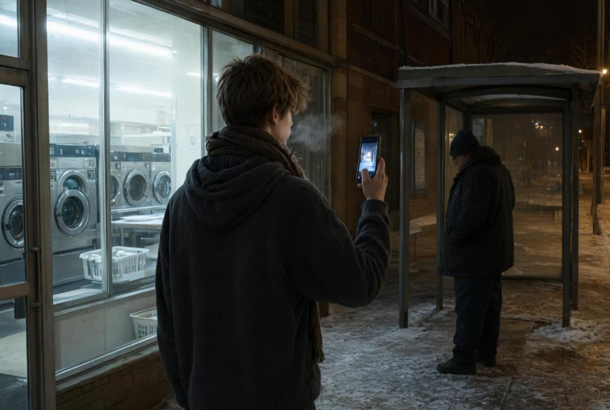
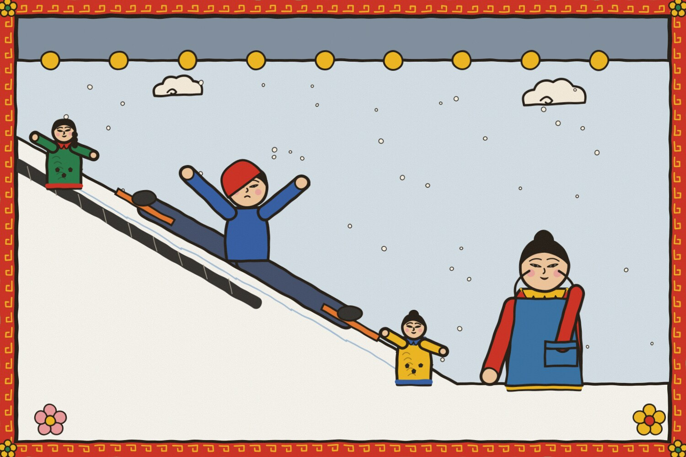

# 第三十八章　洗衣房

布雷登举机认恶客　徐好翔滑雪摔跟头

**拉法叶 19:10 · 成都 08:10（十三）**

老K的消息是七点零五分来的。

你妈今晚去不去洗衣房？

布雷登没回。他往上翻，一条一条往上翻，翻了一个月。几点出门。几点回。走哪条街。花好看吗。他一条都没回过，也一条都没删过，全截了图，存在一个文件夹里，文件夹的名字叫“作业”。

翻到最底下，他停住了。那是去年十二月的一条，那时候他还管这个人叫K哥，还觉得这个人懂他。

你两岁那年冬天，零下十度，你妈半夜抱着你走了。她跟你说过吗？

布雷登把这一行又读了一遍。这件事他不知道。他妈从来没说过。这个世界上知道这件事的，除了他妈，就只有当年家里那另一个人。

楼下，他妈在往塑料筐里塞脏衣服。家里那台洗衣机坏了一个月，修要两百，她说不修了，去街口那家投币的，四块钱一桶，没有烘干，湿着拎回来晾。

布雷登下楼，从她手里把筐接过去。

“我跟你去。”

布里看了他一眼。他一年多没跟她出过门了。她没问为什么，把围巾往他脖子上绕了一圈。

街上的雪化了一半，又冻上，踩上去咯吱咯吱。布雷登抱着筐走在前头，走两步，回头看一眼。

“你看什么？”布里说。

“没看什么。”

“你走路像你外婆。”她说，“走两步回头，走两步回头，怕后头有人。”

布雷登没接话，又往前走了两步，又回了一次头。

洗衣房在南街，一间长条屋子，日光灯，两排机器，一排坏了三台。布里往机器里塞衣服，塞一件抖一下。布雷登站在玻璃窗跟前，看着外头。

街对面是公交站台。最后一班车八点十分，现在七点四十，站台底下站着一个人。白，胖，下巴上一层沙色的胡茬，头上一顶种子公司送的鸭舌帽，帽檐压得很低。他没躲，就站在那儿，两只手揣在兜里，朝这边看。

布雷登推开门，过了街。

他站到那个人跟前，两个人隔着一步远。他比那个人高半个头。他把手机举起来，屏幕朝着那个人，上头是那个对话框，那个帽子头像。

那个人看看屏幕，又看看他。

“你长高了。”他说。

布雷登没说话。手机举着，手在抖，他没放下来。

*图一　手机举着，手在抖，他没放下来。*

那个人把帽檐又往下拉了拉，转过身，顺着街走了，走得不快，也没回头。

布雷登回过头。洗衣房的玻璃后头，他妈站着，手里举着手机，镜头对着街这边。她拍了。她的手是稳的。

**成都 10:00 · 拉法叶 21:00**

天府八楼是滑雪场，室内的，一面坡，雪是造的，冷气开得人鼻子发酸。

徐好翔租了两套，雪板，雪鞋，头盔，一共八百。汪蓉站在租赁柜台跟前看着那张小票，看了半天。

“八百？”

“八百。”

“你晓得我们一碗茶卖好多钱？”

“十五块。”

“五十三碗，还剩五块。”汪蓉说。她算账从来不用想。

徐好翔没接话，蹲下去给她穿雪鞋。雪鞋硬，扣子难扣，他扣了半天，扣得满头汗。汪蓉低头看着他的头顶，头顶上的头发少了，露出一块白，她以前没注意过。

上坡要站传送带，一条黑胶皮带子，慢慢往上爬。徐好翔站不稳，伸手抓汪蓉的胳膊，抓住了就没松，一直抓到坡顶。汪蓉看着前头，没甩开，也没看他。

“当着这么多娃娃，”她说，“你抓啥子抓。”

“我怕摔。”

“你摔了，我也扯不起你。”

“那就一起摔嘛。”徐好翔说。

初级道上全是娃娃，七八岁，一个比一个滑得溜。徐好翔一站上去就往后倒，一屁股坐在雪上。汪蓉伸手拉他，他一拽，把她也拽倒了。两个人坐在雪地上，旁边一个小姑娘嗖的一声从他们中间滑过去，回头看了他们一眼。

“你带我来做啥子嘛。”汪蓉说。她屁股底下是凉的，她没起来。

“三十年，”徐好翔说，“没带你出来耍过一回。”

“你屋头开的就叫耍起嘛。”

“那是让别个耍的。”

汪蓉没说话。她看着他，看他头盔歪在一边，下巴上的胡子没刮干净，两只手不晓得往哪儿搁。

教练过来了，二十出头的小伙子，扶他们起来，教他们把脚摆成八字，慢慢往下蹭。汪蓉蹭得慢，蹭得稳，一步一步，蹭到底，回头看。徐好翔在半坡上，两条腿越分越开，一点一点往下劈，劈成一个一字，动不了了。

汪蓉站在坡底下，看着他，笑了。她笑得很少，笑起来跟别人不一样，是先抿着，抿不住了，再一下子散开。徐好翔在半坡上听见了，抬头看她，看得忘了自己还劈着叉。

后来他们坐在坡底下的长凳上，一人一碗冰粉。徐好翔从兜里掏出两张卡，蓝的，往她手里塞了一张。

“啥子？”

“年卡。两张。”

“好多钱？”

“你莫问。”

“退了。”

“退不了。”徐好翔说，“我问过了。”

汪蓉把那张卡翻过来看了看，背面印着一个小人在滑雪，滑得很潇洒。她把卡揣进围裙兜里。她出门还系着围裙，系了三十年，忘了解。卡揣进去以后，她的手一直在兜里，摸着那张卡的边，摸了好一会儿没拿出来。

*图二　她站在坡底下，围裙没解。*

**拉法叶 21:20 · 成都 10:20**

旧牙科诊所二楼，达米安坐在那排屏幕跟前。马尼拉那边的人开着十几副身子，有的在扫地，有的在叠衣服，有的在给一个老头翻身。

他手机亮了一下，是那个服务器。

他是去年十二月进去的。有一天夜里睡不着，刷到一个视频，说女人都是这样，你不开口，她说你没开口；你开口，她说你逼她。底下有个链接，他点进去了。里头几百号人，一个比一个懂女人。他发过一条，就一条，说那年他在一个女人门口站了一夜，她没开门。底下四十七条回复，都说她在耍他，都说女人就是这样。他看完了，没再说话，也没走。

今晚七点四十一，总频道里有人发了一张截图。截的是一个私信对话框，头像是一顶帽子，名字叫老K。截图底下一行字：

老K是我爸。他现在站在我妈洗衣服的地方对面。

发的人叫B什么什么，十六岁的那种名字。

四十秒以后，这条没了。管理员删的。频道里有人发了一个笑哭的脸，有人发了一句“小子不懂事”，有人@了老K，老K的头像已经灰了。

那四十秒里，他截了图。值守干久了，手比脑子快，什么都先存一份。然后他就看着那块空出来的地方，看了一个半钟头。

他往上翻，翻到自己那一条，四十七条回复还在。他看了一会儿，点开设置，找到最底下那一行红字，删除账号。输密码，再输一遍。确认。

屏幕上，马尼拉那边那个老头翻了个身，面朝墙睡着了。

截图还在他手机里。他没删。他打开县法院的网页，翻到保护令那一页，从头看到尾，不知道这张截图该交给谁。那个B什么什么的孩子，他不认得；孩子他妈是谁，他也不知道。他把网页关了，又打开，又关了。

第三回打开，他没再找该交给谁。那一页最底下有个框，写的是“其他线索”。他把截图拖进去，名字那一栏空着，按了提交。

**拉法叶 22:00 · 成都 11:00**

河边那家老酒吧，礼拜二的晚上没几个人。伊内丝坐在吧台最里头，一瓶啤酒，喝了一半。她头发挽在脑后，挽得松，掉下来一绺，一件深绿的毛衣，袖子推到胳膊肘，胳膊是橄榄色的，冬天里白了一层。

萨凡纳在她旁边坐下，把一张对折的纸搁在吧台上，推过去。

“年三十那天晚上，说我男人那副身子是你卖的，”伊内丝没看那张纸，“是你吧。我认得这个声音。”

“是我。”

“你声音不小。”

“我知道。”萨凡纳说，“所以我先来找你。”

“为什么找我？”

萨凡纳想了一会儿。

“那天晚上我说那句话，说得那么大声，”她说，“你没回头。”

伊内丝把纸打开。纸是从一本样品册后头撕下来的，背面还印着半个肩膀的轮廓，三号。正面是萨凡纳的字，一条一条，跟她卖身子的单子一个格式。三个人。他家。礼拜三晚上九点以后。每一回都戴。谁说停，就停。顺序由萨凡纳安排。

伊内丝看完了，抬头看她。

“他是谁？”

“一个不用开口的男人。”萨凡纳说，“女人都是自己先开口。”

“长什么样？”

萨凡纳张了嘴，要说肩膀几号，下巴几号，腰几号。她说了好几年，张嘴就来。这回话到嘴边，她停住了。

“四十八。”她说，“手上全是采蘑菇划的口子。看人的时候，像在显微镜底下看东西。”

伊内丝把萨凡纳搁在吧台上的笔拿起来，在“顺序由萨凡纳安排”那一行上划了一道，旁边写：我定。又在最底下添了一行，字写得很重：

不许评身子。

萨凡纳盯着那一行。那是她的饭碗。她拿过笔，在那一行旁边签了自己名字的头一个字母。

“礼拜三。”伊内丝把纸折好，塞进自己毛衣兜里，“礼拜三我一个人。”

**拉法叶 23:10 · 成都 12:10**

卧室那面墙后头是邻居家的车库。三年了，蒲青才信那后头没有人。

“你妈元宵以后来，”路易斯说，“住哪间？”

“小屋。”

“小屋跟我们隔一面墙。”路易斯笑，“那你又要一声不出了。”

蒲青没答。他翻身压上去，把路易斯的两只手按在枕头上，按得很实。路易斯指尖上那些小疤，白的，蒲青把那几根手指头含进嘴里，一根一根地含。路易斯不笑了。

蒲青出声了。他是故意出的，一声比一声大，一声比一声整，好像要把这些年咬在手腕上咽回去的，一回出完，趁小屋还空着。路易斯看着他，看他耳朵红透了，手腕上那圈旧牙印，淡得快看不见了。

“你这是，”路易斯喘着说，“在练习？”

“存起来。”蒲青说。

后来路易斯先笑出来，笑得床直晃，蒲青压着他，跟着笑，笑完了，最后那一声出得最长。

后来他们并排躺着，听车库那边，什么声音都没有。

“明天蒲记风味开张。”路易斯说，“那个重庆老板今天又找我了。”

“找你做啥？”

“他托我问你，”路易斯侧过脸，“问你妈。‘蒲记’这两个字，她卖不卖。”

蒲青转过头看他。

“问我妈？”

“‘蒲记’是注册过的，注册人是你妈。”路易斯说，“他查过了。二十多年前，营业执照上也是她。你爸的名字，哪儿都没有。”

蒲青坐起来，伸手开了床头灯，又关了。

“我爸知不知道？”

“你爸，”路易斯说，“连营业执照挂在店里哪面墙上都不知道。”

蒲青想起来了。收银台后头那面墙，一个木框子，玻璃上全是油烟，黄的，看不清里头的字。他从小在那面墙底下写作业，写了十年，一回都没抬头看过。

**拉法叶 23:50 · 成都 12:50**

警察是九点来的，两个，一男一女，在洗衣房门口站着把笔录做了。布里把那张照片调出来给他们看，帽檐底下那半张脸，胡茬，下巴。女警察问她认不认得。

她说认得。她说了他的名字，科迪，说了他的姓，说了他的生日，说完了，她站在洗衣房门口，手里拎着湿衣服的筐，站了一会儿。十四年，她头一回把这个名字说出口。

女警察记下来，说明天上午法院一开门，她把名字填进那张表，照片附上，临时令就能送达。

“送到他手上以后，”女警察说，“他再往那个站台底下一站，就是违令。那时候我们就能抓。”

现在是夜里十二点差十分，湿衣服挂了一屋子，暖气片上，椅背上，楼梯扶手上，滴滴答答。布雷登坐在厨房桌子跟前，他妈坐在他对面。

“他没打过你。”布里说，“他打的是我。”

布雷登没动。

“你两岁那年冬天。在楼梯上，就一回。”她说，“我抱着你走了两英里，走到教会。教会的人给我倒了一杯热水，叫我回去，说一家人要在一起。我没回去。”

“为什么没跟我说？”

布里想了一会儿。

“说了，你就有一个这样的爸。”她说，“不说，你就是没有爸。我觉得没有，好一点。”

布雷登看着桌子上那筐湿衣服。最上头一件是他的卫衣，袖子还在往下滴水，滴在桌面上，积了一小摊。

“明天你几点回？”他问。

布里张了嘴，还没答。

“我去接你。”布雷登说。
