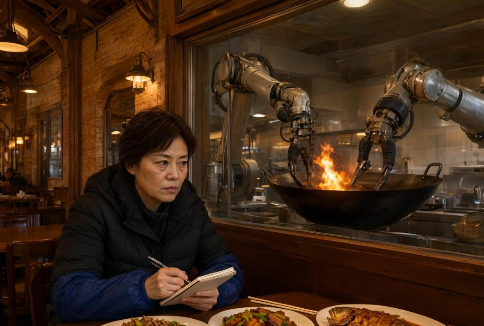

# 第三十九章　蒲记风味

机器回锅无灯盏　三人夜宵吃平菇

**成都 22:30 · 拉法叶 09:30（十三）**

茶馆楼上就一间半屋，半间是灶，一间是床。楼板薄，后屋的麻将声一直往上冒，哗啦啦的，到十点半才歇。

汪蓉坐在床沿上解围裙。带子在后腰打的是死结，三十年都打死结，她反手摸了半天没摸开。徐好翔蹲到她背后去解，指甲剪得秃，抠了好一阵。

结解开了。围裙从她腰上滑下来，兜里那张蓝卡掉在床单上，背面那个小人朝上，还在滑。

窗台上趴着那只花猫，十几年前自己走进茶馆的，不是哪个养的。这一冬它老了，不下楼了，天天睡窗台这一块，白天太阳晒得到。

徐好翔看着那只猫，说了一句：“老话说，猪来穷，狗来富，猫来披孝布。”

“老话是猫来穷，狗来富。”汪蓉说，“孝布是哪点来的？”

“我添的。”

“你又要冲壳子了。”

“冲啥子壳子。”徐好翔说，“猫儿要啥子？身体好，有个人给它挠，没人挠，它自己也睡得着。”

“猫哪个都不认得，就认热板凳。”他说，“人坐热了，站起来走咯，它就趴上去。人它不管，它要的就是那点热气。”

汪蓉没接。

“它年轻的时候，一天换十几根板凳。”他说，“老了，就睡一块。你把它抱到别处去，它要闹，闹三天。闹完了，在别处也睡得好好的。”

汪蓉看着他。

“今天你把我抱到雪地上去了。”

“嗯。”

“我闹过没得？”

“闹了。”徐好翔说，“你笑了。”

她把毛衣从头上脱下来。里头那件秋衣洗得发薄。她五十三了，腰上一圈软肉，左胳膊上有一块旧疤，是二十年前提铜壶烫的，颜色比别处浅。徐好翔的胸口是平的，肚皮比胸口高，裤腰勒出一道红印子。两个人都没关灯，眼睛却都看着窗台上那只猫。

徐好翔的手是凉的，从秋衣底下伸进去，贴在她背上，贴了一会儿，捂热了，才往前挪。汪蓉缩了一下，没躲。

“你手跟雪一样。”

“刚刚摸了猫。”

三十年，他们做这个事有个次序：她先躺，他后躺，灯关了才动，动完了他去灶上烧水。今天次序乱了。灯没关，她也没躺，就坐在床沿上，他跪在地板上，膝盖底下垫的是那条围裙。他把脸埋在她肚子那圈软肉上，埋了很久，她低头看着他头顶那块白，伸手盖住了。

后来她往后一倒，把他也拽上来，跟在雪地上一样。她攥着他背上的秋衣，攥出一把褶子。她是一句是一句的人，这种时候一句都没有，只有呼吸，一口比一口长。到最后她拿额头抵住他的肩膀，抵得死死的，那口气憋到了头，才放出来。

“八百块，”她贴着他的肩膀说，“值了。”

后来徐好翔去灶上烧水。水开了，他没倒，站在灶前头听楼下。楼下什么声音都没有了。窗台上那只猫睡着了，睡在白天晒热、这会儿已经凉透了的那一块。

*图一　哪根板凳热，它就睡哪根。*

**拉法叶 18:20 · 成都 07:20（十四）**

老火车站的厨房玻璃擦得透亮。除夕那天晚上，玻璃后头是一双借来的手。今天是两条机械臂，银灰色，关节上包着黑橡胶，装在一个带轮子的不锈钢架子上，下午从印城拉过来，插上电，就算开张了。

梅姐的老客人来了一百多个，都是来看稀奇的。

蒲青和路易斯坐在靠窗那一桌。重庆老板站在出菜口，扯起嗓子喊：“蒲记风味，成都老师傅五十年的手艺！”

机械臂的动作是拿网上几百条视频喂出来的，食客拍的，店里过年拍的，叫“风味版”。蒲青看着玻璃后头那口锅。锅往下一沉，半寸，再往上一抛，肉片在空中翻个面，落回锅里。起锅之前，勺子在锅沿上敲了两下。

铛，铛。

蒲青的筷子停了。这两声他从小听到大。他在收银台后头那面墙底下写作业，一听见这两声，就该放下笔，去出菜口端盘子。四十年，他爸一直这么敲，敲给跑堂听，后来没有跑堂了，敲给他听，他走了以后，不知道敲给谁听。

回锅肉端上来了。

蒲青夹了一片。第一口是他爸的，豆瓣、蒜苗、糖色，都对。嚼到第二下，他知道不对了。他爸的回锅肉，肉片一下锅就卷，卷成一个一个的小窝，边上焦，中间汪着一点油，他小时候管它叫小碗。这一盘的肉是平的，一片一片贴在盘子上。

“像吗？”路易斯问。

“第一口像。”

隔壁桌坐着重庆老板的老婆。四十多岁，短头发，黑羽绒服，袖子上套着一对蓝袖套。她面前三个盘子，一双干净筷子，每道菜夹一口，嚼，咽下去，在一个小本子上写一行。

*图二　每道菜夹一口，在一个小本子上写一行。*

老板凑过去：“啷个样？”

“腰花要得。回锅肉，肉没卷起。干烧鱼，糖放重了。”她合上本子，“招牌不换，味道我们自己调。”

她走到蒲青这桌坐下，抽了一张餐巾纸，写了一行数字，推过来。

“一年三万美金。”她说，“以后每开一家店，营业额再加一个点。这个给你妈。”

“为什么不找我爸？”蒲青说。

“名字不是你爸的。”她说，“我们查过了。”

蒲青拿手机拍了那张餐巾纸，又对着玻璃后头拍了一段：锅沉半寸，抛，翻面，落，铛，铛。

视频他发给了他爸。餐巾纸那张，他发给了他妈。

路易斯在旁边看着他分。

“菜给你爸，”路易斯说，“钱给你妈。”

“从小就这样。”蒲青说。

**拉法叶 19:00 · 成都 08:00**

丹尼丝那栋旧教堂改的楼，门廊灯还是那一盏，灯罩里的死虫子没人清。

伊内丝把车停在门口，没熄火。小女儿抱着琴盒先下了车，琴上是新换的E弦。

西奥站在门廊上，手里也拿着一个琴盒，旧的，四个角缠着胶布。

“储藏室里翻出来的。”他说，“我九岁拉的那一把。”

小女儿蹲下去开他那个。琴是四分之三的，正合她的个子，弦松了二十多年，一根都不在音上。

西奥拧不了弦轴，手一碰就抖。小女儿自己拧，他在旁边听。

“高了。”

她往回拧一点。

“还高。”

“爸，你怎么听得出来？”

“手不行了，”西奥说，“耳朵还行。”

伊内丝坐在车里，隔着挡风玻璃看。小女儿把琴架到下巴底下，拉一个长音。西奥站到她背后，把手搭在她拿弓的那只手上，想帮她把弓压稳。他的手抖，抖进了弓里，那个长音跟着一颤一颤的。

小女儿笑起来：“你在帮我揉弦。”

西奥也笑了，手没拿开。

伊内丝看着那只手。初一早上它在厨房桌子上抖得停不下来，今天搭在一把琴弓上，抖得没那么厉害了。第三个礼拜。剂量是剂量。

她摇下车窗。

“明天早上七点半，我来接。”

“好。”西奥说。

她把车开出去。开到街口，等红灯，后头那栋楼里又传出来一个长音，先是抖的，抖着抖着，稳住了。是孩子自己拉稳的，还是他的手稳了，她分不出来。

**成都 08:40 · 拉法叶 19:40**

蒲记的卷帘门拉起来一半。老蒲在案板跟前切二刀肉，铁子在后头刷锅，刷得哗哗响。

手机在围裙兜里震了一下。是蒲青发来的，一段视频，一个字没有。

老蒲在围裙上把手擦干，点开。铁子凑过来，下巴快搁到他肩膀上了。

玻璃后头一口锅，两条银灰色的胳膊。锅往下一沉，半寸，抛，肉片翻个面，落回去。起锅之前，勺子在锅沿上敲了两下。

铛，铛。

“它敲啥呢？”铁子说。

老蒲没答。他抬头看了一眼收银台后头那面墙，墙上那个木框子，玻璃黄得看不清里头的字。墙底下原来有一张小桌子，现在上头摞着蒸笼。

视频最后几秒是一盘回锅肉，凑得很近。肉片平平地贴在盘子上。

老蒲按住语音键。

“肉没起灯盏窝。”

他松开，发出去了。手机还拿在手里，他看着那一盘平的肉，又按住了。

“……你吃了没得？”

发出去了。

铁子转过身去刷锅，刷得比刚才还响。

老蒲第三回按住语音键，按了好几秒，没说话，手指往上一滑，那一条没发出去。他把手机揣回围裙兜里，接着切肉，一刀一片，片片一样厚。

**拉法叶 21:00 · 成都 10:00**

伊内丝来晚了七分钟，头发上落着雪。她进门先没看人，看的是墙：一面墙的书，另一面墙上那张黑白照片，一格一格的。

“这是什么？”

“一片芯片，放大两万倍。”邵昌说，“坏一格，整片就扔了。”

“那你今天晚上别看。”伊内丝说。

邵昌眼睛笑了一下，嘴没笑。他去冰箱拿了两瓶啤酒，一瓶给她，一瓶给沙发上的萨凡纳。萨凡纳接了，搁在茶几上，没开。萨凡纳早到了一刻钟，坐得笔直。来的路上她在心里排过一遍，谁先，谁后，谁在哪儿，排了一路。

伊内丝从毛衣兜里掏出那张纸，打开，铺在茶几上，手指在“我定”那两个字上点了一下。

萨凡纳排了一路的那些，就那么一下，都没了。

卧室里多了一台电暖器，新的，标签还挂在上头。书架第三层，两本厚书中间，一盒套子拆开了，一个一个排得整整齐齐，间隔一样宽。

伊内丝看着那一排，笑出了声。

“你这是摆实验台？”

“耗材。”邵昌说，“用一个，补一个。”

伊内丝转过身来，对萨凡纳说：“你先看。”

萨凡纳在床沿上坐下了。她这辈子没坐在边上看过。

伊内丝自己脱。不快，一件一件叠好，搁在椅子上。萨凡纳看着她，眼睛管不住，一档一档地往上对：肩膀比三号宽，比五号厚；腰没有号，样品册里就没有这样的腰；腿粗，结实。她卖得最好的那一副身子，跟这一副摆在一起，像橱窗里的模特。伊内丝的皮肤是橄榄色的，一冬天捂白了一层，小肚子往下坠，肚皮上有几道浅浅的纹。纹底下，一道横着的疤，十几公分，颜色比旁边浅，边上微微鼓起来。

邵昌在她跟前蹲下来，看那道疤，看得很久，一寸一寸地看。萨凡纳知道这个看法，那天晚上他就是这么看她的。

“看出什么来了？”伊内丝说。

邵昌张了嘴。

伊内丝竖起一根手指：“不许评。”

邵昌笑出声来了，这回嘴也笑了。他把嘴闭上，凑过去，把嘴唇贴在那道疤的一头，顺着它，一点一点挪到另一头。伊内丝低头看着他，呼吸变了，手插进他头发里，抓住了。

萨凡纳发现自己攥着被角，攥得指节都酸了。

后来伊内丝把邵昌推倒在床上。他伸手从书架上取了一个，撕开的声音在屋里很响，不慌不忙，跟进超净间之前戴手套一样。伊内丝个子大，往床上一坐，床都陷下去一截。邵昌也不躲，抬头看她。她好像早就知道自己要什么，只是来取。

她没回头，手往后一伸，抓住了萨凡纳的手腕。

“你过来。”

萨凡纳过去了。伊内丝侧过身吻她，嘴里有啤酒的苦味，嘴唇厚，软，不急。萨凡纳没吻过女人，她身上哪一块该配哪一号，她一眼就看得出来，可是不在样品册里的女人，她一个都没碰过。伊内丝把她的手拉过去，按在自己胸口上，沉的，热的，底下心跳得很快。萨凡纳的手停在那儿，什么都没算。

中间邵昌换了一个。伊内丝说：“她。”就一个字。

萨凡纳习惯了在上面，习惯了定节奏，习惯了看着男人的脸，算他什么时候到。这回她看不见他的脸，她面前是伊内丝的脸。伊内丝捧着她的脸，就那么看着，看得很专心。萨凡纳这辈子都是看脸的那个人，今天被看的是她。她想把脸转开，伊内丝不让，拇指搁在她颧骨上，轻轻按着。

“别算了。”伊内丝说。

她就不算了。她叫出来了，声音大得自己都吓了一跳。

再后来就乱了。两个女人都想让他先撑不住，抢着来，额头撞在一起，咚的一声。三个人都愣了，然后伊内丝先笑，萨凡纳跟着笑，邵昌躺在中间，笑得肚子一起一伏，这是她们头一回听他笑出声来，笑了很久。

“不急。”他说。

他就是不急。她们快，他慢；她们抢，他等。电暖器嘀嗒嘀嗒地响，樟脑味的被子早蹬到地上去了。三个人扣成一团，分不清哪只手是谁的。

伊内丝在他耳朵边上说：“现在。”

伊内丝一点都不压声音，十几年在自己家里压着，这一回全放出来了，喊得窗玻璃都在响。邵昌一直没出声，眼睛一直睁着，最后长长地出了一口气，额头抵在伊内丝的锁骨上，半天没抬起来。

后来三个人并排躺着，谁都没说话。萨凡纳看着天花板上那道裂缝，从灯座一直裂到墙角，弯弯曲曲的。上一回她看了半个钟头，今天她才看清楚，那道缝中间分了一个岔。

**成都 10:30 · 拉法叶 21:30**

公证处在区政府后头一栋小楼里，二楼，门口一块牌子，底下一行小字：本处公证员均为真人。

严嬢嬢九点五十到的。老温九点半就到了，站在门口，手里拿一个塑料袋，袋子里是户口本。

“拿到了？”

“拿到了。”

“他问没得？”

“问了。”老温说，“我说了。他没说话，叫无人机送过来的，里头夹了一张条子。”

“写的啥子？”

老温把条子拿出来给她看。条子上就一行字，是温涛的字，比他爸的板书好看：爸，签好了说一声。

严嬢嬢看了，叠好，还给他。

公证员是个四十多岁的女的，短头发，说话慢，一句一句地问。问他们是不是自愿的，问有没有人逼，问知不知道签了以后是什么意思。

“晓得。”严嬢嬢说，“哪天他躺到医院头，说不出话了，我签。哪天我躺到了，他签。”

“对。”公证员说，“表上这一栏，跟委托人是什么关系，你们写什么？”

老温拿着笔，看严嬢嬢。

“写朋友。”公证员说，“一般都写朋友。”

“耍朋友。”严嬢嬢说，“少写一个字都不对。”

公证员抬头看了她一眼，嘴角动了一下，没说什么。老温在那一栏写了三个字：耍朋友。字是一笔一画写的，跟板书一样，横是横，竖是竖。

签完了字，公证员又说了一条：签了以后有十五天，谁想反悔，都可以来撤，不收钱。

“冷静期？”老温问。

“差不多是这个意思。”

“我们冷静了六年了。”严嬢嬢说。

公证员这回笑出了声。她把两份东西各盖了一个章，递过来，又报了一个数。

两个人同时伸手，在桌角那块板子上扫了一下，一人扫一半。板子嘀了两声。

出了门，下楼梯。楼梯是水磨石的，滑，老温下在前头，下一级回一次头，没伸手。严嬢嬢扶着栏杆下来，下到底，把那份东西揣进棉袄里头那一层，跟那张有茶碗印子的纸放在一起。

“我那个女儿，”她说，“说证莫领。”

“这个不是证。”老温说。

“那就是张纸嘛。”严嬢嬢说，“纸，她又没说莫领。”

街边已经有人在挂灯笼了，红的，一串一串，挂歪了，有人在底下喊往左一点。

“晚上几点？”老温问。

“七点。”

“六点半。”

严嬢嬢看着他，看了一会儿。

“六点五十。”她说。

**拉法叶 03:10 · 成都 16:10**

三点多，三个人都饿了。

邵昌在厨房炒平菇，蒜切得碎碎的，油一热，香味冲起来。伊内丝穿着他一件旧毛衣，袖子长出一截，腿光着，盘在厨房的小椅子上。萨凡纳套着他的衬衫，扣子扣错了一颗，没管。

三个人就着锅吃，一人一双筷子。伊内丝吃了两碗饭。萨凡纳看着她吃，想起年三十那天晚上，她跟同桌的人说，那个女人一看就没节过食。现在她看着伊内丝把第二碗饭扒干净，觉得这句话说得一点都没错，就是那天说的时候意思不对。

伊内丝放下碗，把那张纸从毛衣兜里又掏出来，摊在桌上，拿过邵昌搁在冰箱上的笔，在最底下添了一行：下礼拜三。

她把纸推到萨凡纳跟前。萨凡纳看了看，又看邵昌。

“我礼拜三有夜班。”邵昌说。

“那就礼拜四。”伊内丝把“三”划了，改成“四”。

萨凡纳拿过笔，在旁边签了她名字的头一个字母。签完了，她发现自己在笑，笑得不早也不晚。

邵昌把那张纸折好，压在了盐罐子底下。

**成都 17:30 · 拉法叶 04:30**

二嬢家在郫都的田坝头，一楼一底的砖房，门口一块晒坝，晒坝外头就是豌豆地。

蒲嬢嬢在灶房里炒豌豆尖，锅里的油响得噼里啪啦。手机在围裙兜里，那张照片早上八点半就到了，一张餐巾纸，一行字，一个数。她看了一天，看一回，锁一回屏。

二十多年前，她在工商局排了三天的队。老蒲在灶上，说这些纸你去弄。经营者那一栏，她写的是自己的名字；字号那一栏，她想了一下，写了“蒲记”。

二嬢从外头进来，手里拿着手机，脸垮着。

“苗苗她妈发的。”她把手机往灶台上一搁，“公司不放，十五回不来。说录个视频，到时候放给我看。”

蒲嬢嬢把豌豆尖铲起来，装盘。

“六十岁，”二嬢说，“一辈子就这一回。她发视频。”

“上海远嘛。”

“远个铲铲。飞机两个钟头。我想好了，她不回来，我也要整。坝坝宴，整二十桌，把村里头的都喊来。”

“哪个来掌勺？”

“你屋头那个。”

“他都不算我屋头的人了。”

“离了更好请。”二嬢说，“还是姐夫那阵，我都不好意思开口喊他做活路。”

蒲嬢嬢没接话，手伸进围裙兜里，摸到了手机，攥住了。

“你包包头揣的啥子，揣了一天了？”二嬢说。

“蒲青发的。”蒲嬢嬢说，“美国那边的菜。”

二嬢看了她一眼，没再问。她拿起自己的手机，翻出老蒲的号码，开了免提，搁在灶台上。

响了五声，通了。那边有剁肉的声音，咚，咚，咚，停了。

“姐夫，”二嬢说，“十五那天，我满六十。你来郫都，给我整坝坝宴。”

那边没声音。灶上的油还在响。蒲嬢嬢站着，手还攥在兜里。

过了好一会儿，老蒲说话了。

“几桌？”
