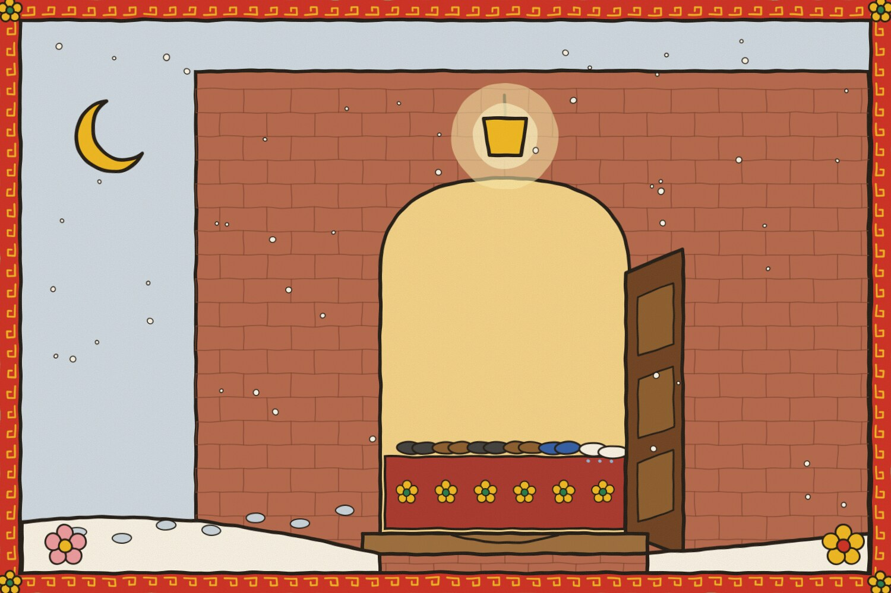

# 第四十章　门槛

优素福一步跨门槛　路易斯单膝跪厨房

**成都 18:00 · 拉法叶 05:00（十四）**

后屋门口贴了一张红纸，汪蓉写的，字是歪的：六十岁以上，不收茶钱。

躺椅早就摞到墙角去了，三十摞，摞得比人高。中间那张麻将桌还在，又从前头搬进来两张。下午三点开的门，到六点，三张桌子都坐满了，后头还站着两个等位子的。

老邓坐在靠门那一桌，脚边趴着铁锅。铁锅老了，嘴边一圈白毛，趴下去就不想起来，尾巴偶尔扫一下老邓的鞋。

“天府那边打电话来了。”老邓摸了一张牌，没看，先说，“说耳朵上取的那块肉，养活了。”

“好久出来？”对家问。

“说是秋天。”

“秋天你还认得到它不？”

“认得到。”老邓把牌拍下去，“它认不认得到我，那就说不清楚了。”

一桌人都笑了。老邓自己没笑，低头看了一眼桌子底下那条真的，拿脚尖碰了碰它的肚皮。铁锅哼了一声，没睁眼。

老范坐靠里那一桌，一边摸牌一边编，说门口那张红纸是他提的。汪蓉说她没听他提过。他说是她梦里头听的，她醒了就忘了。黄嬢嬢坐他下家，不接话，碰了他一张，又碰了一张。

严嬢嬢和老温是六点钟来的，没打牌，一人要了一碗茶，坐在门边上喝。六点四十，两个人起身，往文化公园那边走。汪蓉过去收碗，两个碗底下各压着一沓纸票子，一张十块，一张五块，压得端端正正。她站了一下，把钱收进围裙兜里，没喊他们。

徐好翔站在门口看，手里端着茶碗。汪蓉提着铜壶从他身边过去，一碗一碗掺过去，掺一碗，说一声“慢点烫”。

靠里那一桌吵起来了，一个说对家悔牌，一个说牌没落地不算。两个老头都扭过头来看门口。

徐好翔的扇子朝悔牌那个点了一下。“两碗茶钱。”

“今天不收茶钱。”那老头指着门上那张红纸。

徐好翔看了一眼红纸，把扇子收了。“那就给铁锅买根火腿肠。”

“一天少收好多？”她掺完了，站到他旁边。

“四十来碗。”

“六百。”

“嗯。”

“八百块钱的雪都耍了，”汪蓉说，“六百算啥子。”

“靠窗那个老头，前天走了。”她又说，“他儿子今天来结账，赊了四十几碗。”

“莫收。”

“收都收了。”汪蓉说，“人家儿子要结，你不要，是打他老汉儿的脸。”

她说完就回前头去了。徐好翔看着她的背。围裙带子在她后腰上系着，三十年都是死结，今天是个活结，两只耳朵翘着，一走一晃。

**成都 19:10 · 拉法叶 06:10**

重庆老板的电话是六点五十打来的。印城那边天还没亮，他嗓门照样大。

他说昨天晚上的事，说机器炒的回锅肉肉片不卷，说他老婆尝了一口就晓得差在哪儿。他说想请蒲师傅去印城住两个月，不上灶，就站在机器旁边看，看出来哪儿不对，说一声，工钱好说。

“名字的事，”他说，“我们跟嬢嬢那边在谈，价钱都报了，一年三万美金。你莫管，你管好你的灶就是了。”

老蒲挂了电话，在灶前头站了一会儿，然后搬了一根板凳到收银台后头，站上去，把墙上那个木框子取了下来。

框子上一层油，黄的，厚的，拿指甲刮得下来。他接了一盆热水，兑了碱，拿抹布一点一点擦。擦到第三遍，玻璃底下的字出来了。营业执照。字号：蒲记。经营者那一栏，三个字，是她的名字。他认得这三个字，四十年没念过。

卷帘门响了。蒲嬢嬢从郫都回来拿甑子，二嬢要整二十桌，屋头那几个锅不够大。她进门先看见的是收银台上那个框子，玻璃擦得透亮，灯底下照得出人影。

她站住了。

“你晓得了。”

“重庆那个打电话来了。”老蒲说，“他说跟你在谈。”

“我还没回他。”

“你没回他，”老蒲说，“也没跟我说。”

蒲嬢嬢把包放在桌子上。

“跟你说啥子？说这块牌子上写的是我的名字？你二十几年没抬头看过一眼。”

“招牌是我一铲一铲炒出来的。”

“名字是我排了三天队去办的。你莫过河拆桥。”蒲嬢嬢说，“那年腊月，工商局门口，我揣两个冷馒头，排了三天。你在灶上。你说这些纸你去弄，你填不来那些表。我填得来。表上要填字号，我想了一哈，写了蒲记。我要是写个王记、李记，你这二十几年炒的是哪个的？”

老蒲没说话。

“初八那张纸，”她说，“店是你的，灶是你的，租约是你的。名字，哪个都没写。你没想起来，我也没想起来。”

“你现在想起来了。”

“是人家先想起来的。”

两个人隔着那个框子站着。灶上的火没关，小火，锅里煨着明天要用的高汤，咕嘟咕嘟的。

“三万美金。”老蒲说，“一年。”

“你也晓得了。”

“你卖嘛。”

“我说了卖？”

“你也没说不卖。”

蒲嬢嬢看着他，看了很久，然后伸手把那个框子拿起来，翻过来，背面朝外，靠墙立在收银台底下。

“明天你还去不去郫都？”

“答应了的。”

“那甑子你帮我搬。”她说，“我一个人搬不动。”

**成都 20:30 · 拉法叶 07:30**

钱维岳的房子在虞山脚下，老宅子，三进，后头一进是他住的，前头两进空着，门上的锁都锈了。

近邻的护理机器人站在床边，白壳子，手是软的。开它的人在成都，躺在自己床上，是何蔓。这几天，她每天给这个老头翻三回身，喂两回饭，擦一回澡，一句话都没听懂过。

乐子坐在床头那把藤椅上。他是十一那天从杭州过来的，原说待一天，待到今天。

老头今天精神好，眼睛亮。那双眼睛是新换的，亮得跟那张八十岁的脸不配，看什么都太清楚。

“我讲，”老头说，“你翻给她。”

“你讲好了。”乐子说。

“她给我翻身，手先搁在我背上，搁一下，再翻。”老头说，“别个开的时候，一把就翻过去了。她不是。她搁一下。”

乐子翻过去了。机器人站着没动，过了两秒，发出何蔓的声音，普通话：“嗯。”

“我老婆以前就是这样。”老头说，“她走了二十年了。二十年，没得人先搁一下再翻我。”

乐子翻了。这回机器人没出声，那只软手抬起来一点，又放下了。

“还有一样。”老头说。他把被子底下的手伸出来，枯的，指甲倒是剪得很齐，是何蔓剪的。“我死了，莫埋在虞山。他们姓钱，我也姓钱，他们不认我，我也不认他们。送我回杭州，埋在我妈旁边。南山那边，你晓得的。”

乐子晓得。他爸也在那边。

“你写下来。”老头说，“写了我按手印。不然你讲了，没得人信你。”

乐子从包里翻出一个本子，撕了一张，照着老头的话写。写一句，念一句，老头点一回头。写完了，老头要了印泥，按了右手大拇指，按得很重，按完了看了半天，像在看别人的东西。

“好了。”他说，“讲了一辈子，总算有个人听懂了一回。”

他闭上眼睛。机器人走过去，把他的手放回被子里，先搁在他手背上，搁了一下，才把被子掖好。

乐子把那张纸叠成四折，放进贴身的兜里。

“我睡沙发。”他说。

前头那一进有一张老藤沙发，落满了灰。他拿袖子掸了掸，躺下去，两条腿伸不直，搁在扶手上。

**成都 21:30 · 拉法叶 08:30**

九点半，“后屋”那个群里，铁子发了一张照片。

照片是在城北一个冷链物流园拍的。冷链车的后门敞着，里头码到顶的冻猪肉，白气往外冒。铁子穿一件军大衣，袖子撸到胳膊肘，肩膀上扛着一扇。

“力工的夜班嗷。三车冻肉，卸完回去睡四个钟头，明早给老爷子打荷。”

蒲记打荷那点钱，不够他在成都租一张床。近邻那边他接不了单，无犯罪记录那一栏，他填不了。剩下的就是这个，一扇猪八九十斤，扛一扇两块。冷库里头，机器的关节爱打滑，人不打滑。

王鹏第一个回，回的是一张图。图是他自己做的，跟腊月里那张金字塔一个路数，标题叫《后屋人设图鉴》，四个格子：力工，铁子；小仙女，梓涵；舔狗，乐子（十年沙发）；病娇，空缺，招聘中。

“力工咋了？”铁子回，“力工挣的是干净钱，扛一扇是一扇。你那抽象一个月挣几个子儿？”

“比你多。”

“那你也来扛。”

梓涵在后屋那张歪沙发上刷到了。她这几天就睡在那儿，十五块钱一晚上。

“小仙女是啥子？”她打字，“你们那辈骂人的话嗦？”

唐蕾发了一个：“乐。”

“骂就骂嘛。”梓涵又打了一行，“仙女睡沙发，十五块钱一晚上，账还挂起的。你喃？你睡的那张床，是你妈的。”

王鹏没回这一条。

过了一会儿，乐子也回了。他在虞山脚下那张落灰的藤沙发上躺着，腿伸不直，搁在扶手上。

“十年沙发，一分钱房租没交过。谁舔谁？”

何蔓一直没出声。她在常熟，开着那个机器人，老头睡着了。过了十来分钟，她腾出一只手，回了一条：

“你漏了一个。舔狗：王鹏。证据：钟姐说，汤端得稳。”

唐蕾连发了三个“乐”。王鹏打了一个“典”，删了，把那张图撤回了。撤回的提示刚冒出来，铁子就发了一张截图，图鉴原样，舔狗那一格，有人拿红笔添了两个字：王鹏。

“存档了嗷。”

**拉法叶 09:00 · 成都 22:00**

冉峥把车停在土路口上。车不进院子，这是规矩，戴尔的面包车也不进。

路口有一个小木棚，刷过白漆，漆掉了一半，里头是一部座机电话，几家人合用的。莉迪娅从车上下来，抱着那个饼干铁盒，走进棚子里。

她打开盒子，手机躺在里头，屏幕是黑的。她把手机拿出来，搁在座机旁边那块木板上，跟一本记电话号码的旧本子挨着。

“以后哪家有急事，”她说，“都能用。”

冉峥站在棚子外头。棚子太矮，他进不去。

“医院再打电话，”莉迪娅说，“打你那个号码。”

“嗯。”

“药做好了，你来告诉我们。你不用进院子，在这儿按喇叭，按三下，汉娜就晓得了。”

“好。”

她从棚子里出来，把空了的饼干盒递给他。盖子上那一圈姜饼人，颜色褪得差不多了。

“盒子给你。”

冉峥接过去。那个盒子在他手里显得很小，像一个火柴盒。

“春天我要受洗了。”莉迪娅说，“主教说，我想好了，就去上课。我想好了。”

冉峥点了点头。他不问为什么，他从来不问为什么。

“受了洗，”莉迪娅说，“就不能坐你车前头了。”

“后头也能坐。”

莉迪娅笑了一下。她抬头看着他，他太高了，她得仰着脸。

“你下巴上那个坑，”她说，“我摸过一回。”

“嗯。”

“够了。”

她转身，顺着土路往里走，走得不快，黑裙子底下那双靴子踩在冻硬的车辙上，一步一步。走到第一个弯，她没回头。

冉峥站在棚子边上，手里拿着那个饼干盒。盒子是空的，里头还有一点姜和糖的味道，很淡。

*图一　盒子是空的，里头还有一点姜和糖的味道。*

**成都 23:20 · 拉法叶 10:20**

何蔓下了班，从床上坐起来，取下眼镜，坐了好一会儿才站起来。腿是麻的。

王鹏在楼底下等她。他没说要来，他就来了，手里拿着两个糖油果子，用一张油纸包着，已经不热了。

“十四，灯会开了。”他说，“文化公园。”

“我不耍朋友。”

“我知道。”王鹏说，“我也不耍。我就是去看灯。”

公园里人多。灯都挂起来了，一条龙从这头盘到那头，龙头比房子还高，眼睛一闪一闪。何蔓走在前头，王鹏走在后头半步，人挤过来的时候，他就往她那边侧一下身子，替她挡着。

“那个老头，”何蔓说，“今天说话了。”

“你听懂了？”

“乐子翻的。”她说，“他说我给他翻身，手先在他背上搁一下，再翻。他老婆以前也这样。”

王鹏没接话。他把一个糖油果子递给她，她接了，咬了一口，芝麻掉在她那件大外套上。

“我也有个毛病。”王鹏说，“端碗的时候，这根指头要翘起来。改不掉。”

“我晓得。”何蔓说，“天府那些机器人都学去了。”

“学去了就学去了。”

前头一群人往龙头那边挤，把他们两个挤到一块儿。何蔓伸手抓住了他的胳膊，抓了一下，等人过去了，又放开了。

“明天元宵，”她说，“我回我妈那儿。两个碗。”

“我给钟姐送汤圆。”王鹏说，“她一个人。”

何蔓点点头，把剩下半个糖油果子吃完，把油纸叠成一个小方块，塞进他手里。

**拉法叶 13:00 · 成都 02:00（十五）**

迦勒提着一袋外卖站在清真寺门口。单子上写的是阿丝玛的名字，二十份饭，给晌礼以后留下来的老人吃。

门是开着的。门口那盏灯白天也亮着，灯罩底下一圈暖黄。

他耳朵里塞着那只耳机，里头那个男人的声音又在讲，讲这里的人软，讲真的道在别处，讲要走得远，走得干净。他听了一个冬天了，听得那个声音比自己的还熟。

阿丝玛从里头出来接饭。

“进来。”她说，“外头冷。”

“我送到门口。”

“二十份，”阿丝玛说，“我一个人提不动。”

迦勒看着门槛。木头的，中间磨得凹下去一道，是几十年的鞋底磨出来的。

他把耳机从耳朵里取下来。那个声音还在讲，变小了，在他手心里嗡嗡的。他把它塞进外套口袋，拉上拉链。

然后他抬脚，跨过去了。

里头比外头暖。一排鞋摆在门边，他蹲下去，把自己那双沾了雪水的运动鞋也脱了，摆在最后头。礼拜已经完了，几个老人坐在地毯上，有人在叠拜毯，有人在说话，说的是他听不懂的话，也有人说英语，说今年的雪比去年多。

他把饭搁在靠墙的长桌上，一份一份摆开。摆完了，他没走，在门边上坐下了，靠着墙，腿伸着。

阿丝玛给他端了一杯茶，搁在他脚边，什么都没问，转身去分饭了。

口袋里那个东西还在嗡嗡响。他没掏出来。

*图二　最后那一双鞋，还是湿的。*

**拉法叶 16:30 · 成都 05:30**

路易斯回来的时候，手里拿着一张纸，打印的，还是热的。

蒲青在厨房切葱。他妈早上打过电话来，成都那边是晚上，她在蒲记，说了很久，说框子，说三天的队，说三万美金，说到后来不说了，就在电话那头站着，听得见灶上的汤在响。

路易斯把那张纸放在案板旁边。县里的结婚登记申请表，两个人的名字都填好了，空着签字那一栏。

“明天早上八点，县政府开门。”路易斯说，“两个人去，带证件。领了就能办，不用等。法官九点有空，我问过了。”

蒲青放下刀。

“为什么是明天？”

“三个理由。”路易斯竖起一根指头，“十二月以后，你是爸爸，我是什么？结了婚，我能办收养。不结，我什么都不是。”

第二根。

“你妈下个礼拜来，住小屋。我不想她来了，问你我是你的什么人，你说朋友。”

蒲青没说话。

第三根指头，路易斯竖起来，又放下了。

“第三个呢？”

“我想。”路易斯说，“就这个。”

蒲青看着他。路易斯说完了，脸上有点挂不住，咧嘴一笑，膝盖一弯，在厨房的瓷砖地上单腿跪下去，跪得很夸张，两只手捧着那张申请表，像捧着一枚戒指。

“起来。”蒲青说，“地上凉。”

“你先说要。”

蒲青弯下腰，揪着他的领子把他拽起来，拽到跟前，亲他。路易斯身上有一股冷风和打印机的味道，嘴唇是凉的，亲了一会儿就热了。申请表被挤在两个人中间，皱了。

路易斯把他抵在案板边上，案板上的葱滚了一地。蒲青的手往后撑，撑在刀旁边，路易斯把刀拿开了，放进水槽里，动作很轻，像在后厨收拾别人的台面。然后他回过身来，解蒲青的裤子。

蒲青没让他解完。他一把攥住路易斯两只手腕，腰一拧，两个人换了个边，这回是路易斯的后腰硌在案板沿上。“你跪都跪了，”蒲青说，“今天轮不到你。”

路易斯笑，笑着挣，挣不开。蒲青颠了十来年锅，一条小臂比他粗一圈，掌根上全是茧。路易斯喜欢的就是这双手，头一回见，是在后厨看他单手颠一口铁锅。他不挣了，把头往后一仰，喉结亮出来。

蒲青在那儿尝了一口，跟尝汤一样，不急。然后是锁骨，胸口，一路往下。路易斯的手指插进他头发里，指尖上那些小小的白疤蹭着他的头皮，嘴里出来的是西班牙话，一句比一句短。

案板太高，灶台太硬，最后是在地上。瓷砖是凉的，蒲青把自己的厨师服垫在底下。葱还滚在地上，压烂了两根，一屋子葱味。路易斯的手往前一伸，抓住了柜门的把手，柜门哐地开了，一摞不锈钢盆滑出来，砸在地上转圈，转了半天才停。谁都没去扶。

“轻点——”

“轻不了。”蒲青说，“火大了，收不小。”

路易斯笑得岔了气，笑到一半，变成了别的声音。

这回是蒲青先出的声，一声，整的，没压。厨房的窗户对着邻居家的车库，车库门关着。

后来两个人靠着案板坐在地上，背后是柜门，头顶上是那张皱了的申请表，压在一瓶酱油底下。

“要。”蒲青说。

路易斯笑了，笑得肩膀直抖。

“我爸那边，”蒲青说，“明天早上九点，是晚上十点。元宵。”

“那正好，”路易斯说，“他们都在吃饭。”

**拉法叶 18:10 · 成都 07:10**

冉峥在攀岩馆。他今天爬不动，手上的镁粉擦了三回，还是滑。那个饼干盒搁在储物柜里。

手机响了。印第安纳波利斯的号码。

“是以斯帖·伯克霍尔德的联系人吗？”一个女人的声音，念惯了单子的那种，“药做好了。明天早上九点给药。家里要来人。”

“好。”

他挂了电话，去储物柜拿了饼干盒，拿了车钥匙。土路口那个棚子，按三下喇叭。
