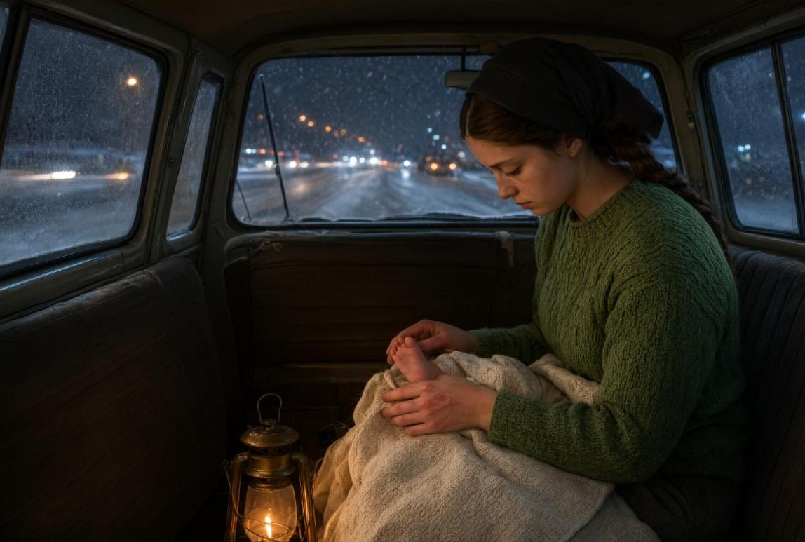
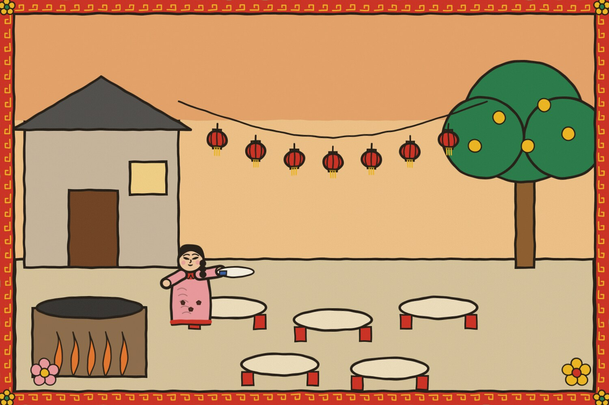

# 第四十一章　剂量

梅姐签字勾得重　晓燕立约写得清

**成都 07:40 · 拉法叶 18:40（十五）**

何蔓七点半上的线。眼镜一戴，成都就没了，眼前是虞山脚下那间屋，窗户纸白了，天刚亮。

早班的单子她背得出来：翻身，擦脸，喂一碗米糊，量血压。她让机器人走到床边，先把那只软手搁在老头背上。

搁了一下。

那只手的指尖上有温度传感，读数是一个数字，在她视野的右下角跳出来，比该有的低了很多。她又搁了一下，这回没拿开。

被子底下的人没动。昨天晚上她给他掖的被角，还是她掖的那个样子。

何蔓在成都自己的床上坐起来一点，眼镜没摘。她让机器人弯下腰，看他的脸。那双新换的眼睛闭着，闭得很平，嘴角往下松了一点，像是讲完了一句话，没等人接。

她照规程按了平台的急呼键。然后她让机器人走出那间屋，穿过天井，走到前头那一进。

乐子还在那张藤沙发上睡着，两条腿搭在扶手上，嘴张着。

机器人在他肩膀上搁了一下手。

乐子醒了，看见那张白壳子的脸，愣了一下，又看见它没动，就那么站着，一只手还搁在他肩膀上。他没问，坐起来，穿上鞋，往后头去了。

何蔓没跟进去。她让机器人站在天井里，站在那块青石板上，等着。

过了一会儿，乐子出来了，手里拿着一张叠成四折的纸，没打开，就那么捏着。他在台阶上坐下，掏出手机，拨了一个号。何蔓听得见那头的声音，成都话，是徐好翔。

“钱老走了。”乐子说。

那头很久没出声。

“他在我那儿扫了一年地。”徐好翔说，“一天一碗茶。”

“我晓得。”

“我来不到。”徐好翔说，“你帮我端一碗茶上去。盖碗，十五块那种，要烫。”

“茶钱算我的。”徐好翔说，“他这辈子没让我请过一回。这回他推不脱了。”

“好。”

乐子挂了电话，在台阶上坐着，没起来。何蔓的视野里，平台的窗口一个接一个弹出来：确认、上报、联系人。联系人那一栏是空的。

她没摘眼镜。按规程，急呼按下去，开机器人的人就可以下线了，后头的事有人管，这一单算到他咽气那一刻为止。

她让机器人走回后头那间屋，站到床边。被角有一处没掖平，她让那只软手把它抹平了。然后她让机器人退到墙角，面朝着床，站着。

“你还在？”乐子在天井里问。他看得见墙角那个白壳子。

“在。”何蔓说，“等他们来。”

“不算钱的。”

“晓得。”

乐子没再说话。一个钟头以后，社区的人来了，殡仪馆的车也来了。何蔓看着他们把老头抬出去，抬过天井，抬出那道生了锈的门。她才摘了眼镜。

她长到这么大，没有亲眼见过一个死人。今天这一个，隔着三千多里，眼睛是机器的，手也是机器的，说不上亲眼。

她在床沿上坐着。窗外，楼下有人在放鞭炮，元宵了。

**成都 08:40 · 拉法叶 19:40**

邓晓燕下了夜班，到家八点半。

老罗在灶上煮醪糟蛋，一锅，两个碗，蛋卧得圆圆的，没散。他六十二了，围裙系在肚子上头，系得很高，看起来像个大号的娃娃。

“你先吃。”他说。

“先睡。”

“吃了再睡。”

她没吃。她把包扔在沙发上，走过去，从后头抱住他，脸贴在他背上。他身上一股醪糟的甜味，一股老人的热乎气。她在ICU站了十二个钟头，手上全是消毒液的味道，干的，手背上裂了两道口子。

“锅头的蛋要煮老了。”老罗说。

“老就老。”

她伸手把火关了。

卧室的窗帘没拉严，一道光斜着照在床上。她躺下去就不想动了，眼睛闭着，老罗在她身后躺下来，侧着，贴着她的背。她的皮肤白，是熬夜熬出来的那种白，发灰，他的手搁上去，又黑又粗，指甲缝里还有一点豆瓣的红，几十年都没洗干净过。

他没急着来。他的手从她腰上绕到前头，搁在她肚子上，不动，先焐着。她的肚子是凉的，站了一夜站凉的。

“冷锅下不得油。”他说。

“那你烧嘛。”她眼睛没睁。

他就烧。手是慢的，从肚子往上，一圈一圈地，转得她后背往他怀里拱。他这辈子等过多少口锅热，不差这一会儿。

“热了。”她说。

她没睁眼，只把他的手拉过来，按在自己肚子上。他不快，她也不要快，像夜班上一回一回地数心跳。他阑尾那道疤贴在她腰窝上，硬的，凉的，后来就不凉了。

她没出声，就是攥着他那只手，攥得他指节发白。他在她后颈上亲了一下。

“醪糟蛋，”她闭着眼睛说，“热一哈再吃。”

**成都 09:20 · 拉法叶 20:20**

老罗睡着了。他睡着了打呼，一声长一声短。

邓晓燕没睡。她起来，套上他那件旧毛衣，坐到厨房的小桌子跟前，从抽屉里摸出一张白纸，一支圆珠笔。

她写字跟写护理记录一样，一条一条，标号，一行一个意思。

一、本人邓晓燕，与罗某将于下周一办理结婚登记。

二、罗某名下现住房一套，位于某小学上方，系罗某与其前妻婚内所购。本人对该房屋不主张任何权利，婚后亦不主张。

三、该房屋将来由罗佳继承。罗佳的女儿九月入学，户口不动。

四、本人工资归本人，罗某退休金归罗某，家用各出一半。

五、本人如先于罗某去世，本人存款一半给罗某，一半给本人母亲的坟。

她写到第五条，停了，笔尖在纸上点了一个点，洇开了一小团。她妈走了四年，坟在龙泉山上，一年去一回。她把那一条划掉了，在旁边重写：一半给罗某，一半捐给华西ICU的家属等候区，买几张躺得下人的椅子。

写完了，她签了名，写了日期，正月十五。

醪糟蛋在锅里凉了。她把火打着，热了一哈，盛了一碗，坐在桌子跟前吃。那张纸搁在碗边上，她拿碗压着一个角。

**拉法叶 20:40 · 成都 09:40**

冉峥在土路口按了三下喇叭。

雪又下起来了，车灯照出去，雪片斜着飞。过了一会儿，路那头晃出一盏马灯，是莉迪娅，后头跟着汉娜，怀里抱着一团拼布被子。

她们走到车跟前。莉迪娅把马灯举高了一点。

“明天早上九点。”冉峥说，“药做好了。”

莉迪娅没说话，回头看汉娜。汉娜用她们自己的话说了一串，说得很快。

“她从下午就不肯吃。”莉迪娅说，“又叫不醒了。”

冉峥把后车门打开。

汉娜抱着孩子坐进去。莉迪娅站在车门边，看了一眼那个座位，前头的，副驾驶。

她坐到后头去了，挨着汉娜，把孩子那只小脚从被子里摸出来，捏在手心里。脚是凉的。

车开上了高速。雨刮器一下一下地刮，刮开一片，雪又落满。冉峥从后视镜里看了一眼，看见莉迪娅低着头，看着手里那只脚。马灯搁在她脚边，火苗一抖一抖的。

*图一　马灯搁在她脚边，火苗一抖一抖的。*

一个钟头的路，谁都没说话。下高速的时候，莉迪娅抬起头，在后视镜里跟他对上了眼睛，看了一下，又低下去了。

**成都 10:30 · 拉法叶 21:30**

上海，北京东路那间屋。十五上午，四张桌子都坐了人，靠窗那张对面，多摆了一把椅子。

椅子上坐着阿包。他六十三了，乐清人，个子不高，头发全白，剪得很短，一件灰毛衣，袖口起了球。门口铜牌子上那几个英文字母，是他的公司，总部在瑞士楚格，事务所开到了九个国家。他每年回乐清过年，回去的路上在上海停两天，到这间屋里坐一坐，看陈阿姨签字。

小沈把一份东西推过来，这回没推给陈阿姨，推给了阿包。

“楚格转过来的。”小沈说，“印城那家火锅公司，申请复核。就是礼拜二那个动作包。”

附件三样。一封律师信。一张新报价，原价的五倍。一张授权书，抬头写着“蒲记”字号持有人，签名那一栏空着，底下一行小字：协商中。律师信里还有一句，说原审签字人年事已高，申请换一位签字人。

阿包看完，递给陈阿姨。

陈阿姨戴上老花镜，翻到授权书那一页，看了看空着的那一栏，又翻回去，看那个手印。手印当中缺的那一块，还是缺的。

“字号归字号，手归手。”她说，“伊拉要换人签，换啥人签侪一样。”

阿包没问她什么。他家原来在柳市开厂，做断路器。断路器这东西，平常没人看它一眼，电一过头，它就跳，跳一下，屋里就不着火。二五年那个厂关了。后来他做的买卖，样样比断路器挣钱。有人问他这辈子后悔什么，他说没有，想了想，又说断路器厂不该关。

他拿过笔，在复核那一栏写了两个字：维持。签了名，签在陈阿姨的名字底下。

“回他们，”他跟小沈说，“就这两个字。”

“他们说要打官司。”

“让他们打。”

他掏出手机。每回到上海，他都去常熟坐一个下午，跟钱维岳喝一壶龙井。这一回过年前就约好了，十五下午。

电话响了很久才有人接。是个陌生的声音，普通话，底下压着一点杭州口音。

“钱总在不在？我是阿包。”

那头停了一下。“钱老今天早上走了。”

阿包没说话。陈阿姨抬起头来。

“你是哪个？”

“我姓乐。”那头说，“这几天给他当耳朵。”

阿包没问耳朵是什么意思。他问灵堂设在哪里，那头说就在家里，今天晚上。他说他晚上到。

他挂了，又拨了一个号，这回说的是乐清话。屋里没人听得懂，小沈只听出来他喊了一声“虹姐”。说了几句，那头没声音了。阿包也不催，拿着电话等着，等了很久，那头说了一句什么，他应了一声，挂了。

“啥人？”陈阿姨问。

“深圳一个开排档的。”阿包说。

陈阿姨没再问。她把那份复核合上，盖了章，放进左手边那一摞里。

**拉法叶 22:10 · 成都 11:10**

梅姐关了店，回到家十点。文在厨房里对账，念念睡了。

冰箱门上，那张附件二还拿磁铁吸着，吸了九天，纸角翘起来，磁铁是念念的，一个小熊。

梅姐把小熊拿下来，把那张纸拿下来，铺在桌上，从文手边拿了他的笔。

文看着她。

“想好了？”

“想了九天。”梅姐说，“昨天那一百六十个座，房租交上了。今天我才有空想这个。”

“你昨天收那个钱，”文说，“我说了你。”

“你说得对。”梅姐说，“钱是钱。这个不是钱。”

她签了。签名那一栏下头，还有一个小框：本人自愿放弃三十日异议期。她在那个框里打了一个勾，打得很重。

“我送你去？”文说。

“你看到念念。”

她骑电驴去的。琳家在城西，过了河，一片收过的麦地，麦秆还码在地头，盖着雪。屋里的灯亮着。

琳开的门，穿着睡衣，外头套着凯的旧绒衣。凯站在她后头，手里拿着一条毯子，好像本来是要给谁盖的。

梅姐把那张纸递过去。

“附件二。”

琳接过去，低头看，看到那个打了勾的小框，拿指头在上头摸了一下。

“你可想好了？”

“签都签了。”梅姐说，“丑话讲在前头：她十八岁那年，要是来问，你就说是我签的。不要说是罐子自己来的。”

“晓得了。”

“妈那边，你去讲。”

琳点点头。梅姐转身要走，琳在后头叫了她一声。

“姐。”

梅姐站住了，没回头。

“你可要进来坐一下？”

“不坐了。”梅姐说，“明天元宵，店里要包汤圆。”

她走到电驴跟前，跨上去，又下来，走回来，从琳手里把那条毯子拿过去，往琳肩膀上一搭，搭好了，才走。

**拉法叶 23:00 · 成都 12:00**

苏海勒回家吃饭，吃完了没走。他爸妈每天夜里十一点要出去站一会儿，站在后门廊上，朝红隼岭那边看。

二月底，夜里还冷，地里的雪化了一半，一块白，一块黑。地那头，红隼岭四座塔顶上的白汽，在黑里一炷一炷立着。

地那头的路上，一盏电驴的灯过去了，走得不快，往城里去。

他妈裹着一条毯子，他爸站在她后头，两只胳膊从后头连人带毯子一起圈住，下巴搁在她头顶上。他妈个子小，他爸个子也不高，下巴搁上去刚刚好。

苏海勒在门里头看着。他从小看到大。小时候他以为全世界的爸妈夜里都要出去站一会儿，上了小学，头一回去同学家过夜，才知道不是。

十一点整，最东边那一炷白汽粗了一圈。

手机响了，是他姐。苏拉娅二十四，在红隼岭值夜班，九号厅的控制台归她看，露丝带着她。她发来一张照片：控制台，一排屏幕，最边上贴着一张便利贴，上头画了一个圆，圆里点了两个点。底下一行字：起了。今晚爸那块芯片的仿真也排上了。

他推开门，把手机举给门廊上的两个人看。他妈看了，笑了，头往后一靠，靠在他爸胸口上。他爸低下头，在她头顶上亲了一下。

苏海勒把门带上，回自己屋去了。他姐叫苏拉娅，是昴星团；他叫苏海勒，是老人星。两个名字是他爸妈结婚那年，在这个门廊上一人起了一个，起好了，等了一年，才有他姐。昴星团冬天就挂在这个门廊头顶上。老人星在这儿是看不见的，在他妈老家拉合尔，冬天看得见，贴着地平线，一会儿就落了。

**成都 12:40 · 拉法叶 23:40**

天府五楼，过了排队街往里走，有一个假院坝，顶上吊着塑料的葡萄藤。门口的牌子上写：坝坝宴，九大碗，一百八十八一位。席是真的，新人是没得的。

唐蕾在这儿当娘家人，一场一百五，管一顿饭。她的活有两样：新娘子出门的时候哭，司仪喊闹的时候带头闹。新娘子没有，门是有的，贴了喜字，到点开一下，里头是空的，她对着空门哭。

她哭得好。头一场哭完，司仪过来问她以前是不是干过。她说没有，她只是麻将打得多，等得住。

今天这一场十二桌，坐满了。大半是五六十岁的，一对一对来的，也有一个人来的。蒸肘子上桌的时候，三号桌一个老头端着酒杯过来了。六十几，衬衫领子是新的，折痕还在。

“妹儿，”他说，“我多给你两百，你喊我一声。”

“喊啥子？”

“喊爸。”老头说，“我女儿三十八了，不结。她说她一个人好耍。我也不催了。我就想当一回老丈人，有人端杯酒，喊我一声，我说一句，好生过。”

唐蕾看了看他那个领子。

“钱不要。”她说，“酒你自己倒，我这儿只有雪碧。”

老头给自己倒满了。唐蕾端着雪碧站起来。

“爸。”

“哎。”老头应得很快，像等了好多年的。他把酒喝了，想了半天，那一句没有说出来，换了一句：“你一个人，也要好生吃饭。”

“我吃得多。”唐蕾说，“你看嘛，肘子我都吃了半个了。”

老头笑了，回三号桌去了。坐下以前，他朝那扇贴喜字的空门看了一眼。

司仪在台上喊，娘家人，再哭一个。唐蕾把嘴一抹，站起来。这一回她没有等，眼泪自己就下来了。

**成都 13:30 · 拉法叶 00:30**

元宵这天，卢嬢嬢的汤圆铺排了一条街。

对面机器那家也排，排得短。机器那家的汤圆一个是一个，圆得跟弹子一样，六块钱一碗。卢嬢嬢这边的，大的大，小的小，十二块一碗。排队的大半是老的，也有几个年轻的，举着眼镜在拍，拍完了跟人说，这家的不圆。

王鹏排在第十几个。前头是黄嬢嬢，提一个饭盒。

“给老范买？”王鹏问。

“他血糖高。”黄嬢嬢说，“我买一碗，他吃一个，剩下七个我吃。年年都是这样。”

“那你买一个的不就是了？”

“一个不卖。”黄嬢嬢说，“一碗八个，少一个都不卖，你问她嘛。”

轮到王鹏，卢嬢嬢在案板后头，两只手全是糯米粉，抬眼看了他一下。

“在这儿吃，还是带走？”

“带生的。”王鹏说，“晚上煮。”

“哪个煮？”

“我。”

卢嬢嬢的手停了。老喻在旁边下锅，锅里的水翻花，他拿漏勺在锅沿上敲了一下。

“你会煮？”

“不会。”

“水开了下，”卢嬢嬢说，“下了莫搅，搅破了芝麻漏出来。浮起来，点一道冷水，再浮起来，再点一道，点三道，就熟了。”

“三道。”

“机器那家，”卢嬢嬢拿下巴指了指对面，“下锅是机器，点水也是机器，一道都不会少。我这个是人搓的，也要人煮。你记不记得到？”

“记得到。”

她拿一个纸袋子，一个一个往里头数，数到八个，停了一下，又放了一个进去。

“八个的钱。”她说。

“九个。”

“多那一个，”卢嬢嬢说，“你煮的时候先下它，看它破不破。它破了，你再重来，莫拿破的给人家吃。”

王鹏扫了手，接过纸袋子，捧着走了。纸袋子是凉的，里头的汤圆隔着纸，一个一个摸得出来。

老喻看着他的背影，跟排在后头的人说：“那个娃娃，送女朋友的。”

“你咋晓得？”

“买生的，自己煮，”老喻说，“不是送女朋友，就是送他妈。他那个样子，不像送他妈的。”

卢嬢嬢在案板后头说：“又编。”

“编的也对。”老喻说，“你等着看。”

**拉法叶 02:20 · 成都 15:20**

里利儿童医院四楼，家属区的灯调暗了，咖啡机亮着一个红点。

莉迪娅和汉娜坐在靠窗那张沙发上。汉娜手里还是那个吸奶器，嗡嗡响，吸满一瓶，倒掉，再吸。冉峥坐在走廊另一头的塑料椅子上，太矮，膝盖顶到胸口。那个饼干盒搁在他膝盖上。

护士每隔一个钟头出来一回，念一个数。

“一百六十二。”

莉迪娅翻给汉娜。汉娜把吸奶器关了，又打开。

“一百五十八。”

医院药房的桥接药不够了，那种药全州一年用不了几回，晚上找不到人配。值班医生打了几个电话，最后打到了拉法叶一家药房的夜间号码上。

电话响的时候，科琳醒着。她回药房，开了后头的灯，称粉，一回称五份，倒完一份，心里数一个数，手是稳的。配药台底下那只黄桶里有一根她自己的小棍，傍晚关了门验的：两道杠，一道深，一道浅。配完那一瓶，她又从架子上数出五片，装进一个棕色的小瓶子。这一瓶她没贴标签。

两点二十，电梯门开了，科琳走出来。她穿一件长羽绒服，底下是睡衣，手里提着一个保温袋，袋子上贴着她自己手写的标签，跟药房里打出来的一个样。她有夜间通行证，一个钟头的路，开了五十分钟。

她把保温袋交给护士，签了字，说了剂量，说了两遍。护士进去了。

科琳在走廊里站了一会儿，然后走到冉峥跟前。他站起来，那么大一个人，在走廊里站着，头快碰到灯。

她看见了他膝盖上那个饼干盒。她什么都没问。

“颜色？”她说。

冉峥看着她。这两个字，两年来只在一个地方说过。

“黄。”他说。

科琳点点头，在他旁边那张塑料椅子上坐下了。他也坐下了。她没碰他，也没让他碰她，就那么并排坐着，看着走廊那头那扇关着的门。她一只手揣在羽绒服口袋里，攥着那个小瓶子。

“一百二十。”

“九十五。”

天快亮的时候，护士出来，念完了数，又说了一句。

“七十一。九点，照旧。”

莉迪娅翻过去，汉娜把吸奶器搁下了，没再打开。她把脸埋在手里，肩膀抖了一下，就一下。

科琳站起来，把羽绒服拉链拉到下巴，走了。电梯门合上以前，她看见冉峥还坐在那张矮椅子上，饼干盒搁在膝盖上，两只手扣着盒盖。

**成都 16:00 · 拉法叶 03:00**

淮安，城西一个老小区，四楼。韩临坐在厨房门口的小板凳上，他妈在里头搓汤圆。

韩临四十了，在淮安一所中学教数学，教了十三年。二十几岁在印第安纳念过几年书，认得几个人，邵昌是其中一个。那几年他干过一件事：几百万块碎片，拼成一张处处对得上的图。后来他把拼图的法子删了，回了淮安。

四点整，眼镜角上跳出一条。卡洛威每天夜里三点发一条，那边的夜里三点，是淮安的下午四点。全世界二十来万个助手替主人读，他不让，他自己看。

帖子就一行：今夜，没有量到。底下一张图，一个圆，大半是灰的，灰里头几十个亮点。亮的是量到的。灰的，是猜的。

那片灰，拿他从前那个法子，一夜就拼得满满的，处处对得上。他看了一会儿，没动。

邵昌的消息是跟着进来的。礼拜二他问过邵昌一句：怎么停了？邵昌这会儿才回，那边是夜里三点。

截面有个空，针尖那么大。重做了。这会儿正在上机仿真。

韩临回了一个字：好。

“看什么呢？”他妈在厨房里问。

他把眼镜摘下来，递进去给她看。他妈两只手都是糯米粉，凑过来，眯着眼睛看了半天。

“一颗星星旁边的一块地。”韩临说，“亮的是量到的，灰的是猜的。”

“猜的不算数。”他妈说。

“不算数。”

“亮的是哪个量出来的？”

韩临想了想。

“好多人。”

他妈没再问，转过身去，把手上那个汤圆搁进簸箕里，排在一排汤圆的末尾，排得齐齐的。

“水滚了，”她说，“下几个？”

“八个。”韩临说。

**成都 16:30 · 拉法叶 03:30**

二嬢家的晒坝上，二十张桌子摆开了，红塑料凳一摞一摞码在桌腿边上。二嬢踩在条凳上挂灯笼，一根绳子从屋檐拉到那棵老柚子树上，红灯笼一个挨一个。

老蒲在院坝角上垒了一口柴灶，借的村里的大铁锅，比他蒲记那口大一圈。柴是二嬢攒了一冬的，干的，火一起来就旺。他光着两条胳膊，烫疤一道一道的，在火光里发白。

蒲嬢嬢在旁边蒸甑子饭。她不用他开口，他手伸过来，她就把东西递过去：盐，糖，豆瓣，一把蒜苗，一把花椒。四十年了，她站在收银台后头，听得出他下一样要什么。今天也一样，一样都没递错。

两个人谁都没提那个框子。

二嬢从条凳上下来，凑到灶边，看他炒。

“姐夫，”她说，“我喊你，你就来了。我还以为你要端架子。”

“是你喊我。”老蒲说，“又不是她喊我。”

“她喊你，你就不来？”

老蒲没答，把锅颠了一下，火苗蹿起来，舔到锅沿上。蒲嬢嬢在甑子那边，揭开盖子看了一眼饭，又盖上了，盖得很响。

二嬢看看这个，看看那个，笑了，回去挂她的灯笼。

四点过，一辆面包车开到田坎边上停了。车门一拉，先下来一根拐棍，再下来一个老太婆，个子矮，块头大，一件紫红的羽绒服撑得满满的。脚还没站稳，嗓门先到了：

“二妹！你满六十，啷个不跟老子说？”

晒坝上挂灯笼的，摆凳子的，都回过头来。

是六嬢。她们妈那一辈，堂姊妹里头她排第六，今年九十八。年轻时候去的重庆，当妇产科医生，接了一辈子生，一口成都话早拐成了重庆话，说起话来像敲钟，摆多大的席都用不着话筒。她们妈前几年也走了，那一大家人每年正月还是要团一回，几十年了，都是六嬢喊。昨天晚上她听说二嬢要摆二十桌，电话里头只说了一句：今年就团到你那儿。

车上又下来七八个。九嬢扶着车门，瘦，手里攥着一个小本子，下了车，先把晒坝上的娃娃挨个数了一遍，数一个，在本子上勾一个。十嬢最后下来，八十三了，头发染得黢黑，脚一沾地就问哪一桌打麻将。

蒲嬢嬢把手在围裙上擦了，过去扶六嬢。六嬢盯着她看了半天。

“你是哪个屋头的？”

“我是秀芬。我妈是老七。”

“秀芬。”六嬢说，声音一点没小，“你爸喃？喊他出来，车上有他的茶。”

蒲嬢嬢没答。她爸走了七年多了。九嬢在后头轻轻拉了一下六嬢的袖子，六嬢没理，拄着拐棍往主桌走，一路走一路喊人，喊错了一半。

柴灶那边，老蒲拿勺子在锅沿上磕了一下，没回头。

她喊人不喊名字，喊的是哪一房的。

“你是大姐抱大的。”她拿拐棍点着一个六十几岁的女人，“大姐一辈子没嫁人，一屋的娃娃都是她抱大的，九十几才走，送她的人排了半条街。那天你哭得最凶。”

“六嬢，那天我在外地，没赶回来。”

“那就是你妹妹哭的。”六嬢往前走，“你是二哥屋头的。二哥当了一辈子家，八十几走的，三个都是女。你是老几的娃儿？”

“老二的。”

“老五那一房来了没得？老五修房顶摔下来那年，他娃儿才这么高。”她拿手在拐棍半中腰比了一下。

一个头发花白的男人站起来了，五十好几。“六嬢，我在这儿。”

六嬢仰起头看他。“长这么高了。”

走到摆了麻将的那一桌，十嬢已经坐下了，在码牌。

“老七那个兄弟，就是你们舅舅，”六嬢这句是对着蒲嬢嬢说的，眼睛看的是十嬢手底下的牌，“一辈子就是耍，耍到酒头去了，走得早。耍，也要看咋个耍。”

“六姐，我耍得好，”十嬢说，“你放心。”

六嬢在主桌坐下来，拿拐棍把晒坝上的人头点了一遍，没点清楚。

“我爷爷婆婆生了十个，十个都带大了。”她说，“那阵哪家不夭两个？就我们屋头，一个没丢。我老汉儿在春熙路开铺子。他兄弟教书，就是你们家公，七十岁走在街上，遭一个骑洋马儿的小伙子撞了。他爬起来，拍了灰，喊人家走，说娃儿你忙你的。回去半个月，人就没了，里头出血。”

“六姐，”九嬢说，“今天二妹过生，说点好的。”

“这个还不好？”六嬢说，“十个，一个没丢。”

苗苗在桌子底下钻来钻去，七岁，扎两个羊角辫，手腕上戴着一个蓝色的手环，二嬢给她买的，定位的，她妈从上海寄来的钱。

“痒。”苗苗把手环往上捋，捋到胳膊肘，又捋下来。

“莫取。”二嬢在条凳上喊，“取下来，奶奶找不到你。”

苗苗跑到蒲嬢嬢跟前，指着晒坝外头那片地。豌豆地过去是一条渠，渠边上有一间小砖房，灰扑扑的，门是铁皮的。

“姨婆，那个小房子是做啥子的？”

“抽水的。”蒲嬢嬢说，“莫去，水深。”

她往柴灶那边看了一眼。火正旺，老蒲背对着她，听不见。

“你表叔八岁那年，”她压低了声音说，“在里头躲了一下午。你爷爷打着电筒找到天黑。”

“为啥子躲？”

“他爸骂了他。”蒲嬢嬢说，“这个事，他爸到今天都不晓得。”

苗苗眨眨眼睛，好像得了一个了不起的宝贝，捂着嘴跑了。

柴灶那边，锅里的回锅肉起了灯盏窝，一片一片卷起来，边上焦了。老蒲拿勺子在锅沿上敲了两下。

铛，铛。

苗苗从桌子底下钻出来，跑过去，伸手去接那个盘子。手环在她手腕上一跳一跳的。

蒲嬢嬢手里的甑子盖停在半空，停了一会儿，才盖下去。

*图二　锅沿上敲两下，她就跑过来了。*
